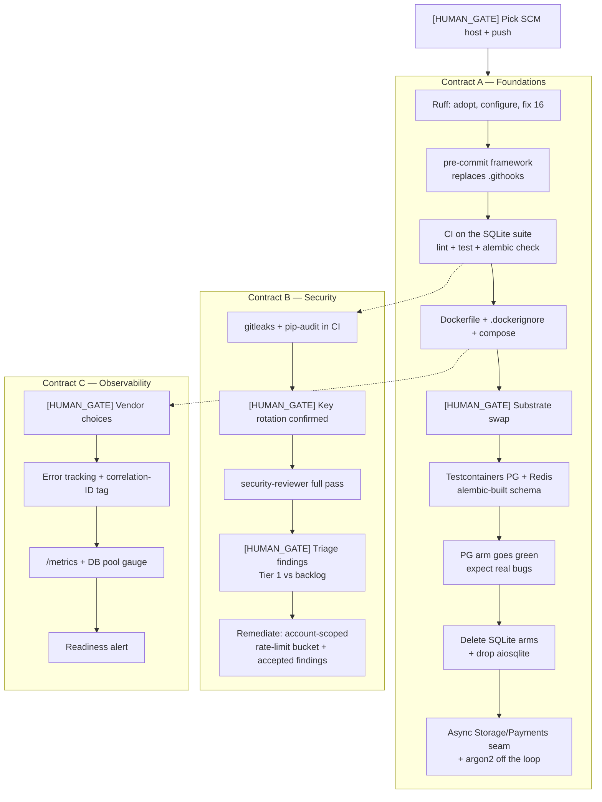

# ADR 0001 — Tier 1 production readiness

- **Status:** Proposed (awaiting Isaac's approval; planner drafts the contracts after)
- **Date:** 2026-09-07
- **Scope:** `fastapi_sermon` backend
- **Supersedes / relates to:** `docs/reviews/api-auth-review.md`, `docs/reviews/codebase-review.md`, `DEPLOYMENT.md`, `plans/plan.md`, `plans/plan-nonauth.md`

> **Note:** `docs/` is currently in `.gitignore`. This ADR is untracked until that
> carve-out is decided. See "Open decisions", D0.

---

## Context

Two review-remediation batches have shipped (`9e8d366` auth findings 1–4,
`a67218e` non-auth findings 1–8). The application logic is in reasonable shape.
The *engineering substrate around it* is not, and six gaps stand between the
current state and a defensible first deploy.

Facts established by reading the tree, not assumed:

| Observation | Evidence |
|---|---|
| **No git remote exists.** The repo is local-only; history starts at `ee76427`. | `git remote -v` empty; `git log` 5 commits |
| `.env` is **not** in this repo's history | `git log --all -- .env` empty — history was re-initialised |
| The leaked AWS key ID is still in **tracked** files | `DEPLOYMENT.md:8`, `plans/plan.md:70` |
| The pre-commit hook excludes `*.md` and `*.py` from scanning | `.githooks/pre-commit` pathspecs |
| `ruff` is neither a declared dependency nor configured | `pyproject.toml` has no `[tool.ruff]`, no dev entry; `uv run ruff` fails to spawn |
| `pre-commit` (the framework) is not in use — it's a raw `core.hooksPath` bash hook | no `.pre-commit-config.yaml`; `core.hooksPath=.githooks` |
| 240 test functions, all on `sqlite+aiosqlite:///:memory:` + `tests/fake_redis.py` | `tests/conftest.py:44`, `:20-27` |
| The suite builds schema via `Base.metadata.create_all` — **migrations are never executed by any test** | `tests/conftest.py:63` |
| Two dialect branches whose Postgres arm has never run | `app/services/analytics_service.py:84`, `app/services/search_service.py:41` |
| `Storage` and `PaymentProvider` Protocols are **sync**, called from `async` handlers | `app/core/storage.py:27`, `app/core/payments.py:36`; 7 + 6 call sites |
| `app/core/email.py:62` **already** wraps blocking SMTP in `asyncio.to_thread` | in-repo precedent for the seam fix |
| argon2 hash/verify runs inline on the event loop | `app/core/security.py:34,37` — called from async login handlers |
| Docker Desktop is installed but **the daemon is not running** | `docker info` → socket missing |
| `VIRTUAL_ENV=/opt/anaconda3` shadows the project `.venv` | every `uv run` emits a mismatch warning |

The consequential one is the first: **CI has nothing to run on.** "Nothing runs
tests on push" is not a missing workflow file, it is a missing remote. That
reorders the work and creates the first gate.

---

## Decision

Tier 1 ships as **three contracts**, not one, and not six.

### Why three, not one

- **A is a ratchet.** Each step makes the next step safe. It is strictly ordered
  and has one internal gate.
- **B cannot be planned in advance.** A `security-reviewer` pass produces findings
  whose remediation scope is unknown until it runs. A plan-as-contract that
  can't enumerate its own steps isn't a contract; B is *two* plans separated by a
  triage gate.
- **C is the only work that adds dependencies to the production image** and the
  only work that commits Isaac to a recurring vendor relationship. Different risk
  class, different approval, different day.

A and B run **concurrently after A3**. C is genuinely optional for a first
deploy and can trail.

---

## Per-item approach

### 1. CI pipeline

**Prerequisite decision (D1): SCM host.** There is no remote. This is Isaac's
call and it is load-bearing for item 3.

| Option | For | Against |
|---|---|---|
| **GitHub (private)** | Actions free on private repos; Docker present on `ubuntu-latest` runners (Testcontainers just works); `gitleaks-action`, Dependabot, CodeQL all free; largest action ecosystem; matches a multi-app portfolio | Vendor; Dependabot's PR-centric model clashes with the no-PR flow |
| **GitLab (private)** | CI + container registry built in; good for a future image push | Smaller ecosystem for the exact actions item 3 wants |
| **Self-hosted Forgejo/Gitea + runner** | No vendor, full control | Ops burden on a machine that doesn't exist yet; contradicts "compute deferred" |

**Recommendation: GitHub**, chiefly because items 2 and 3 lean on Docker-on-runner
and on gitleaks/SCA tooling that is free and first-class there. If Isaac picks
otherwise, item 3's SCA path changes (see below) but nothing else does.

**Decision — CI lands on the *existing SQLite suite*, before the substrate swap.**
This directly answers the sequencing question. Rationale: CI's job is to be the
red/green signal *while* you perform the risky change. Doing the substrate swap
first means the largest, most failure-prone change in Tier 1 lands with no
automated verification. Reversing that is free — the CI job's `pytest` invocation
does not change when the substrate does. The substrate PR's acceptance criterion
becomes literally "the same job is still green."

**Jobs:**
- `lint` — `ruff check` + `ruff format --check`
- `test` — `uv sync --frozen` + `uv run pytest`
- `migrations` — `alembic upgrade head` against a throwaway PG, then
  `alembic check`. This is worth calling out: it catches ORM/migration drift,
  which the suite currently cannot see at all because it uses `create_all`.
- `security` — see item 3

Use `astral-sh/setup-uv` with caching; `concurrency` group to cancel superseded
runs on a branch.

**Ruff, precisely.** It is not currently a dependency. Add it to the dev group,
configure `[tool.ruff]` in `pyproject.toml` (line length, target `py313`, rule
selection), then **fix the 16 errors in the same step**. Reject a baseline file
or blanket `per-file-ignores` — 16 is not enough debt to justify a suppression
mechanism that will outlive the debt.

**pre-commit, precisely.** Isaac's stated convention is the `pre-commit`
framework; reality is a bash script at `core.hooksPath=.githooks`. Reconcile by
adopting `.pre-commit-config.yaml` running `ruff`, `ruff-format`, `gitleaks`, and
the stock `detect-private-key` / `check-added-large-files`, then deleting
`.githooks/pre-commit`.

> **Gotcha:** `pre-commit install` writes to `.git/hooks`, which git **ignores**
> while `core.hooksPath` is set. `git config --unset core.hooksPath` is a required
> step or the hooks will silently never run.

*Dependency tradeoff:* `pre-commit` is a dev tool that bootstraps its own
isolated environments outside `uv`. That's a second package manager on the dev
machine. Accepted — it is the only way local and CI run byte-identical checks,
and it is the portfolio-wide convention already.

---

### 2. Real-Postgres + real-Redis test substrate

**Tool: `testcontainers[postgres,redis]`**, dev group only.

*Dependency tradeoff:* pulls the `docker` Python SDK, which pulls
`requests`/`urllib3`. Dev-only; never enters the runtime image. The zero-new-dep
alternative is "run `docker compose up` yourself and set `TEST_DATABASE_URL`" —
which is genuinely viable and which this design **keeps as a first-class fast
path** (below). Testcontainers earns its place on "a fresh clone runs
`uv run pytest` and it works," which matters for a pattern Isaac will copy into
other apps.

Four sub-decisions, each with a real tradeoff:

**a) Schema creation: `alembic upgrade head`, not `Base.metadata.create_all`.**
Build the schema once per session by running the migrations. This validates the
migration chain on every CI run for free and closes the drift class the suite is
currently blind to. Cost: session startup goes from ~50 ms to a few seconds.
Worth it. Pair it with an `alembic check` assertion (empty autogenerate diff) so
ORM/migration drift fails loudly rather than accumulating.

**b) Per-test isolation: `TRUNCATE ... RESTART IDENTITY CASCADE`, not
transaction rollback.** The tempting fast pattern is to bind each test to an
outer connection with `join_transaction_mode="create_savepoint"` and roll back.
Reject it: the code under test **commits** (`analytics_service.py:126`), and one
of the bugs this migration exists to find is a concurrency bug whose behaviour
depends on real commit and visibility semantics. Wrapping commits in savepoints
makes `commit()` a lie — which is the exact category of fidelity loss we are
leaving SQLite to escape. `TRUNCATE` over the table list costs single-digit
milliseconds per test against a local container.

**c) Fast path: an env-var escape hatch, not a second dialect.** If
`TEST_DATABASE_URL` / `TEST_REDIS_URL` are set, the fixtures use them and skip
container startup entirely. Isaac points these at the compose stack from item 4
and gets a sub-second inner loop on the same dialect. Combine with Testcontainers
container reuse (`TESTCONTAINERS_REUSE_ENABLE=true`) so a cold run pays startup
once per day, not per invocation.

> **Explicitly rejected:** keeping `aiosqlite` behind a pytest marker as the
> "fast" path. Two substrates means two truths, and it reproduces the dual-arm
> problem one layer up. `aiosqlite` gets **deleted** from the dev group at the
> end of this contract. That deletion is what makes the migration real.

**d) The dialect branches get deleted.** Once Postgres is the only substrate,
`analytics_service.py`'s `sqlite_insert` arm and `search_service._is_postgres`'s
LIKE fallback are dead code that exists solely to serve the old test substrate.
Removing them eliminates a whole class of never-executed code. This is a named
deliverable of the contract, sequenced **last** — after the PG arm is green, never
before.

Redis: one session-scoped container, `FLUSHDB` between tests (mirrors the
existing `_fake.store.clear()`), and `tests/fake_redis.py` is deleted.

---

### 3. Security

This contract has an internal shape the others don't: **audit → triage →
remediate**, with a gate between each.

**Secret scanning: `gitleaks`**, replacing `.githooks/pre-commit`. The hand-rolled
hook has at least four bypasses, three of which are structural:

1. `':!*.md'` — markdown is never scanned. `DEPLOYMENT.md:8` contains
   `***REMOVED-AWS-ACCESS-KEY***` right now, committed, and the hook that exists to catch
   AWS keys cannot see it.
2. `':!*.py'` — a secret hardcoded in Python source is never scanned.
3. The `SECRET_KEY` rule's placeholder exclusion greps the **whole staged diff**,
   not the matching line: any `change-me` anywhere in the diff disables the rule
   entirely for that commit.
4. `--no-verify`, documented in the hook's own header.

Run `gitleaks` in both places: `protect` on the staged diff via pre-commit,
`detect` over full history in CI.

*Immediate consequence:* the first `gitleaks detect` will fail on the current
tree. Two files hold the key ID. `DEPLOYMENT.md` should be redacted
(`AKIA…2CTE`). `plans/plan.md` is an **approved, immutable contract** — do not
edit it; add a `.gitleaksignore` entry with a comment saying why.

**Key rotation: `[HUMAN_GATE]`, and the existing guidance is stale.**
`DEPLOYMENT.md` §1 tells you to `git filter-repo` the `.env` out of history.
`git log --all -- .env` returns nothing — this repo's history begins at
`ee76427` and never contained it. So step 3 of that runbook is already satisfied
*for this repo* and should be corrected. What is **not** established, and only
Isaac can establish it: whether key `***REMOVED-AWS-ACCESS-KEY***` was actually deleted
in IAM (not merely deactivated), and whether the pre-reinit history exists in any
other clone or backup. Gate until confirmed. This gate hardens further once D1 is
answered — pushing to a remote is the moment "local-only leak" becomes
"published leak."

**Dependency scanning: `pip-audit`, plus a deliberate stance on bump automation.**
`pip-audit` is PyPA-maintained, reads the resolved environment, needs no vendor
account, and runs as a CI job (recommend: on push *and* nightly, so a new CVE in
an unchanged tree still surfaces). *Tradeoff to state plainly:* Isaac's git flow
is "no pull requests," and Dependabot/Renovate are PR-shaped by design. Rather
than bend the flow, let `pip-audit` fail a scheduled job and have Isaac bump
deliberately with `uv lock --upgrade-package <x>`. Dependabot's *alerts* (no PRs)
remain free value if D1 lands on GitHub.

**Account-scoped rate limiting.** `GlobalRateLimitMiddleware` is per-IP fixed
window; the login limiter is IP+email. Auth review finding #9 already names the
gap. The attack this misses is credential stuffing distributed across a botnet —
per-IP limits are simply not in the path of that. Design: a **second bucket**
evaluated alongside the IP bucket (deny if *either* trips), keyed on the
authenticated principal (`sub`) for authenticated routes and on the normalised
email for `/auth/login`, `/auth/forgot-password`, `/auth/reset-password`.

*Scope call:* the **account dimension is Tier 1**; converting fixed-window to
sliding-window (sorted set or a token-bucket Lua script, to close the 2×
boundary burst) is **Tier 2**. Split them; the second is an optimisation, the
first is a missing control.

*Rejected:* adopting `slowapi` or `fastapi-limiter`. Both are thin wrappers,
`slowapi` is sync-oriented, and Isaac already owns a working middleware with the
correct fail-open posture documented in `DEPLOYMENT.md` §8. Adding a dependency
to replace working code with less-considered code is a net loss.

**`security-reviewer` pass.** Run the agent over the full surface → produce
`docs/reviews/security-review.md` → **gate** → triage each finding into "Tier 1
remediation" or "backlog." Only then can the remediation plan be written.

---

### 4. Dockerfile + compose

Low risk, no gate, and it unblocks the test-substrate fast path.

**Image:** multi-stage. Builder copies the `uv` binary in
(`COPY --from=ghcr.io/astral-sh/uv:python3.13-bookworm-slim /uv /bin/uv`) and runs
`uv sync --frozen --no-dev` into a venv; runtime is `python:3.13-slim-bookworm`
with the venv copied over, a non-root user, and no build toolchain.
`psycopg[binary]` means no `libpq-dev`/`gcc` in either stage.

*Dependency tradeoff worth surfacing:* psycopg upstream discourages
`psycopg[binary]` for production in favour of `psycopg[c]` compiled against the
system libpq (binary bundles its own libpq/OpenSSL, which lags on security fixes
and can conflict). `[binary]` is what's locked and it is fine to ship; moving to
`[c]` costs a compile stage with `libpq-dev` + `gcc`. Flagging, not changing.

**Cloud-agnostic contract of the image:** config exclusively from environment
variables (already true — `pydantic-settings`), JSON logs to stdout (already
true), listens on `$PORT` defaulting to 8000, exposes `/health/live` and
`/health/ready` (already true).

**The entrypoint runs uvicorn and nothing else.** No `alembic upgrade head` in
the entrypoint or a startup hook. This is the single most common containerised-
FastAPI mistake and it directly contradicts `DEPLOYMENT.md` §3's "run once, not
per instance." Migrations are a separate `docker run ... alembic upgrade head`
invocation, which is exactly the shape an ECS one-off task or a k8s Job takes
later — deferring compute without painting into a corner.

**`.dockerignore` is mandatory** and currently absent. Without it the build
context includes `.venv`, `.git`, `dump.rdb`, `__pycache__`, `.pytest_cache`.

**Compose:** `api` + `postgres:17` + `redis:8`, named volumes, healthchecks with
`depends_on: {condition: service_healthy}`.

*Rejected for Tier 1:* adding MinIO for the S3 seam. `LocalStorage` already
covers dev, and adding it now means the compose stack becomes the thing being
debugged instead of the app. Defer.

> **Superseded (2026-09, W8).** MinIO (+ a one-shot `createbuckets`) is now in
> the compose dev stack. The "`LocalStorage` covers dev" call held only while
> nothing exercised a browser-side upload: the admin portal's editor does a
> browser-direct presigned PUT, and `LocalStorage` fakes both the presigned URL
> and the object's existence — so a failed PUT still `confirm`s and the job
> marches to `ready`. The stub was masking broken uploads on the screen the
> portal design calls highest-risk. Compose sets `S3_ENDPOINT_URL=http://minio:9000`
> (the API's own reads/writes) and `S3_PUBLIC_ENDPOINT=http://localhost:9000`
> (`S3Storage` signs the browser's presigned URLs for this host, since SigV4
> signs `Host`); the production preflight rejects a localhost
> `S3_PUBLIC_ENDPOINT`. This note is the record; a fuller `scribe` pass can
> follow.

---

### 5. Observability

Three separable decisions. Two of them are Isaac's.

**a) Error tracking — decision D2 (vendor).**

| Option | For | Against |
|---|---|---|
| **Sentry** (`sentry-sdk[fastapi]`) | Best-in-class FastAPI/asyncio integration; free tier ~5k events/mo; release tracking, grouping, dedup | Vendor + data egress; it's an APM SDK that *wants* to trace — `traces_sample_rate` must be explicitly 0 to honour the no-tracing constraint; monkeypatches |
| **GlitchTip** | Sentry-API-compatible, self-hostable, same SDK | One more container to run, on compute that doesn't exist yet |
| **Log-derived alerting only** | Zero new deps; `main.py:157` already funnels every unhandled error through one handler | No grouping, no dedup, no release correlation — you get a count, not a bug tracker |

Recommendation if any vendor is acceptable: **Sentry**. The integration is
genuinely cheap because `main.py` already has the single catch-all and a
correlation ID. **Bind `correlation_id` as a Sentry tag** — that is the detail
that makes a log line and an error event joinable, and it is the difference
between this being useful and being noise.

**b) Metrics — `prometheus-fastapi-instrumentator`, plus one custom collector.**
One dependency, exposes `/metrics`, and gives request rate, latency histogram and
error rate out of the box. The custom piece: **DB pool saturation**, a gauge
callback reading `primary_engine.pool` (`.size()`, `.checkedout()`, `.overflow()`).
No off-the-shelf instrumenter provides this, and given `db_pool_size=10` /
`max_overflow=20` it is the metric that actually predicts the first outage.

Two guards: exclude `/metrics` from `GlobalRateLimitMiddleware`, and do not expose
it publicly — put it behind an auth dependency or a separate internal port.

**Decision D3 — where do metrics go?** This is the first recurring-vendor commit
and it is Isaac's.

| Option | For | Against |
|---|---|---|
| **Grafana Cloud free tier** | 10k series free, hosted, nothing to run — fits "compute deferred" | Vendor; free-tier retention limits |
| **Prometheus + Grafana in compose** | No vendor, full control | There is nowhere to *run* it in a deployed environment yet; this becomes local-only theatre |
| **Datadog / Better Stack / New Relic** | Turnkey, metrics + errors + logs in one place — could subsume D2 | Cost scales fast; strongest lock-in |

Pragmatic lean: **Grafana Cloud free tier**, precisely because compute is
deferred. But note the third option's real appeal — one vendor for D2 and D3
halves the integration surface.

**c) One meaningful alert — recommend the readiness alert, deliberately.**
`/health/ready` returning 503 for >2 consecutive minutes, via any uptime checker
(free from several vendors, including Grafana Cloud and Better Stack).

The reason to choose this one over "5xx rate > 2% over 5 minutes" is
**sequencing**: it needs no metrics backend, so the Tier 1 alert ships
independently of D3. If D3 lands quickly, add the 5xx-rate alert on top. This
decouples the only deliverable that must ship from the decision most likely to
stall.

*Dependency tradeoff, stated once and loudly:* this is the **only** Tier 1 item
that adds dependencies to the production image (`sentry-sdk`,
`prometheus-fastapi-instrumentator` → `prometheus-client`). Everything else in
Tier 1 is dev-group or infrastructure. That asymmetry is why C gets its own gate.

---

### 6. Blocking I/O off the event loop

**Approach: make the Protocols async; the adapter owns the threading.**

| Option | Verdict |
|---|---|
| **A. `asyncio.to_thread` at each call site** | Rejected — scatters the concern across 13 call sites; every future call site can forget |
| **B. Async `Storage` / `PaymentProvider` Protocols; adapters wrap sync SDK calls in `to_thread`** | **Recommended** — the seam already exists and this is what it's for; impossible to forget; `app/core/email.py:62` is the in-repo precedent |
| **C. Swap to async clients (`aioboto3`, Stripe's `*_async`)** | Rejected for now — `aioboto3`/`aiobotocore` pin `botocore` hard and break on `boto3` bumps; Stripe's async coverage is partial. Revisit only if S3 call volume justifies it |

**The precise change is smaller than it looks.** Not every method on those
Protocols does network I/O:

- `presigned_upload_url` / `presigned_download_url` — **local HMAC signing, no
  network.** No thread hop needed.
- `verify_webhook` — `stripe.Webhook.construct_event` is HMAC + JSON parse,
  **pure CPU, no network.** No thread hop needed.
- Genuine network calls needing `to_thread`: `object_exists`, `delete_object`,
  `create_checkout_session`, `create_portal_session`, `cancel_at_period_end`,
  `get_subscription_period_end`. **Six methods.**

So: **every** Protocol method gets an `async def` signature (uniformity — a mixed
sync/async Protocol is a footgun), but only those six actually dispatch to a
thread. The other three return directly from an async function. That gets
interface consistency without paying a pointless thread hop on the hot signing
path.

Blast radius: 13 call sites gain an `await`; `LocalStorage` and `MockProvider`
become trivially async; test fixtures unchanged in shape.

**Additional finding in the same class, recommended for inclusion:**
`app/core/security.py` runs argon2 hash/verify inline on the event loop.
`PasswordHash.recommended()` is argon2id at defaults — roughly 50–100 ms of
deliberate CPU *per login attempt*, blocking the loop for every other request on
that worker. `argon2-cffi` releases the GIL during hashing, so `to_thread`
genuinely parallelises here rather than just moving the stall. Same treatment,
same contract.

---

## Where the `[HUMAN_GATE]`s fall

| # | Gate | Why it's a gate |
|---|---|---|
| **G0** | **SCM host chosen; first push to a remote** | The code leaves the laptop for the first time. It currently carries an AWS key ID in a tracked file. Public/private, host, and org are Isaac's call, and everything in item 1 and half of item 3 hangs off the answer. |
| **G1** | **Test substrate swap** (before landing Testcontainers) | Changes the execution substrate for all 240 tests at once, deletes `fake_redis.py`, drops `aiosqlite`. Reversible in git but disruptive in practice, and it is the step most likely to surface unexpected failures. |
| **G2** | **AWS key rotation confirmed** | Only Isaac can verify IAM state and whether pre-reinit history survives elsewhere. Blocks enabling `gitleaks detect` on history and blocks G0's push in the strict reading. |
| **G3** | **Security review triage** | The `security-reviewer` output is unknown until it runs; deciding which findings are Tier 1 vs backlog is a judgement call with schedule impact. |
| **G4** | **Observability vendor selection (D2, D3)** | Recurring cost, data egress to a third party, and the only new *production* dependencies in Tier 1. |
| — | Dockerfile + compose | **Not** a gate. Additive, no runtime behaviour change, trivially revertible. |
| — | Async seam refactor | **Not** a gate. Internal interface, no public API change, fully covered by tests once the substrate is real. |

Deliberately **not** gated but worth Isaac's eye at review: deleting the SQLite
dialect arms. It changes production code paths (by deleting the ones production
never used), which reads scarier than it is.

---

## Explicit non-goals for Tier 1

Tier 1 must **set these up cleanly and then stop**:

| Non-goal | What Tier 1 does instead |
|---|---|
| **ECS / Fargate / k8s manifests** | Ship a cloud-agnostic image with env-only config and a separate migration invocation. No orchestrator-specific YAML. |
| **OpenTelemetry spans / distributed tracing** | Metrics + error tracking only. If Sentry is chosen, `traces_sample_rate` is explicitly 0. |
| **Real job queue (Celery / arq / SQS)** | `BackgroundTasks` stays (`app/api/auth.py:151`). Do not build a queue abstraction on one use case. |
| **`content_service.py` split** (review finding #10, 724 lines) | Untouched. A refactor of that size under a substrate migration is two risky changes at once. |
| **Auth findings 5–9** | Except finding #9's account-dimension bucket, which is pulled in because it's a missing control, not an optimisation. |
| **DB statement / lock timeouts** | Tier 2. The PG substrate makes them testable for the first time — that's the setup, not the delivery. |
| **Backup / RPO-RTO, managed-vs-self-run Postgres in prod** | Explicitly deferred (decision D4 below). Tier 1 does not pick a production database host. |
| **Client-facing idempotency keys** | Tier 2. |
| **Scheduled-job runner hardening** | `DEPLOYMENT.md` §5's cron guidance stands. |
| **MinIO in compose** | `LocalStorage` stub covers dev. |
| **pytest-xdist parallelism** | Only if the substrate swap pushes runtime past ~2 minutes. Each worker would need its own template-cloned database — real complexity, add it when measured, not before. |
| **Sliding-window rate limiting** | Tier 2; the account dimension is the Tier 1 half. |

---

## Risks

**R1 — The Postgres arm of the upsert has never executed. Expect it to fail.**
`analytics_service.py:84-124` builds an `ON CONFLICT DO UPDATE` whose PG arm has
literally never run. The unique constraint it infers on
(`uq_playback_user_sermon`) *does* exist in migration `d3e4f5a6b7c8`, so index
inference should resolve — but the `case()` expressions in the `set_` clause,
the `col.completed | incoming.completed` OR, and PG's rules about qualified
column names in `SET` are all first-contact. **Budget a debugging session, not a
green run.** This risk is the entire justification for the substrate work; it
firing is success, not failure.

**R2 — `search_service`'s `to_tsvector`/`ts_rank` path also runs for the first
time,** and it very likely has no functional GIN index behind it. Correct results,
sequential scans. Expect the substrate to surface an indexing finding — log it to
Tier 2 rather than fixing it mid-contract.

**R3 — Docker is not running locally.** Docker Desktop is installed (client
29.6.1, compose v5.2.0) but the daemon socket at
`~/.docker/run/docker.sock` is absent. Testcontainers fails hard without it.
Trivially fixed by starting Desktop; called out so it isn't discovered as a
mystery failure mid-migration. Corollary for CI: this is a real argument for
GitHub-hosted runners, which have Docker available by default.

**R4 — `VIRTUAL_ENV=/opt/anaconda3` shadows the project `.venv`.** Every `uv run`
emits a mismatch warning and ignores the active env. Today it's noise; the
footgun is a bare `pytest` or `python` resolving to anaconda's interpreter with a
different dependency set — which produces failures that don't reproduce in CI.
Worth a one-line fix (direnv, or unset it in the shell profile) at the start of
Contract A.

**R5 — `ruff` is not installed at all**, so the "16 errors" figure is from an
ad-hoc run and may not reproduce under whatever `[tool.ruff]` config gets chosen.
Selecting a stricter rule set than the default will produce more than 16. Pick
the config first, *then* count, and don't let the number drive the config.

**R6 — Suite runtime regression.** 240 tests going from in-memory SQLite to a
real container will get slower. `TRUNCATE`-based isolation plus a session-scoped
container plus container reuse should keep it acceptable, but if it lands badly
the mitigation ladder is: env-var fast path → `pytest-xdist` → (last resort)
revisit savepoint isolation for the read-only tests only.

**R7 — The migration-built schema may not match `create_all`.** The suite has
never run the migrations, so drift is plausible and would surface as tests
failing on missing columns/constraints rather than on logic. That's the `alembic
check` step earning its keep on day one. It is also the highest-value thing this
whole contract buys.

**R8 — Sentry's tracing gravity.** If D2 lands on Sentry, the SDK will happily
start producing spans. Honouring "OTel is Tier 2" requires explicitly setting
`traces_sample_rate=0` and resisting the sampled-tracing default in every
upgrade. Low severity, easy to drift on.

---

## Open decisions for Isaac

| ID | Decision | Notes |
|---|---|---|
| **D0** | `docs/` is gitignored. Carve out `docs/adr/` and `docs/reviews/`? | This ADR and both code reviews are currently untracked. ADRs that aren't in history aren't institutional memory. |
| **D1** | **SCM host** — GitHub / GitLab / self-hosted; private assumed | Blocks all of Contract A. Recommendation: GitHub, on the strength of Docker-on-runner + free gitleaks/Dependabot. |
| **D2** | **Error-tracking vendor** — Sentry / GlitchTip / log-derived only | Recommendation: Sentry, with `traces_sample_rate=0`. |
| **D3** | **Metrics backend** — Grafana Cloud free tier / self-run Prometheus / all-in-one vendor | Lean: Grafana Cloud, because compute is deferred. Note that an all-in-one vendor could subsume D2. |
| **D4** | **Production Postgres: managed (RDS/Aurora/Neon/Supabase) vs self-run** | Explicitly *out* of Tier 1 scope, but flagged because it interacts with backup/RPO-RTO and with the read-replica support already wired at `app/db/database.py:21`. Deciding it early makes Tier 2 cheaper. |
| **D5** | Confirm `***REMOVED-AWS-ACCESS-KEY***` is **deleted** in IAM, and whether pre-reinit git history exists in any other clone | Gate G2. Also: `DEPLOYMENT.md` §1's `git filter-repo` step is stale for this repo and should be corrected. |
| **D6** | Dependency-bump policy given the no-PR flow | `pip-audit` fails a nightly job → deliberate `uv lock --upgrade-package`. Confirm this over adopting Dependabot/Renovate PRs. |

---

## Consequences

**Positive**

- The dual-dialect code disappears entirely. Every line the suite exercises is a
  line production runs, and vice versa.
- Migrations become continuously verified rather than verified at deploy time.
- Local and CI run byte-identical lint and secret checks.
- The image is cloud-agnostic, so the ECS/Fargate decision stays genuinely
  deferred instead of quietly pre-made.
- The `to_thread` seam pattern matches the one already established in
  `app/core/email.py`, so the codebase converges rather than diverging.
- Contracts A/B/C map cleanly onto separate feature branches under the simplified
  git flow, with A and B parallel after A3.

**Negative / accepted costs**

- Test suite gets slower; a Docker daemon becomes a hard prerequisite for running
  tests at all, locally and in CI.
- Three new dev-group dependencies (`ruff`, `testcontainers`, `pip-audit`), one
  out-of-`uv` dev tool (`pre-commit`), and — pending D2/D3 — up to two new
  **production** dependencies.
- Contract B's schedule is unknowable until the security review runs.
- The PG-arm bugs are found on Isaac's time rather than in production. That is
  the trade being made deliberately, and it is the right one, but it does mean
  Tier 1 will feel longer than the item count suggests.

**Neutral**

- `DEPLOYMENT.md` needs three corrections regardless: §1's stale history-purge
  step, §3's deploy sequence gaining the container form, and §9's "metrics/tracing
  deferred" note narrowing to tracing only.
