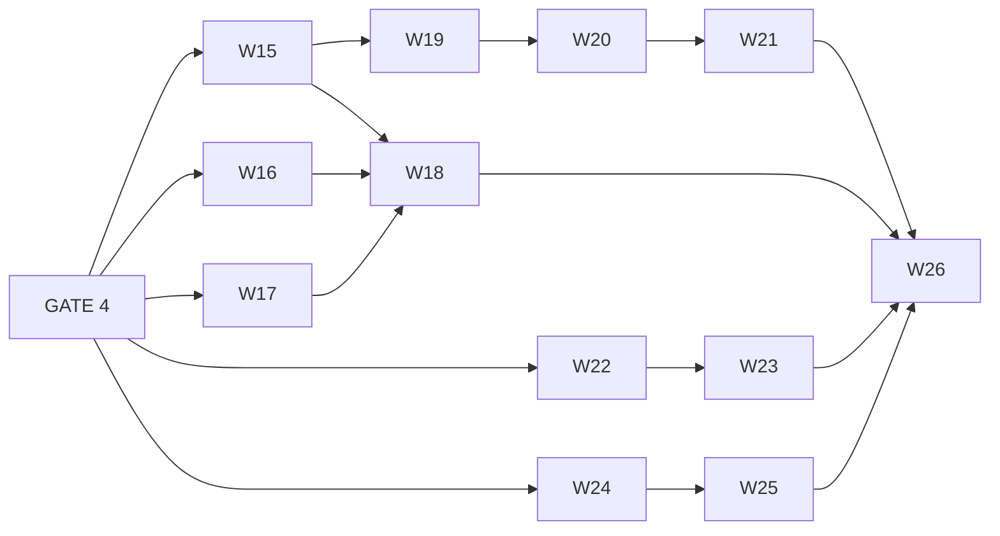

# RhemaPod Admin Portal — Phase 2 — **SUPERSEDED DRAFT**

> **SUPERSEDED (2026-09-10) by `plans/plan-admin-portal-phase2.md`,** which is the contract.
> Isaac's rulings narrowed the scope substantially (Settings cut, MRR cut, the plays rollup cut,
> the chart re-sourced from `first_played_at`) and **renumbered every work item**. Nothing below is
> executable; it is retained only as the analysis the contract was derived from. Where the two
> disagree, the contract wins.
>
> **Original header follows.**
>
> **STATUS: DRAFT.** This is analysis for Isaac's review, not a contract. Nothing here is a
> committed gate, no work item is executable, and no `[HUMAN_GATE]` below has been crossed or
> pre-approved. It becomes `plans/plan-admin-portal-phase2.md` only after Isaac approves scope and
> sequence. Until then the only approved plan is `plans/plan-admin-portal.md` (Phase 1, complete,
> merged at `9e27068`).

Phase 1 delivered W1–W14: sermons, series, speakers/categories, announcements, and the
review→publish workflow. Phase 2 is the four screens deferred in `plan-admin-portal.md` §C:
Dashboard, Subscriptions, Users & roles, Settings.

---

# 0. Headline findings (read these first)

Four things change the shape of Phase 2 relative to the brief:

1. **The plays-per-week chart cannot be built from the data that exists, and no amount of
   frontend work fixes it.** `PlaybackSession` is one upserted row per user per sermon with
   `last_played_at` *overwritten* on every ping (`app/models/models.py:548`, and the docstring says
   so deliberately). There is no event stream. "Plays in week 31" is not recoverable — the row that
   was played in W31 and again in W35 now reads as W35 only. Every historical bucket
   systematically undercounts, worse the older it gets. The same defect kills every delta on the
   design's stat tiles ("12.4%", "3.1 pts", "+38 this month") and the 30/90/Year period selector.
   **This is the one item that must land early and ship late**, because it needs calendar time to
   accrue data. See §2.1 and W16.

2. **Users & roles is much closer to done than the brief assumed — including invite-send.**
   `POST /users` already creates a staff account *and* sends the invite email, transactionally
   (`auth_service.create_staff`, rolls back if delivery fails), against a real SMTP backend
   (`app/core/email.py`). `plan-admin-portal.md` §C's "invite sending is Phase 2" is stale — it
   shipped in backend Phase 3/6. What is actually missing is small and additive. See §2.3.

3. **Subscriptions has zero staff-facing backend.** Every route under `/subscriptions/*` is
   self-service for the logged-in member. There is no list endpoint, no staff read model, and —
   critically — **no amount is stored anywhere**, so the design's MRR tile has no source of truth.
   `handle_webhook` parses tier, status, customer, period end; it never reads an amount. See §2.2.

4. **Settings has no backend at all and is ~60% aspirational.** There is no settings table, no
   config endpoint; everything is env via `pydantic-settings`, `@lru_cache`d at boot. Two of the
   design's toggles ("Push on publish", "Allow offline downloads") depend on infrastructure that
   does not exist, one ("Require manager approval") would turn a hard authz invariant into a
   runtime flag, and one ("Rotate API keys") is an AWS credential operation that should not be an
   app button. See §2.4.

Net: **Users & roles is cheap and should go first. Subscriptions and Settings are genuinely new
backend surface. Dashboard is blocked on a data-model decision, not on charting.**

---

# 1. Gap analysis — screen → capability → status

Status key: **exists** = usable as-is · **partial** = endpoint exists, needs additive change ·
**missing** = no backend · **blocked** = not derivable from the current data model.

Effort is backend only, rough, in ideal half-days.

## 1.1 Dashboard / Analytics

| Capability (design) | Backend | Status | Effort |
|---|---|---|---|
| Total plays tile | `GET /admin/analytics/overview` → `total_plays` | **exists** | — |
| Completion rate tile | `overview.completion_rate` | **exists** | — |
| Paid members tile | `overview.active_subscribers` | **exists** | — |
| Published sermons tile | `overview.published_sermons` | **exists** | — |
| …"of 128 total" | no `total_sermons` field | **partial** — one COUNT | 0.5 |
| Tile deltas (12.4%, 3.1 pts, +38 this month) | no historical snapshot anywhere | **blocked** | see W16 |
| Period selector (30 / 90 / Year) | `overview()` takes no params | **blocked** (same cause) | see W16 |
| Plays per week, last 8 weeks | no event stream; `last_played_at` overwritten | **blocked** | see W16 |
| Top sermons (ranked, with counts) | `GET /admin/analytics/top-sermons` | **exists** | — |
| "Your work in progress" — drafts | `GET /sermons` + status filter | **partial** — needs author scoping | 0.5 |
| WIP card: "Processing 38%" | `GET /sermons/{id}/uploads` is per-sermon only | **missing** — no global in-flight feed | 1 |
| WIP card: "Rejected · note" | rejection reason lives in `ApprovalLog` | **partial** — needs latest-log join | 1 |
| Greeting subhead ("Two uploads finished overnight") | derived from the two above | **missing** | folds in |

`overview()` today issues eight independent `COUNT`/`SUM` full-table aggregates per request, no
rollup, no cache. Fine at current scale; it is the thing that breaks first. See R6.

## 1.2 Subscriptions

| Capability (design) | Backend | Status | Effort |
|---|---|---|---|
| Member list w/ tier, status, renewal, provider | nothing staff-facing under `/subscriptions/*` | **missing** | 2 |
| Filter: All / Active / Past due / Cancelled | — | **missing** (folds into list) | — |
| Filter: Any tier / Monthly / Annual | — | **missing** (folds into list) | — |
| Active-paid tile | `subscription_service.count_active_paid_subscribers` | **exists** (not exposed as staff route) | 0.5 |
| Past-due count tile | — | **missing** — one grouped COUNT | 0.5 |
| Cancelling-at-period-end tile | `cancel_at_period_end` column exists | **missing** — one COUNT | 0.5 |
| **MRR tile + "avg $6.79 / member"** | **no amount stored on `Subscription`; webhook never parses one** | **missing** — needs a decision, see R2 | 1–2 |
| "+38 this month" | `Subscription.created_at` is row creation (a free row is made at register), not "became paid" | **blocked** — no paid-since timestamp | 1 |
| "Renews 2027-03-12" | `valid_until` | **exists** | — |
| "ends Sep 30" (cancelling) | `valid_until` + `cancel_at_period_end` | **exists** | — |
| **"retry Sep 9" (past due)** | Stripe-side dunning state, never stored | **missing** — see R5 | — |
| Export CSV | — | **missing**; recommend client-side from the loaded page, not an endpoint | 0 |
| Row `···` menu | design does not say what is in it — **this is the Stripe scope question**, see R5 | **undecided** | — |

## 1.3 Users & roles

| Capability (design) | Backend | Status | Effort |
|---|---|---|---|
| Staff list w/ name, email, role, joined | `GET /users` → `Page[UserPublic]` (id, email, full_name, role, is_active, created_at) | **exists** | — |
| …filtered to staff | returns **all** users, viewers included, `created_at desc` only | **partial** — needs `role` filter; unusable without it, and a PII concern (R4) | 0.5 |
| Search a person | — | **partial** — needs `q` | 0.5 |
| Role-count tiles (Viewers / Editors / Managers / Admins) | — | **missing** — one GROUP BY | 0.5 |
| **Invite staff** | `POST /users` — creates **and sends the invite email**, transactional | **exists** — brief's assumption is stale | — |
| Change role (inline `Manager / Editor / Admin`) | `PATCH /users/{id}/role`, with `_may_assign` matrix, self-demotion block, manager-can't-touch-manager/admin | **exists** | — |
| **"The last admin can't be demoted"** (design copy) | **not enforced anywhere in `change_role`** | **missing** — see R3 | 0.5 |
| State: Active | `is_active` column | **exists** | — |
| **State: "Invited · 41h left"** | no `invited_at` column; invite state lives only as a Redis single-use jti | **missing** — needs a migration or a scope cut | 1 |
| Deactivate / suspend | `is_active` column exists, **no endpoint writes it** | **missing** | 1 |
| Resend invite | — | **missing** | 0.5 |

**Verdict: Users & roles is a thin read over existing endpoints plus ~4 half-day additive bits.**
It is the cheapest screen in Phase 2 and it retires Phase 1 risk D9 (staff accounts created by
script). It should go first.

## 1.4 Settings

| Capability (design) | Backend | Status | Recommendation |
|---|---|---|---|
| Church name, support email, time zone | **no settings store exists at all** | **missing** | build a narrow one (W24) |
| App icon (1024×1024) | reuse the presign → confirm pipeline from W9 | **partial** — needs a settings-scoped target | build |
| "New sermons default to Free/Paid" | tier defaulting is in `content_service` | **missing** | build — small, real |
| **"Require manager approval"** | a hard invariant in `app/services/approval.py`, not a flag | **missing** | **cut.** Turning an authz invariant into a runtime toggle is a security decision, not a settings row |
| **"Push on publish"** | no push infrastructure exists; no mobile app | **missing** | **cut** — render disabled with a "not yet" affordance, or omit |
| **"Allow offline downloads"** | no mobile app | **missing** | **cut** |
| **"Rotate API keys — invalidates every signed media URL"** | media URLs are S3 SigV4 presigns against AWS credentials | **missing** | **cut.** This is a Secrets Manager / IAM rotation, not an app button. Shipping it as one is a footgun that can break every media URL in flight |

**Verdict: ship a narrow Settings — church profile + the one real publishing default — and cut the
rest explicitly rather than stubbing it.** A disabled toggle that never becomes enabled is worse
than an absent one.

---

# 2. The four decisions Isaac actually has to make

## 2.1 Analytics data model — the blocking decision

The design's Dashboard is a *time-series* dashboard drawn against a *point-in-time* data model.

Options:

| | Approach | Tradeoff |
|---|---|---|
| **A** | Ship the chart against a `last_played_at` week-bucket proxy | Wrong, and wrong in a way that flatters recent weeks. A chart that always slopes up because of how it's counted is worse than no chart |
| **B** | Full append-only `playback_event` table | Correct and general, but it's the event pipeline the model docstring deliberately refused. Unbounded growth on the hottest write path (a ping every ~30s per active viewer) |
| **C** | **Narrow daily rollup: `sermon_play_daily(sermon_id, day, plays, unique_viewers, completions)`, upserted inline in `record_progress`** | Bounded (sermons × days, not users × pings). One extra upsert on the write path. Daily grain rolls up to the 8-week chart, the 30/90/Year selector, and every tile delta. Cannot backfill |
| **D** | Defer the chart out of Phase 2 entirely | Honest, but the Dashboard is *the* Phase 2 screen and a Dashboard with no chart is a stat-tile page |

**Recommendation: C, sequenced early.** It is the smallest thing that makes the design truthful. It
keeps the "no event stream" decision intact — this is an aggregate, not a log — and it costs one
`INSERT … ON CONFLICT` on a path that already does exactly that.

The consequence Isaac must accept: **no backfill.** The chart is empty on day one and has real data
after eight weeks. That is why W16 lands in the first backend batch even though W18/the chart is
near the end of the sequence. Options for the gap: ship the chart with an explicit "collecting
since {date}" state (recommended), or hold the chart behind a flag until the window fills.

Same table answers the tile deltas and the 30/90/Year selector. One migration, four features.

## 2.2 The charting decision

Constraints: Next 16 App Router with RSC, TS strict, Tailwind v4 `@theme` tokens, no chart
dependency in the GATE 1 list, and Phase 1 risk **D5** (design-fidelity drift) standing.

What is actually being drawn: **one** 8-bar vertical bar chart with week labels, and a
top-sermons list that is not a chart at all — it is a ranked list with a proportional-width bar,
which the existing `Progress` primitive from W2 already covers.

| | Option | Tradeoff |
|---|---|---|
| **A** | **Recharts** | ~100 kB+ gzipped with its d3 tail, client-only, `ResponsiveContainer` forces a client boundary on the whole Dashboard, and you spend the time overriding its defaults to hit the design's exact radii and tokens anyway. Buys interaction you have not been asked for |
| **B** | **visx** (`@visx/shape` + `@visx/scale`) | Modular, ~20–30 kB for this usage, honest primitives. Still a dependency, still d3-scale, still a client boundary, for a linear scale that is `v / max * h` |
| **C** | **Hand-rolled SVG** — a `BarChart` component, ~60 lines | Zero dependency, **server-renderable so the Dashboard stays an RSC**, tokens applied directly, exact fidelity by construction, no GATE 1 amendment. You own it; there are no tooltips, no axes, no animation unless you write them |
| **D** | CSS-grid bars, no SVG | Simplest, but the design's rounded bar caps and baseline treatment fight the box model |

**Recommendation: C.** Two chart forms, both trivial, and one of them isn't a chart. A library here
is a dependency, a client boundary, and a fidelity fight bought to avoid writing a division.

**State the exit trigger explicitly so this isn't relitigated per-item:** take visx (option B) the
first time the Dashboard needs *any* of — hover tooltips, a second series, a non-uniform time axis,
or a chart type that isn't bars. Do not incrementally hand-roll toward a charting library.

## 2.3 Subscriptions — read-only or operational?

The design shows a `···` row menu and does not say what is in it. This is the single largest
scope-and-risk fork in Phase 2, so it needs an explicit answer before W22.

- **Read-only + "Open in Stripe" deep link (recommended).** The staff screen answers *who is
  subscribed, on what, until when*. Anything mutating — refunds, plan changes, forced cancellation
  — happens in the Stripe dashboard, which already has the audit trail, the permissions model, and
  the fraud tooling. The portal grows zero new outbound Stripe surface. `PaymentProvider`
  (`app/core/payments.py:36`) already carries `cancel_at_period_end(subscription_id=...)` if a
  narrow exception is ever wanted, but nothing else — no refund, no plan change.
- **Operational.** Every mutating action is a new provider method, a new webhook reconciliation
  path, a new authz rule, real money, and an irreversible-operation test burden.

**Recommendation: read-only for Phase 2.** Note the honesty problem this creates and accept it: the
portal will show a member as past-due while a Stripe-side refund or manual fix has already resolved
it, until the next webhook lands.

## 2.4 Settings store shape

**Recommendation: a single-row `app_settings` table with typed columns**, not a key-value blob.
Reasoning: Isaac's stated requirement is reviewable, additive Alembic migrations. A KV/JSONB blob
moves every future setting outside migration review and outside Pydantic validation — you get
schema drift with no diff to read. Typed columns cost one migration per new setting, which is the
point. Cache in Redis with invalidate-on-write, same pattern as the entitlement cache.

Reads are `manager+`; writes are **`admin` only** — publishing defaults change content behaviour
platform-wide.

---

# 3. GATE 3 Batch 7 vs new Phase 2 backend work

`plan-admin-portal.md`'s **[HUMAN_GATE 3]** is standing: any backend change the portal needs halts
and batches. Phase 2 surfaces a lot of backend, and lumping it all into "Batch 7" would be a
category error. The split:

**Batch 7 (genuine GATE 3 class — additive changes to existing surfaces, one review sitting):**

| # | Change | Class | Surfaces at |
|---|---|---|---|
| 1 | `GET /users` += `role`, `q`, `is_active` filters | public API | W19 |
| 2 | `GET /users/counts` (or fold into overview) — role tallies | additive route | W19 |
| 3 | `OverviewStats` += `total_sermons`, `draft_sermons` | public response shape | W18 |
| 4 | `GET /sermons` author-scoped filter for "my WIP" | public API | W18 |
| 5 | Global in-flight uploads feed for the WIP cards | additive route | W18 |

**Not Batch 7 — genuinely new Phase 2 backend, each with its own gate:**

- **W16** — `sermon_play_daily` rollup + write-path change. New table, hot-path write, migration.
- **W20** — deactivate endpoint + last-admin invariant. Authz change, `security-reviewer` mandatory.
- **W22** — staff subscriptions read API + MRR source-of-truth decision. Stripe-facing, cost.
- **W24** — `app_settings` store. New table, changes platform publishing behaviour.

Each of these introduces a new domain concept or changes an invariant. They do not belong in an
"additive filters" batch and should not be approved in one motion with it.

---

# 4. Work items

Same convention as `plan-admin-portal.md` §W. **Nothing below is approved.**

### [HUMAN_GATE 4] — Phase 2 scope
Approve: the analytics rollup approach (§2.1), the charting decision (§2.2), the read-only
Subscriptions posture (§2.3), the Settings store shape *and the four cuts* (§2.4), and the
Batch 7 / new-work split (§3). **Nothing in W15–W26 starts before this.**

### [HUMAN_GATE 3 — Batch 7]
The five additive backend changes in §3. Landed together with regression tests. Items 1 and 4 touch
public API filters → ADR per Isaac's convention.

---

### W15 — Backend Batch 7
**Delivers:** the five §3 items, with tests.
**Depends:** GATE 4, GATE 3 Batch 7.
**Acceptance:** `GET /users?role=editor&q=ada` returns only matching staff; role counts match a
hand-run `GROUP BY`; regenerated `openapi.json` diff is additive only and `npm run gen:api` produces
no type breakage in the existing portal.
**Review:** `reviewer-gilfoyle`. `security-reviewer` on item 1 (see R4).

### W16 — Play rollup table `sermon_play_daily` — **[HUMAN_GATE]**
**Delivers:** migration; upsert wired into `analytics_service.record_progress`; `overview()` gains a
period parameter sourced from the rollup; a `plays-per-period` series endpoint.
**Depends:** GATE 4. **Lands in the first backend sitting regardless of when W18 ships** — the data
needs calendar time to accrue.
**Acceptance:** a simulated week of pings produces daily rows whose sums match the `PlaybackSession`
totals; a restart-then-replay does not double-count; the write path's added latency is measured, not
assumed; `record_progress` under concurrent pings still accumulates correctly.
**Review:** `reviewer-gilfoyle` + `qa-strategist` (this is a hot-path write with a correctness
property that is easy to get subtly wrong).
**Gate rationale:** new table, migration, change to the highest-frequency write in the system.

### W17 — Chart primitives
**Delivers:** `components/charts/BarChart.tsx` (hand-rolled SVG, RSC-safe) and a `RankedBarList`
composed from the existing W2 `Progress` primitive. No new dependency.
**Depends:** GATE 4 (§2.2).
**Acceptance:** renders on the server with zero client JS; matches the design's bar geometry, radii
and week labels against the `.dc.html`; degrades correctly at n=0, n=1, and all-zero series; axis
labels remain readable at the narrowest supported width.
**Review:** design-fidelity pass.

### W18 — Dashboard screen
**Delivers:** greeting + contextual subhead; WIP cards (draft / processing / rejected); four stat
tiles; period selector; plays-per-week chart; top sermons.
**Depends:** W15, W16, W17.
**Acceptance:** every tile traces to a real endpoint field — **no computed-in-the-frontend
statistic**; the chart renders an explicit "collecting since {date}" state for weeks before W16
landed rather than drawing a zero; deltas are absent (not zero) where no prior period exists;
Editors do not see subscriber or revenue figures.
**Review:** design-fidelity + `reviewer-gilfoyle`.

### W19 — Users & roles screen
**Delivers:** staff list, search, role filter, role-count tiles, invite-staff dialog, inline role
change. **All on endpoints that already exist plus W15.**
**Depends:** W15.
**Acceptance:** inviting a staff member sends a real invite and the recipient can complete
set-password (the W4 flow) end to end; a manager attempting to change a manager's or admin's role
gets the backend's typed error surfaced as a field message, not a toast; the list never shows
viewers by default.
**Review:** `reviewer-gilfoyle`. **This item retires Phase 1 risk D9.**

### W20 — User lifecycle backend — **[HUMAN_GATE]**
**Delivers:** `PATCH /users/{id}/active` (deactivate/reactivate); **the last-admin invariant** in
`change_role` *and* in deactivate; resend-invite endpoint; `invited_at` column if the design's
"Invited · 41h left" state survives scope review.
**Depends:** W19.
**Acceptance:** the last active admin can be neither demoted nor deactivated, by any actor
including themselves, proved by test; deactivating a user revokes their refresh tokens (same
revoke-before-commit ordering as `change_role`); a deactivated user's live access token is rejected
at the next request, not merely at refresh.
**Review:** `security-reviewer` **mandatory** + `reviewer-gilfoyle`.
**Gate rationale:** authz change, lockout risk, session revocation semantics.

### W21 — Users & roles lifecycle actions
**Delivers:** the row `···` menu — deactivate, reactivate, resend invite — with confirmation on the
destructive path; invited/active state column.
**Depends:** W20.
**Acceptance:** the last-admin refusal renders as an explanatory inline message, not a generic
error; a deactivated row is visually distinct and its actions are correct.

### W22 — Staff subscriptions read API — **[HUMAN_GATE]**
**Delivers:** `GET /admin/subscriptions` (paginated, filter by status + tier, joined to user for
name/email); stat aggregates (active paid, past due, cancelling, MRR); **and the MRR
source-of-truth fix — recommend `amount_cents` + `currency` persisted on `Subscription` at webhook
time** (see R2).
**Depends:** GATE 4 (§2.3 must be settled first).
**Acceptance:** the list is read-only — no route in this item calls Stripe outbound; MRR traces to
persisted per-subscription amounts, not a hardcoded price map; a member with no amount recorded is
excluded from MRR and that exclusion is visible, not silently zero.
**Review:** `security-reviewer` (PII: staff-readable member emails at scale) + `reviewer-gilfoyle`.
**Gate rationale:** new public surface, PII exposure, Stripe-adjacent, revenue figures.

### W23 — Subscriptions screen
**Delivers:** four stat tiles, filter bar, member table, CSV export (client-side from loaded rows),
"Open in Stripe" row action.
**Depends:** W22.
**Acceptance:** read-only — no mutating call exists in this screen; past-due rows carry the
grace-period explanation from the design's subhead; CSV matches the visible filtered set;
`requireRole("manager")` still holds (Editors 404).

### W24 — `app_settings` store — **[HUMAN_GATE]**
**Delivers:** single-row typed table + migration; `GET /admin/settings` (manager+),
`PATCH /admin/settings` (**admin only**); Redis cache with invalidate-on-write; icon upload via the
existing presign→confirm pipeline.
**Depends:** GATE 4 (§2.4, including the four cuts).
**Acceptance:** a settings write is visible to a second process within one request (cache
invalidation actually works, tested against real Redis); the default-tier setting demonstrably
changes the tier of a newly created sermon; the row is created by migration, not lazily on first
read.
**Review:** `security-reviewer` (admin-only write) + `reviewer-gilfoyle`.
**Gate rationale:** new table, migration, changes platform-wide publishing behaviour.

### W25 — Settings screen
**Delivers:** church profile section, publishing defaults section. **No danger zone. No push or
offline toggles.**
**Depends:** W24.
**Acceptance:** a non-admin manager sees the values read-only with no submit affordance; the cut
sections are absent, not disabled.

### W26 — Phase 2 hardening
**Delivers:** a11y sweep across the four screens (same bar as W14); Playwright coverage; seed script
extended with subscription and playback fixtures so the Dashboard and Subscriptions screens have
non-empty local data.
**Depends:** all.
**Acceptance:** axe clean on all four; the seed produces a Dashboard that is not empty; role-gating
proved per screen for editor / manager / admin.

## Sequence

Critical-path note: **W16 is not on the visual critical path but is on the calendar one.** Land it
in the first backend sitting or the chart ships empty.

Recommended order of *value*: W19/W20/W21 (Users) → W23 (Subscriptions) → W25 (Settings) →
W18 (Dashboard, last, so the chart has the most data). This inverts the design's nav order
deliberately.

---

# 5. Risks

**R1 — The Dashboard's headline chart has no truthful data source. (High / High)**
Covered at §2.1. *Mitigation:* W16 lands first and the chart ships with an explicit collection-start
state. **The failure mode to refuse is option A** — shipping the `last_played_at` proxy because the
rollup hasn't accrued yet. A chart that slopes up because of its own counting artifact will be
believed, quoted, and acted on.

**R2 — MRR has no source of truth. (Medium / High)**
No amount on `Subscription`; `handle_webhook` never parses one; config holds Stripe *price IDs*, not
amounts. Three ways out: a price map in settings (drifts from Stripe silently — the number is wrong
and nothing tells you), a live Stripe lookup per dashboard render (latency, rate limits, a
third-party dependency on an internal screen), or **persist `amount_cents` + `currency` from the
webhook payload, which already carries it**. *Recommendation:* the third, as part of W22. It is
additive and it makes the figure auditable. Existing rows have no amount and must be excluded
visibly, not defaulted.

**R3 — Last-admin lockout becomes reachable the moment W20 ships. (Medium / High)**
Today zero-admin is unreachable only by accident: `change_role` blocks self-demotion, so the last
admin cannot demote themselves and admin B demoting admin A still leaves B. The design copy already
promises "The last admin can't be demoted" and the code does **not** enforce it. Add a deactivate
endpoint without the invariant and lockout is a two-click operation with no recovery path short of
`app/scripts/create-admin`. *Mitigation:* the invariant is a named W20 acceptance criterion on
**both** paths, with `security-reviewer` mandatory. Also confirm the break-glass script still works.

**R4 — `GET /users` exposes every viewer's email to any manager. (Medium / Medium)**
The endpoint returns all users unpaginated-by-role, `created_at desc`. The design shows 4,812
viewers. A staff-management screen has no reason to enumerate the membership's email addresses.
*Mitigation:* Batch 7 item 1 defaults the list to staff roles; `security-reviewer` on that item;
decide deliberately whether managers may enumerate viewers at all, rather than inheriting it.

**R5 — Stripe surface area creep. (Medium / High)**
The design's `···` menu is unspecified. Every mutating action is new provider surface, new webhook
reconciliation, real money, and irreversible-operation testing. *Mitigation:* §2.3 settles it at
GATE 4 as read-only; W22's acceptance criteria make "no outbound Stripe call" a testable property
rather than an intention. Accepted consequence: portal state lags Stripe-side manual fixes until the
next webhook.

**R6 — Analytics query cost. (Low now / Medium rising)**
`overview()` is eight full-table aggregates per call, uncached, on `get_read_db`. A dashboard that
several staff leave open turns into a repeated sequential scan of `playback_sessions` and `users`.
*Mitigation:* W16's rollup absorbs the play-related ones; cache the remainder briefly. Note the
replica fallback — if the replica is unconfigured this all lands on the primary.

**R7 — "Require manager approval" as a runtime toggle. (Low if cut / High if built)**
It reads like a settings row and behaves like an authz invariant. A flag that lets editors publish
directly is a privilege-escalation switch in a settings form. *Mitigation:* cut at §2.4. If it is
ever wanted, it is its own design with its own security review, not a Settings checkbox.

**R8 — Design/reality divergence is wider in Phase 2 than Phase 1. (Medium / Medium)**
Phase 1's §A.9 logged five gaps. Phase 2 has more, and bigger: the whole chart, MRR, "+38 this
month", "retry Sep 9", "Invited · 41h left", and four Settings controls. The design was drawn
against an imagined contract. *Mitigation:* §1's tables are the divergence register; the four cuts
are explicit rather than stubbed. Expect more at build time — GATE 3 stays standing.

---

# 6. Non-goals for Phase 2

- **Any mutating Stripe operation from the portal** — refunds, plan changes, forced cancellation,
  dunning intervention. Read-only (§2.3).
- **Push notifications** and **offline downloads** — no infrastructure, no mobile app.
- **API key / credential rotation from the UI** — an AWS Secrets Manager operation.
- **Runtime-toggleable approval requirement** — an authz change, not a setting (R7).
- **A full event-stream analytics pipeline** — the daily rollup is deliberately narrower (§2.1).
- **Backfilled historical charts.** Not possible; not attempted.
- **A charting library.** Hand-rolled, with a stated exit trigger (§2.2).
- **Cross-entity global search.** Deferred again — `/search` + `/search/suggest` exist backend-side
  but this is its own screen, not a Phase 2 tail.
- **Dark mode.** Still no palette.
- **Audit-log UI** beyond the existing approval timeline.
- **Real-time.** Polling only.
- **Cohort / retention / funnel analytics.** The rollup enables them; Phase 2 does not build them.
- Containerizing the portal, deploy target, CI — unchanged from Phase 1 §C.

## What Phase 3 would be

Roughly, in likely order:
1. **The mobile viewer app** — the actual product; everything so far is the tooling around it.
2. **Cross-entity global search** as a first-class screen.
3. **Deeper analytics on the rollup** — retention, per-series performance, cohort views. Cheap once
   W16 has a year of data, impossible before.
4. **Operational Subscriptions**, if and only if running the church's billing through the Stripe
   dashboard proves genuinely painful. Evidence first.
5. **Audit-log UI** across roles and settings — which W20 and W24 both start generating.
6. **CI + a deploy target.** Phase 1 risk D8 has been accruing since the repo became a monorepo.

---

# 7. Open questions for the Skeptic

1. **Is the Dashboard worth Phase 2 at all?** It is the most expensive screen (a migration, a
   hot-path write change, and an eight-week data wait) and the least operationally necessary. A
   church admin needs to invite an editor far more often than they need a plays-per-week chart. Is
   the honest sequencing "Users, Subscriptions, Settings — and Dashboard in Phase 3, on a year of
   rollup data"?
2. **Does the daily rollup actually earn its hot-path cost**, or is a nightly batch job over
   `PlaybackSession` deltas sufficient? The batch version is wrong in a different way (it can't see
   within-day replays) but touches nothing on the write path.
3. **MRR at this scale** — is a revenue figure derived from webhook payloads something a church
   admin portal should display at all, given it will disagree with Stripe's own number the moment
   there is a refund, proration, or currency conversion? Is "Active paid: 1,240" enough?
4. **Should managers see the Subscriptions screen at all**, or is it admin-only? Phase 1's stub sets
   `requireRole("manager")`, which was a nav-grouping decision, not a data-sensitivity one.
5. **Is `is_active` deactivation the right model**, or does a church need soft-delete / departed-staff
   semantics with content attribution preserved? Sermons carry an author; what does a deactivated
   editor's back-catalogue attribution look like?
6. **"Invited · 41h left" — worth a migration?** It needs an `invited_at` column purely for a status
   pill. Cheaper alternative: show "Never signed in" from a `last_login_at` that doesn't exist
   either. Or cut the state entirely and let the resend-invite action carry the affordance.
7. **Settings for a single church** — is a settings *table* premature for a single-tenant app whose
   church profile changes approximately never? The counter-argument is that env-var edits require a
   redeploy and a non-technical admin can't do them. Which of those two costs is real here?
