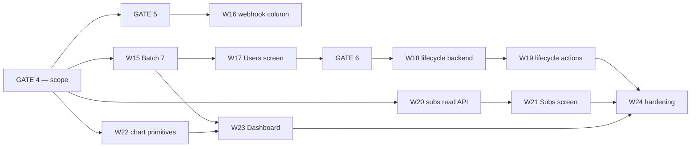

# Plan: RhemaPod Admin Portal — Phase 2 (Users & roles · Subscriptions · Dashboard)

Design source of truth: `docs/design_admin_portal/README.md` (+ the `.dc.html` references).
Backend source of truth: `app/api/*.py`, `app/services/*.py`, `app/models/models.py` — **read over the
design README where the two disagree.** They disagree in more places in Phase 2 than in Phase 1;
§A.7 is the register.

Predecessor: `plans/plan-admin-portal.md` (Phase 1 — architecture + W1–W14, shipped). Everything in
that document's §A (BFF session design, API client, data layer, design system, role-gating, config,
testing bar) **still holds unchanged** and is not restated here. Its `[HUMAN_GATE 3]` (standing
backend gate) and its Amendments A1–A4 remain in force.

Supersedes: `plans/plan-admin-portal-phase2-DRAFT.md`. That file was analysis, not a contract. Where
the two disagree, **this document wins**; the DRAFT is retained only as the working-out.

---

## Goal

Ship the three staff screens deferred in Phase 1 §C — **Users & roles**, **Subscriptions**,
**Dashboard** — at a scope where every number on screen traces to a fact the database already knows,
and no screen depends on data the system has never collected.

**Settings is not in Phase 2.** It moves to Phase 3 in full (resolved decision 3). The `/settings`
stub shipped in Phase 1 stays a stub.

## Definition of Done (Phase 2)

- [ ] A manager can list staff, filter by role, invite a new staff member (real email, real
      set-password completion), change a role inline, and deactivate/reactivate an account —
      end to end against the local Docker stack.
- [ ] The last active admin cannot be demoted or deactivated, by any actor including themselves,
      and the invariant holds under concurrent attempts on a real PostgreSQL connection.
- [ ] A manager can list paying members with tier, status and renewal date, filter the list, export
      the visible rows, and open a member in Stripe. **No screen in Phase 2 makes a mutating call to
      Stripe, and no route added in Phase 2 calls Stripe outbound at all.**
- [ ] The Dashboard renders four stat tiles, top sermons, the "your work in progress" cards and an
      8-week new-listeners chart. **Every value on it is read from a backend field — nothing on the
      Dashboard is computed in the frontend, and no delta, percentage-change or period selector
      appears anywhere.**
- [ ] Exactly one Alembic migration lands in Phase 2 (`ProcessedWebhook.subscription_id`), it is
      additive, and `alembic downgrade` restores the prior schema cleanly.
- [ ] `npm run verify` is green; Playwright covers the Users lifecycle path; `axe` is clean on all
      three screens; role-gating is proved per screen for editor / manager / admin.
- [ ] `security-reviewer` has passed on the user-lifecycle backend (mandatory) and on the staff
      user-list scoping and the staff subscriptions read API.
- [ ] **No scope creep.** No Settings screen, no `app_settings` table, no plays rollup, no MRR, no
      dollar figure anywhere in the portal, no charting library.

## Constraints / Assumptions

- **Locked by Isaac, not relitigated here:** the twelve resolved decisions below. Reopening any of
  them is a plan amendment, not an executor's call.
- Phase 1 §A is unchanged. In particular: the BFF proxy is the only path from browser to API, both
  tokens stay in httpOnly cookies per Amendment A1, and `admin_portal/` remains host-run with
  `npm run dev` against the Docker stack.
- **Billing is USD-only.** No currency column, no locale formatting, no FX. Recorded so Phase 3
  inherits the assumption rather than discovering it (resolved decision 12).
- Week boundaries in the new-listeners series are **ISO weeks in UTC**. The portal has no timezone
  setting because Settings is Phase 3; a church-local week is a Phase 3 upgrade, not a Phase 2 gap.
- Phase 1 risk **D3** (single Next instance) is still an accepted constraint and Phase 2 does not
  relax it. See §D.

---

## Resolved decisions

Twelve questions were put to Isaac before this plan was finalised. All twelve are **settled**. The
plan body reflects them as decided facts, not as options.

| # | Decision | Resolution | Where it lives |
|---|---|---|---|
| 1 | Dashboard scope | **Reduced.** Four stat tiles (existing `overview()`), top-sermons (existing), "your work in progress" cards, and the weekly chart per decision 6. **No 30/90/Year period selector. No `sermon_play_daily` rollup.** | §A.1, W23 |
| 2 | MRR tile | **Cut.** Subscriptions ships exact counts only: Active paid · Monthly · Annual. **No dollar figure anywhere in the portal.** | §A.3, W20 |
| 3 | Settings | **Cut entirely to Phase 3.** No `app_settings` table, no settings endpoint, no Settings screen. The Phase 1 `/settings` stub stays a stub. | §C, §E |
| 4 | Subscriptions posture | **Read-only, confirmed.** No outbound Stripe calls from the portal. "Open in Stripe" deep link off `provider_customer_id` is the escape hatch. Past-due rows show "past due since {updated_at}" with **no retry date** — dunning state is not stored. | §A.3, W20, W21 |
| 5 | Staff list filtering | **Role filter only.** No `q` / email search in Phase 2. **Managers can never reach viewers** — the staff-management list is hard-scoped to staff roles for every actor. | §A.6, W15 |
| 6 | Dashboard chart | **"New listeners per week" from `PlaybackSession.first_played_at`** — exact, backfillable, no migration, no write-path change. Answers **reach, not engagement**; labelled "New listeners", never "Plays". | §A.2, W23 |
| 7 | Schema change | **One additive nullable `subscription_id` on `ProcessedWebhook`.** The only migration in Phase 2. Own gate. | §A.4, GATE 5, W16 |
| 8 | Invite-state pills | **Cut.** No "Invited · 41h left", no "Never signed in". No `invited_at`, no `last_login_at` column. The **Resend invite** action carries the affordance. | §A.6, W19 |
| 9 | Departed staff | **`is_active=false`, decided explicitly.** Attribution unchanged — a departed editor's name stays on their back-catalogue. **No `departed_at`, no reassign-authorship flow in Phase 2.** | §A.6, GATE 6, §E |
| 10 | Test harness | **No Testcontainers migration.** Decisions 3 and 6 remove all new-table work, so Phase 2 adds no DB concurrency surface SQLite cannot cover — **except the last-admin invariant race**, which gets one PG-gated test module and an explicitly stated harness limitation. | §A.5, W18 |
| 11 | Gates | **One scope gate on this narrowed plan** (GATE 4), plus the two downstream gates that guard genuinely irreversible things (GATE 5 migration, GATE 6 authz). Everything else flows on approval — see the note under GATE 3 Batch 7. | §B |
| 12 | Currency | **USD.** No currency column, no locale work. Moot in Phase 2 (decision 2 cuts MRR); recorded for Phase 3. | Constraints |

---

# A. Architecture decisions

## A.1 What the Dashboard is, now that it is reduced

The design drew a *time-series* dashboard against a *point-in-time* data model. Rather than build the
model to fit the drawing, Phase 2 builds the drawing to fit the model. What ships:

| Block | Source | New backend? |
|---|---|---|
| Four stat tiles — total plays, completion rate, paid members, published sermons | `GET /admin/analytics/overview` → `OverviewStats` | none |
| Top sermons (ranked, with counts) | `GET /admin/analytics/top-sermons` | none |
| "Your work in progress" — drafts | `GET /sermons?status=draft` **author-scoped** | Batch 7 #3 |
| WIP — processing | global in-flight uploads feed | Batch 7 #4 |
| WIP — rejected | `GET /sermons?status=rejected` author-scoped, + the approval log per card | Batch 7 #3 |
| New listeners, last 8 weeks | `GET /admin/analytics/new-listeners` over `first_played_at` | Batch 7 #5 |

**Deliberately absent, and this is the decision:** no tile deltas ("12.4%", "+38 this month"), no
"of 128 total" sub-line, no 30/90/Year period selector. Each of those needs a historical snapshot the
system has never taken. A delta rendered as `0` or `—` next to a real number reads as a real number;
absence reads as absence. **Tiles ship bare.**

**The WIP "rejected" card and its N+1.** The rejection note lives in `ApprovalLog`, readable per
sermon (Phase 1 GATE 3 #5 made it Editor-readable for their own sermon). The card fetches the log for
**at most 5** rejected sermons, in parallel, cached by React Query. That is 5 small proxied requests
on a screen everyone opens — which interacts with Phase 1 risk **D2** (the global rate limiter behind
the BFF). Rejected alternative: widening `SermonListItem` with a `latest_rejection_note` field, which
puts an approval-workflow detail on a general-purpose list DTO to save five requests. If D2 bites,
the fix is D2's fix, not a wider DTO.

**`overview()` remains eight uncached full-table aggregates per call** and Phase 2 makes it the
landing screen every staff member opens. This is not fixed here — see risk **P5**.

## A.2 The weekly metric — `first_played_at`, and exactly what it counts

`PlaybackSession.first_played_at` is set by `server_default=func.now()` on insert and **is not in the
`on_conflict_do_update` `set_` clause** in `analytics_service.record_progress` — verified at
`app/services/analytics_service.py`. It is therefore durable history: it says when a given user first
played a given sermon and is never overwritten by a later ping.

Consequences that matter:

- **The chart is non-empty on day one.** It is computed from rows that already exist, over the whole
  history of the table. There is no eight-week wait and no "collecting since {date}" state. This is
  the single biggest reason the rollup was cut.
- **It is exact, not a proxy.** Contrast `last_played_at`, which *is* overwritten and would
  systematically undercount older weeks — the failure mode this decision exists to avoid.
- **It answers reach, not engagement.** It cannot tell you how much anyone listened. Label it
  accordingly. "Plays" is a banned word on this chart.

**The definition, pinned:**

> **M1 — "New listeners" (shipped).** For each of the last 8 ISO weeks (UTC), the count of distinct
> `user_id` whose **earliest** `first_played_at` across all sermons falls in that week. People who
> listened to anything for the first time, that week.

The alternative, named so it is not re-derived at build time:

> **M2 — "First-time listens".** `COUNT(*)` of `PlaybackSession` rows whose `first_played_at` falls
> in the week — new user↔sermon pairings. A broader weekly-activity number.

M1 is what the ruled label literally means and is what ships. **If M1 proves near-flat and near-zero
on real data at W23** (likely for an established congregation with few new arrivals per week), the
switch to M2 is a one-line query change plus a label change and lands as a plan **amendment**, not a
gate. Do not ship a chart that is a flat line at 3 and call it done.

**Accuracy caveat to state on the screen or in the README, not to hide:** `PlaybackSession.user_id`
is a non-null FK. Only authenticated users are counted; anonymous playback does not exist in this
data model. "Listeners" means "registered accounts that played something".

## A.3 Subscriptions — read-only, and what "exact counts only" means

**Posture (resolved decision 4).** The staff screen answers *who is subscribed, on what, until when*.
Everything mutating — refunds, plan changes, forced cancellation, dunning intervention — happens in
the Stripe dashboard, which already owns the audit trail, the permissions model and the fraud
tooling. The portal grows **zero** new outbound Stripe surface. `PaymentProvider`
(`app/core/payments.py`) carries `cancel_at_period_end(...)`; Phase 2 does not call it.

**The three tiles, and why they are the only three:**

| Tile | Query | Why it is safe |
|---|---|---|
| Active paid | `subscription_service.count_active_paid_subscribers` — `tier IN (monthly, annual)` AND `status IN (active, cancelled)` | already the definition behind the analytics overview and the publish toast; one source of truth, not two |
| Monthly | `COUNT(*) WHERE tier = 'monthly'` within the same status set | `SubscriptionTier.MONTHLY` is a stored column |
| Annual | `COUNT(*) WHERE tier = 'annual'`, same | `SubscriptionTier.ANNUAL` is a stored column |

**Precision about "zero new surface" (resolved decision 2).** These three numbers need **no new
column and no write-path change** — every input already exists. They do still need a staff-facing
**read route**, because every route under `/subscriptions/*` today is self-service for the logged-in
member. W20 delivers that route. "Zero new surface" means zero new *stored* surface, not zero code.

**MRR is cut and stays cut.** No amount is stored on `Subscription`; `handle_webhook` never parses
one; config holds Stripe *price IDs*, not amounts. Every route to a revenue figure is either a price
map that drifts silently from Stripe, or a live Stripe lookup on an internal screen. **No dollar
figure appears anywhere in the Phase 2 portal** — not a tile, not a column, not a CSV field.

**Past-due honesty.** Stripe-side dunning state (the retry schedule) is never stored. A past-due row
reads **"past due since {updated_at}"** and stops there. It does not say "retry Sep 9", because the
system does not know. Accepted consequence: the portal lags Stripe-side manual fixes until the next
webhook lands — a member fixed by hand in Stripe still reads past-due here for minutes. Say so in the
screen's subhead rather than pretending to be live.

**PII.** The list joins `Subscription` to `User` for name and email — a staff-readable enumeration of
the paying membership. It is paginated, manager+, and gets a mandatory `security-reviewer` pass at
W20. It is **not** a gate (resolved decision 11), because GATE 4 settles the posture that creates it.

## A.4 `ProcessedWebhook.subscription_id` — the only schema change

`ProcessedWebhook` is already an **append-only event ledger**: one row per provider event, with
`provider`, `event_id`, `event_type`, `created_at` and a `UniqueConstraint(provider, event_id)`. It is
written at exactly one place — the single `db.add(ProcessedWebhook(...))` in
`subscription_service.handle_webhook`, where the resolved `sub` is already in scope.

Adding a nullable `subscription_id` **turns that ledger from a dedup table into a queryable history**:
"which subscriptions became paid in month M", "which lapsed", "what is the churn curve" — all exact,
going forward, with no new table and no new write path.

- **Shape:** nullable FK to `subscriptions.id`, `ON DELETE SET NULL`. The FK gives referential
  integrity and index support; `SET NULL` keeps the ledger row when a subscription is deleted, which
  matters because the ledger's whole purpose is that rows never disappear. A bare nullable UUID with
  no FK is the alternative — cheaper, weaker. **Decide at GATE 5.**
- **Write:** one line at the existing `db.add`, populated as `sub.id if sub is not None else None`.
  The column is nullable precisely because `_find_subscription` legitimately returns `None` for events
  that match no local subscription.
- **Read:** nothing reads it on the hot path. Nothing reads it in Phase 2 **at all**.

**State the honest cost at the gate:** this migration has **no Phase 2 user-visible payoff.** The
Dashboard ships without deltas (decision 1) and Subscriptions ships without "+X this month"
(decision 2), so nothing in this phase renders a value derived from this column. It is bought
entirely for Phase 3 optionality — and it is bought *now* because the history it captures only
accrues from the day it lands. That is a defensible trade and it is also exactly the kind of trade
that deserves an explicit yes rather than a silent one.

## A.5 The last-admin invariant, and what the test harness can actually prove

**The invariant:** `COUNT(*) FROM users WHERE role = 'admin' AND is_active = true` must never reach 0.

**Today it is unreachable only by accident.** `auth_service.change_role` blocks self-demotion, so the
last admin cannot demote themselves, and admin B demoting admin A still leaves B. **Adding a
deactivate endpoint makes zero-admin a two-click operation** with no recovery path short of
`app/scripts/create-admin`. The design copy already promises "The last admin can't be demoted" and
the code does not enforce it.

**The race is real.** `SELECT COUNT(*) …` followed by `UPDATE` in two concurrent transactions lets
both see 2 and both write, reaching 0. It must be enforced on **both** paths — `change_role` and the
new deactivate — since the two can race each other, not just themselves.

**Mechanism — and a correction.** A partial unique constraint (`UNIQUE … WHERE role='admin' AND
is_active`) **cannot express this invariant**: unique constraints bound cardinality from *above*, and
this is a minimum-cardinality rule. It would enforce "at most one admin", which is the opposite of
what is wanted. The viable mechanisms:

| | Mechanism | Tradeoff |
|---|---|---|
| **A** | `SELECT id FROM users WHERE role='admin' AND is_active FOR UPDATE` before the count, in-transaction, on both paths | Smallest — locks rows already being read, no new lock namespace. Lock set must include the target row (it does, on any path that could reach zero) |
| **B** | `pg_advisory_xact_lock(<fixed key>)` around both paths | Simplest to reason about, serializes all admin mutations globally. Introduces an advisory-lock namespace the codebase does not currently use |
| **C** | `SERIALIZABLE` isolation on those two transactions | Correct, but changes session config and requires serialization-failure retry handling on an auth path |

**Recommend A**, with B as the fallback if the lock set proves awkward in practice. Decide at GATE 6.

**What the SQLite harness can prove — stated so no acceptance criterion overreaches.** `FOR UPDATE`
is silently ignored by SQLite, and SQLite's single-writer model means the interleaving that produces
zero-admin **cannot be reproduced there at all**. The existing suite can therefore prove the
*sequential* invariant (the last admin is refused, on both paths, for every actor) and cannot prove
the *concurrent* one. Per resolved decision 10:

- The sequential invariant is a normal acceptance criterion in the default suite.
- The concurrency case is **one PG-gated test module** — Testcontainers PostgreSQL, `skip` with an
  explicit reason when Docker is unavailable. Two concurrent demote/deactivate transactions, assert
  one wins and one is refused.
- **Cap it at one module.** This is the thin end of the wedge toward the harness migration decision 10
  rejected. Naming the cap here is the point; a second PG-gated module is a plan amendment.

## A.6 Users & roles — what exists, what is added, what is cut

Much of this screen is already backed. `GET /users` returns `Page[UserPublic]`;
`POST /users` **creates a staff account and sends the invite email transactionally** (rolls back if
delivery fails) — Phase 1 §C's "invite sending is Phase 2" was stale, it shipped backend-side;
`PATCH /users/{id}/role` carries the `_may_assign` matrix, the self-demotion block and the
manager-cannot-touch-manager/admin rule.

**Added (Batch 7):** the list is hard-scoped to staff roles (editor / manager / admin) for **every**
actor, with a `role` filter narrowing within that set, plus a role-count aggregate for the tiles.

Note the reading of resolved decision 5 this encodes: **viewer enumeration is out of Phase 2 scope
outright, not a permission tier.** "Managers can never reach viewers" is implemented as "the
staff-management list never returns viewers", which is simpler than an actor-dependent scope and
removes the R4-class PII exposure for admins too. The **Viewers** count tile survives, because an
aggregate is not an enumeration.

**Added (W18, gated):** deactivate/reactivate, the last-admin invariant on both paths, resend-invite.

**Cut (resolved decision 8):** the "Invited · 41h left" and "Never signed in" pills. Invite state
lives only as a Redis single-use jti with a 48h TTL; surfacing it as a pill costs an `invited_at`
column for a status label. The **Resend invite** row action carries the affordance instead —
it is the thing a staff member actually does with that information.

**Departed staff (resolved decision 9):** `is_active=false`, and **attribution is deliberately
unchanged**. A departed editor's name stays on their back-catalogue; that is a truthful record of who
wrote what, not a leak. No `departed_at`, no reassign-authorship flow, no soft-delete semantics in
Phase 2.

### The Redis-down deactivation trade — a GATE 6 decision, not an implementation detail

`change_role` revokes refresh tokens **before** commit and therefore **503s on a Redis outage**, with
the role change rolled back (`app/services/auth_service.py`, and the comment there says so
deliberately). A deactivate endpoint that copies that pattern inherits the consequence:
**Redis down ⇒ you cannot deactivate a compromised account.** That is a bad property for the one
endpoint whose purpose is to stop someone.

A relevant fact, verified: `get_current_user` (`app/core/dependencies.py`) **re-reads the user row on
every single request** and rejects `is_active=False`. It also sources `role` from that row, not from
the JWT. Deactivation is therefore *self-enforcing on the next request* whether or not the refresh
token was revoked.

| | Option | Tradeoff |
|---|---|---|
| **A** | Copy `change_role` exactly — revoke before commit, 503 on Redis outage | Consistent with the existing auth path. Redis down = cannot lock out a compromised account |
| **B** | Commit `is_active=false` first, then attempt revoke; on revoke failure return success with a warning | Deactivation always succeeds. The un-revoked refresh token can still mint an access token — which `get_current_user` then rejects anyway, because the user row says inactive |
| **C** | B, plus a recorded "revocation pending" state swept when Redis returns | Correct and complete. A new sweep, new state, new failure mode, for a window measured in minutes |

**Recommend B**, on the grounds that availability of a lockout control matters more than symmetry
with `change_role`, and that the per-request `is_active` re-read makes the residual exposure
narrow. **`security-reviewer` adjudicates at GATE 6.** This is named here as a decision precisely so
it is not settled by whoever writes the endpoint.

## A.7 Charting — hand-rolled SVG, with a stated exit trigger

What is actually drawn: **one** 8-bar vertical bar chart with week labels, and a top-sermons ranked
list that is not a chart at all — it is a proportional-width bar the Phase 1 `Progress` primitive
already covers.

| | Option | Tradeoff |
|---|---|---|
| **A** | Recharts | ~100 kB+ gzipped with its d3 tail; you then spend the time overriding its defaults to hit the design's exact radii and tokens. Buys interaction nobody asked for |
| **B** | visx (`@visx/shape` + `@visx/scale`) | Modular, ~20–30 kB here, honest primitives. Still a dependency and still d3-scale, for a linear scale that is `v / max * h` |
| **C** | **Hand-rolled SVG `BarChart`, ~60 lines** | Zero dependency; design tokens applied directly so fidelity is exact by construction; **no GATE 1 dependency-list amendment** |
| **D** | CSS-grid bars, no SVG | Simplest, but the design's rounded bar caps and baseline treatment fight the box model |

**Decision: C.** Grounds, stated precisely: **bundle size, token fidelity, and not amending the
GATE 1 dependency list.** Note what is *not* a reason — "it stays an RSC". That argument dies the
moment any chart interactivity lands, and building a decision on it invites relitigating C the first
time someone wants a hover state.

**Exit trigger, so this is not re-argued per work item:** take visx (option B) the first time the
Dashboard needs **a second series or a non-linear axis**. Not a tooltip — a tooltip is a `<title>`
element or a positioned div and does not justify a dependency. Do not incrementally hand-roll toward
a charting library.

## A.8 Where the design and the backend disagree (Phase 2 register)

Phase 1 §A.9 logged five gaps. Phase 2's are wider, and most are resolved by cutting rather than
building. This table is the register; expect additions at build time — GATE 3 stays standing.

| Design shows | Reality | Resolution |
|---|---|---|
| Tile deltas — "12.4%", "3.1 pts", "+38 this month" | No historical snapshot exists anywhere | **Cut.** Tiles ship bare (§A.1) |
| 30 / 90 / Year period selector | `overview()` takes no params | **Cut** (decision 1) |
| "Plays per week, last 8 weeks" | `last_played_at` is overwritten; no event stream | **Replaced** by New listeners from `first_played_at` (§A.2) |
| "…of 128 total" under Published sermons | No `total_sermons` field on `OverviewStats` | **Cut.** Keeps the tiles at zero new response surface |
| MRR tile + "avg $6.79 / member" | No amount stored; webhook never parses one | **Cut** (decision 2) |
| "retry Sep 9" on past-due rows | Stripe-side dunning state, never stored | **Replaced** by "past due since {updated_at}" (§A.3) |
| "Invited · 41h left" | No `invited_at`; invite state is a Redis jti | **Cut** (decision 8) |
| "The last admin can't be demoted" | Not enforced anywhere in `change_role` | **Built** — W18, gated (§A.5) |
| Row `···` menu on Subscriptions | Unspecified in the design | **Read-only** — "Open in Stripe" only (§A.3) |
| Settings: church profile, defaults, push, offline, key rotation | No settings store of any kind | **Cut to Phase 3** (decision 3) |
| `GET /sermons?created_by=me` | No such param | **Built** — Batch 7 #3 |

---

# B. Phase 2 work items

Ordered by dependency. Sequenced so **Users & roles lands first** — it retires Phase 1 risk **D9**
(staff accounts created by curl/seed script) and is the thing a church admin actually needs weekly.
The Dashboard, the most-drawn screen, goes last, because it is the least operationally necessary.

Numbering continues from Phase 1 (W1–W14). **Note for anyone holding the DRAFT:** the draft's W20
(user lifecycle backend) is **W18** here; the draft's W22 (subscriptions read API) is **W20**. The
draft's numbering is void.

---

## [HUMAN_GATE 4] — Phase 2 scope

**Position:** before W15. Nothing below starts until this clears.

This gate approves **this document** — the twelve resolved decisions, the three-screen scope, the
five-item Batch 7, and the cuts (Settings, MRR, period selector, tile deltas, invite pills, the plays
rollup). Isaac answered the scope questions in chat; this document is the record of those answers.

**Crossing this gate authorizes W15, W17, W19–W24 to run to completion.** Execution halts only at
GATE 5 (the migration) and GATE 6 (the authz change).

## [HUMAN_GATE 3 — Batch 7] — standing backend gate

Phase 1's `[HUMAN_GATE 3]` is standing: any backend change halts and batches. Phase 2 surfaces five
additive changes, all enumerated below.

**GATE 4 discharges the go/no-go on all five** — they are named, scoped and approved in substance by
approving this document. What remains is the **implementation review**, which is a review, not a
halt: `reviewer-gilfoyle` on the batch, `security-reviewer` on item 1. Items 1 and 3 change public
API surface and get an ADR per Isaac's convention.

| # | Change | Class | Consumed by |
|---|---|---|---|
| 1 | `GET /users` hard-scoped to staff roles + `role` filter | public API + authz-adjacent | W17 |
| 2 | Role-count aggregate for the tiles (one `GROUP BY`) | additive route | W17 |
| 3 | `GET /sermons` author-scoped filter (`created_by=me`) | public API | W23 |
| 4 | Global in-flight uploads feed, scoped to the caller's sermons | additive route | W23 |
| 5 | `GET /admin/analytics/new-listeners?weeks=8` — M1 weekly series (§A.2) | additive route | W23 |

Batch 7 lands as **one** review sitting even though items 3–5 are not consumed until W23. One review
is cheaper than three, and the items are independent of each other.

---

### W15 — Backend Batch 7
**Delivers:** the five items above, with tests; regenerated `docs/openapi.json`; ADRs for items 1
and 3.
**Depends:** GATE 4.
**Acceptance:** `GET /users` returns **no viewers, for any actor role, with or without a filter**;
`role=editor` narrows within staff; role counts match a hand-run `GROUP BY`; the new-listeners series
returns 8 buckets whose union of distinct users equals a hand-run query over `first_played_at`, and
returns non-empty data against the existing seed **without any backfill step**; the uploads feed
returns only jobs on sermons the caller may see; the regenerated spec diff is additive only and
`npm run gen:api` produces no type breakage in the shipped portal.
**Review:** `reviewer-gilfoyle`; `security-reviewer` on item 1.

### W16 — `ProcessedWebhook.subscription_id` — **[HUMAN_GATE 5]**
**Delivers:** one additive Alembic migration (nullable FK, shape decided at the gate); the one-line
populate at the existing `db.add(ProcessedWebhook(...))` in `handle_webhook`.
**Depends:** GATE 4, GATE 5. Independent of every other item — can land any time after the gate.
**Acceptance:** `alembic upgrade head` then `downgrade` restores the prior schema exactly; a webhook
that resolves a subscription writes the id, one that does not writes `NULL`, both proved by test;
the existing webhook idempotency tests are unchanged and still pass; **no read path anywhere in the
codebase references the new column**.
**Review:** `reviewer-gilfoyle`.
**Gate rationale:** a schema migration. Additive and reviewable, but still a migration — and one
whose entire payoff is deferred to Phase 3 (§A.4). It deserves an explicit yes.

### W17 — Users & roles screen (read + invite + role change)
**Delivers:** staff list on the Phase 1 `DataTable`, role filter, role-count tiles, invite-staff
dialog, inline role change. **A thin read over existing endpoints plus W15** — no new frontend
primitives.
**Depends:** W15.
**Acceptance:** inviting a staff member sends a real invite and the recipient completes set-password
through the Phase 1 W4 flow, end to end; a manager attempting to change a manager's or admin's role
sees the backend's typed error as a field-level message, not a toast; **no viewer ever appears in
the list**; no invite-state pill appears anywhere (decision 8); `requireRole("manager")` holds —
Editors 404.
**Review:** design-fidelity pass. **This item retires Phase 1 risk D9.**

### W18 — User lifecycle backend — **[HUMAN_GATE 6]**
**Delivers:** `PATCH /users/{id}/active` (deactivate / reactivate); **the last-admin invariant on
both `change_role` and deactivate**, via the mechanism chosen at the gate (§A.5); a resend-invite
endpoint.
**Depends:** W17, GATE 6.
**Acceptance:**
- The last active admin can be neither demoted nor deactivated, by any actor including themselves —
  proved in the default suite, sequentially, on **both** paths.
- **One PG-gated test module** (Testcontainers PostgreSQL, skipped with an explicit reason when
  Docker is unavailable) proves the concurrent case: two simultaneous demote/deactivate transactions
  leave exactly one admin standing. **The default SQLite suite structurally cannot prove this and no
  criterion here pretends otherwise** (§A.5, decision 10).
- Deactivation behaves per the gate's Redis decision (§A.6) — and whichever option is chosen, the
  behaviour on a Redis outage is covered by a test, not left to inference.
- **A deactivated user's live access token is rejected at the next request.** This is **already true
  in shipped code** — `get_current_user` re-reads the user and rejects `is_active=False` on every
  request. It is a **test to write, not behaviour to build**; do not implement anything for it.
- `app/scripts/create-admin` still works as the break-glass path, confirmed by running it.
**Review:** `security-reviewer` **mandatory** + `reviewer-gilfoyle`.
**Gate rationale:** authz change, lockout risk, session-revocation semantics. Two decisions must be
made *at* the gate and not by the implementer: the invariant mechanism (§A.5 A/B/C) and the
Redis-down deactivation trade (§A.6 A/B/C).

### W19 — Users & roles lifecycle actions
**Delivers:** the row `···` menu — deactivate, reactivate, resend invite — with a confirmation
dialog on the destructive path; a visually distinct deactivated row state.
**Depends:** W18.
**Acceptance:** the last-admin refusal renders as an explanatory inline message naming *why*, not a
generic error toast; a deactivated row's available actions are correct (reactivate, not deactivate);
resend-invite gives explicit success feedback, since it is the only remaining invite affordance
(decision 8).
**Review:** design-fidelity pass.

### W20 — Staff subscriptions read API
**Delivers:** `GET /admin/subscriptions` — paginated, filterable by status and tier, joined to `User`
for name and email; the three aggregate counts (§A.3). Manager+.
**Depends:** GATE 4. Independent of W15–W19.
**Acceptance:** **no route added in this item makes an outbound Stripe call** — asserted as a test,
not an intention; "Active paid" matches `count_active_paid_subscribers` exactly (one definition, not
a second one written for this screen); the list is paginated with a hard maximum page size; **no
amount, price or currency field exists in the response schema** (decision 2).
**Review:** `security-reviewer` (PII — staff-readable enumeration of paying members) +
`reviewer-gilfoyle`. Not a gate: GATE 4 settles the posture (decision 11).

### W21 — Subscriptions screen
**Delivers:** three stat tiles (Active paid · Monthly · Annual), filter bar (status, tier), the
member table, CSV export built client-side from the loaded rows, and an **"Open in Stripe"** row
action off `provider_customer_id`.
**Depends:** W20.
**Acceptance:** **no mutating call exists anywhere in this screen** — no cancel, no refund, no plan
change, no retry; past-due rows read "past due since {date}" with **no retry date**; the subhead
states the lag honestly (portal reflects the last webhook, not live Stripe); CSV matches the visible
filtered set and contains no amount column; **no dollar sign appears anywhere on the screen**;
`requireRole("manager")` holds — Editors 404.
**Review:** design-fidelity pass.

### W22 — Chart primitives
**Delivers:** `components/charts/BarChart.tsx` — hand-rolled SVG, ~60 lines, design tokens applied
directly — and a `RankedBarList` composed from the Phase 1 `Progress` primitive. **No new
dependency.**
**Depends:** GATE 4. Parallel with everything.
**Acceptance:** matches the design's bar geometry, radii and week labels against the `.dc.html`;
degrades correctly at n=0, n=1 and an all-zero series (an empty state, not a collapsed axis); axis
labels stay readable at the narrowest supported width; `package.json` is unchanged.
**Review:** design-fidelity pass.

### W23 — Dashboard screen
**Delivers:** greeting; "your work in progress" cards (drafts / processing / rejected); four stat
tiles; the 8-week **New listeners** chart; top sermons. **No period selector. No deltas.**
**Depends:** W15, W22.
**Acceptance:** every value on the screen traces to a backend response field — **no statistic is
computed in the frontend**; the chart is **non-empty against the seeded stack with no backfill step**
(§A.2) and is labelled "New listeners", with the word "plays" appearing nowhere on it; no tile shows
a delta, a percentage change or an "of N total" sub-line; the WIP rejected card fetches at most 5
approval logs; Editors see the screen without subscriber figures.
**Review:** design-fidelity + `reviewer-gilfoyle`.

### W24 — Phase 2 hardening
**Delivers:** a11y sweep across the three screens at the Phase 1 W14 bar; Playwright coverage of the
Users lifecycle path (invite → set password → sign in → change role → deactivate → last-admin
refusal); `seed_dev.py` extended with subscription rows across all four statuses and both paid tiers,
and playback rows spread over the last 8+ weeks so the Dashboard is non-empty locally.
**Depends:** W19, W21, W23.
**Acceptance:** `axe` clean on all three screens; the seed produces a non-empty Dashboard **and** a
non-empty Subscriptions list; role-gating proved per screen for editor / manager / admin; the DoD
checklist above is fully ticked.

## Sequence

**No item is on a calendar critical path.** This is the direct payoff of resolved decisions 1 and 6:
with the rollup cut and the chart sourced from `first_played_at`, nothing in Phase 2 has to land
early to accrue data. W16 is likewise unblocked and unblocking — it can land whenever GATE 5 clears.

---

# C. Non-goals for Phase 2

- **Settings, in full** — no `app_settings` table, no settings endpoint, no Settings screen. The
  Phase 1 `/settings` stub stays exactly as it is (decision 3).
- **Any mutating Stripe operation from the portal** — refunds, plan changes, forced cancellation,
  dunning intervention, retry triggering (decision 4).
- **Any dollar figure** — MRR, ARPU, revenue, lifetime value, an amount column in the CSV
  (decision 2).
- **Tile deltas, percentage changes, and the 30/90/Year period selector** (decision 1).
- **The `sermon_play_daily` rollup** and any change to the `record_progress` write path (decision 1).
- **Engagement analytics.** The chart answers reach. Retention, cohorts, funnels, per-series
  performance: not Phase 2.
- **`invited_at` / `last_login_at` columns and the invite-state pills** (decision 8).
- **Departed-staff semantics** — `departed_at`, soft-delete, reassign-authorship, attribution
  rewriting (decision 9).
- **Viewer enumeration** anywhere in the portal. Aggregate counts only (decision 5, §A.6).
- **`q` / email search on the staff list** (decision 5).
- **A charting library**, with the exit trigger stated in §A.7.
- **A Testcontainers migration for the frontend-facing suite.** One PG-gated module, capped
  (decision 10, §A.5).
- **Cross-entity global search.** `/search` + `/search/suggest` exist backend-side; the screen does
  not, and it is not a Phase 2 tail.
- **Push notifications, offline downloads, API-key rotation from the UI** — no infrastructure, no
  mobile app, and the last is a Secrets Manager operation, not an app button.
- **A runtime-toggleable "require manager approval".** It reads like a settings row and behaves like
  an authz invariant; making it a checkbox is a privilege-escalation switch in a form.
- **Dark mode.** Still no palette.
- **Real-time.** Polling only.
- **Audit-log UI** beyond the existing approval timeline.
- Containerizing the portal, a deploy target, CI wiring — unchanged from Phase 1 §C.

---

# D. Risks

Phase 1 risks that remain live in Phase 2 keep their **D** numbers. New Phase 2 risks are **P**.

**D2 — The global rate limiter will 429 real staff behind the BFF. (High / Medium)**
Unchanged from Phase 1, and Phase 2 makes it worse in one specific way: the Dashboard is the landing
screen everyone opens, and its WIP rejected card fans out up to 5 extra proxied requests per load
(§A.1). Every request still arrives from the Next server's single IP against 300/60s.
*Mitigation:* Phase 1 GATE 3 #1 stands — raise the dev limit, `X-Forwarded-For` trust before any
deploy. **The WIP card's fan-out is not a reason to widen a list DTO;** it is a reason to close D2.

**D3 — Refresh-rotation races log users out mid-session. (Medium / High)**
Unchanged and **not relaxed by Phase 2**. Preemptive refresh plus per-process dedupe covers the
single-instance case and nothing beyond it. Phase 2 adds three more screens' worth of parallel
requests to the same single Next process, which raises the frequency of the near-miss without
changing the boundary. *Mitigation:* single instance remains an accepted constraint (Phase 1 resolved
decision 7); **the trigger for reopening Phase 1 GATE 3 #9 is still a multi-instance deployment, and
it must be checked before a topology change, not after users start getting logged out.**

**D5 — Design fidelity drift. (Medium / Low-per-instance, High cumulative)**
Unchanged, and Phase 2 introduces the first bespoke SVG geometry in the codebase (§A.7) — bar radii,
cap treatment and baseline are hand-written and have no primitive to drift *from*.
*Mitigation:* the `/kit` route stays the standing reference; W22 gets its own fidelity pass before
W23 composes it; tokens named verbatim so drift stays greppable.

**P1 — Last-admin lockout becomes reachable the moment W18 ships. (Medium / High)**
Today zero-admin is unreachable only by accident. A deactivate endpoint without the invariant makes
it a two-click operation with no recovery short of `app/scripts/create-admin`. The race makes the
naive `COUNT`-then-`UPDATE` implementation insufficient even *with* the check.
*Mitigation:* §A.5 — the mechanism is decided at GATE 6, enforced on **both** paths, `security-reviewer`
mandatory, break-glass confirmed by running it, and the concurrency proof is a PG-gated test with its
harness limitation stated rather than papered over.

**P2 — Redis outage blocks deactivating a compromised account. (Low / High)**
Copying `change_role`'s revoke-before-commit ordering means a Redis outage 503s the one endpoint whose
purpose is to stop someone. *Mitigation:* §A.6 names it as an explicit GATE 6 decision with three
options and a recommendation, adjudicated by `security-reviewer`, and whichever option is chosen gets
a Redis-outage test. **It is a decision, not an implementation detail** — that is the mitigation.

**P3 — The portal shows stale billing state. (Medium / Medium — accepted)**
Read-only Subscriptions means the portal reflects the last webhook, not Stripe. A member fixed by
hand in Stripe reads past-due here until the next event lands; a past-due row carries no retry date
because dunning state is not stored. *Mitigation:* accepted, and made honest rather than hidden —
W21's subhead states the lag and the row copy says "past due since {date}" rather than inventing a
schedule. The alternative (an operational portal) is the far larger risk.

**P4 — PII: a staff-readable enumeration of the paying membership. (Medium / Medium)**
`GET /admin/subscriptions` joins to `User` for name and email. *Mitigation:* manager+, paginated with
a hard maximum page size, mandatory `security-reviewer` at W20. Separately, the staff-management list
is hard-scoped to staff roles for every actor (§A.6), which removes the larger Phase 1-era exposure
of enumerating every viewer's email.

**P5 — `overview()` is eight uncached full-table aggregates, now on the landing screen. (Low now /
Medium rising)**
Phase 2 puts it on the screen every staff member opens, several of whom will leave it open. With the
rollup cut (decision 1), nothing absorbs the play-related aggregates. *Mitigation:* **not fixed in
Phase 2** — stated so it is a known boundary rather than a surprise. The cheap fix when it bites is a
short Redis TTL on `overview()`, not a rollup. Note the replica fallback: if the read replica is
unconfigured, all of this lands on the primary.

**P6 — The new-listeners chart may be a flat line near zero. (Medium / Low)**
M1 counts first-ever listeners per week; an established congregation with few new arrivals produces a
boring, uninformative chart. *Mitigation:* §A.2 pre-names M2 as the swap and states that switching is
a one-line query change landing as an **amendment**, not a gate. Evaluate against real seeded data at
W23 rather than after launch.

**P7 — A migration with no Phase 2 payoff. (Low / Low)**
`ProcessedWebhook.subscription_id` renders nothing in Phase 2; it is bought entirely for Phase 3
(§A.4). *Mitigation:* stated plainly in the GATE 5 rationale so the trade is approved knowingly. It
lands now only because the history it captures accrues from the day it ships.

**P8 — Design/reality divergence is wider in Phase 2 than Phase 1. (Medium / Low)**
Eleven divergences are already logged (§A.8) against Phase 1's five; the design was drawn against an
imagined contract. Most are resolved by cutting. *Mitigation:* §A.8 is the register; GATE 3 stays
standing so a new one is a routine halt-and-batch, not a plan rewrite. **Expect more at build time.**

---

# E. What Phase 3 becomes

Not a plan. A record of what Phase 2 deliberately pushed forward, so Phase 3 starts from a list
rather than from archaeology.

1. **The mobile viewer app.** The actual product; everything so far is tooling around it. It is also
   what makes several deferred items real rather than speculative.
2. **Settings** (decision 3), in the shape the mobile app's needs define — church profile, publishing
   defaults, and the app-facing values a mobile client actually reads. Deferring it past the app is
   the point: a settings store designed before its main consumer exists is a guess. When it lands:
   a single-row typed table, not a KV/JSONB blob, so every new setting stays inside migration review
   and Pydantic validation.
3. **The plays rollup** (`sermon_play_daily`), if and only if engagement questions arrive that
   `first_played_at` genuinely cannot answer. It is a hot-path write change and should be earned.
   Note it still cannot backfill — the same fact that made it a bad Phase 2 bet makes it a *timed*
   Phase 3 bet.
4. **MRR and revenue reporting** (decision 2), which requires first persisting `amount_cents` from
   the webhook payload — the payload already carries it. `ProcessedWebhook.subscription_id` (W16) is
   the other half of this: churn curves and "became paid" history come from the ledger.
5. **Departed-staff semantics** (decision 9) — `departed_at`, reassign-authorship, and a decision
   about what a departed editor's back-catalogue attribution *should* say. Phase 2 chose "unchanged"
   deliberately; revisit with real churn, not hypothetically.
6. **Operational Subscriptions** (decision 4), if and only if running the church's billing through
   the Stripe dashboard proves genuinely painful. Evidence first.
7. **Cross-entity global search** as a first-class screen. The backend exists.
8. **Deeper analytics** — retention, cohorts, per-series performance.
9. **Audit-log UI** across roles and settings. W18 starts generating the events.
10. **CI + a deploy target.** Phase 1 risk **D8** has been accruing since the repo became a monorepo,
    and it is now the oldest unaddressed item in the portfolio.

---

# Amendments

Post-approval amendments. Each is a recorded, deliberate deviation from the approved plan body above;
the plan body is otherwise still the contract.

*(None yet.)*
