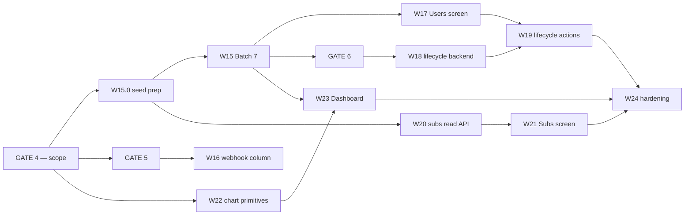

# Plan: RhemaPod Admin Portal — Phase 2 (Users & roles · Subscriptions · Dashboard)

Design source of truth: `docs/design_admin_portal/README.md` (+ the `.dc.html` references).
Backend source of truth: `app/api/*.py`, `app/services/*.py`, `app/models/models.py` — **read over the
design README where the two disagree.** They disagree in more places in Phase 2 than in Phase 1;
§A.7 is the register.

Predecessor: `plans/plan-admin-portal.md` (Phase 1 — architecture + W1–W14, shipped). Everything in
that document's §A (BFF session design, API client, data layer, design system, role-gating, config,
testing bar) **still holds unchanged** and is not restated here. Its `[HUMAN_GATE 3]` (standing
backend gate) and its Amendments A1–A4 remain in force.

Supersedes: `plans/plan-admin-portal-phase2-DRAFT.md`. That file was analysis, not a contract. Where
the two disagree, **this document wins**; the DRAFT is retained only as the working-out.

**Revision — 2026-09-10, pre-kickoff.** Commit `587071b` was reviewed by `reviewer-gilfoyle` before
W15 started (verdict: *request changes*; the full review is in `status.md`). This revision closes that
review plus two rulings from Isaac. It is a **pre-execution revision, not an amendment** — no work
item has run, so the contract is being corrected before it binds anything, and the Amendments section
below stays empty. What changed, in one place:

| Change | Where |
|---|---|
| **Ruling 1a** — an editor's Dashboard is greeting + WIP cards only; the analytics guard is **not** relaxed and Batch 7 stays at five items | decision 1a, §A.1, W23 |
| **Ruling** — decision 5 stands; the existing viewer-discovery tests are rewritten onto the DB fixture as part of W15, and the "can't promote a pre-existing viewer" consequence is named | §A.6, W15, §C, §E |
| Seed circularity broken — bulk seed rows move out of W24 into new **W15.0** | W15.0, W20, W24 |
| Batch 7 #2 pinned as a **full-table** `GROUP BY role` (viewer bucket real), unlike #1 | §A.6, Batch 7 table, W15 |
| new-listeners bucketing mandated **dialect-neutral**, boundaries computed in Python | §A.2, W15 |
| `docs/openapi.json` regen + ADR obligation restated on W16, W18, W20; W18's ADR named | W16, W18, W20 |
| **GATE 6 + W18 re-hung off W15**, parallel with W17; W19 joins both chains | W18, W19, Sequence |
| Past-due copy corrected to **`Past due`, no date** — `updated_at` is last-any-change | decision 4, §A.3, §A.8, W21, P3 |
| "Open in Stripe" **hidden** when `provider_customer_id` is null; W15.0 seeds it | §A.3, W21 |
| `weeks` hardcoded to 8, not a query param | Batch 7 table, W15 |
| P6 given a **numeric** trigger, an honest data source, and a corrected cost for the M2 swap | P6, §A.2, W23 |
| Nits: `FOR UPDATE` precedent cited; dead `ON DELETE SET NULL` branch recorded for GATE 5; W19 never-colour-only restated; critical-path phrasing corrected | §A.4, §A.5, W19, Sequence |

---

## Goal

Ship the three staff screens deferred in Phase 1 §C — **Users & roles**, **Subscriptions**,
**Dashboard** — at a scope where every number on screen traces to a fact the database already knows,
and no screen depends on data the system has never collected.

**Settings is not in Phase 2.** It moves to Phase 3 in full (resolved decision 3). The `/settings`
stub shipped in Phase 1 stays a stub.

## Definition of Done (Phase 2)

- [ ] A manager can list staff, filter by role, invite a new staff member (real email, real
      set-password completion), change a role inline, and deactivate/reactivate an account —
      end to end against the local Docker stack.
- [ ] The last active admin cannot be demoted or deactivated, by any actor including themselves,
      and the invariant holds under concurrent attempts on a real PostgreSQL connection.
- [ ] A manager can list paying members with tier, status and renewal date, filter the list, export
      the visible rows, and open a member in Stripe. **No screen in Phase 2 makes a mutating call to
      Stripe, and no route added in Phase 2 calls Stripe outbound at all.**
- [ ] The Dashboard renders **two role variants** (§A.1): a manager/admin sees greeting + four stat
      tiles + the 8-week new-listeners chart + top sermons + their WIP cards; an **editor sees the
      greeting and the WIP cards only** — no tiles, no chart, no top-sermons. **Every value on it is
      read from a backend field — nothing on the Dashboard is computed in the frontend, and no delta,
      percentage-change or period selector appears anywhere.**
- [ ] Exactly one Alembic migration lands in Phase 2 (`ProcessedWebhook.subscription_id`), it is
      additive, and `alembic downgrade` restores the prior schema cleanly.
- [ ] `npm run verify` is green; Playwright covers the Users lifecycle path; `axe` is clean on all
      three screens; role-gating is proved per screen for editor / manager / admin.
- [ ] `security-reviewer` has passed on the user-lifecycle backend (mandatory) and on the staff
      user-list scoping and the staff subscriptions read API.
- [ ] **No scope creep.** No Settings screen, no `app_settings` table, no plays rollup, no MRR, no
      dollar figure anywhere in the portal, no charting library.

## Constraints / Assumptions

- **Locked by Isaac, not relitigated here:** the twelve resolved decisions below. Reopening any of
  them is a plan amendment, not an executor's call.
- Phase 1 §A is unchanged. In particular: the BFF proxy is the only path from browser to API, both
  tokens stay in httpOnly cookies per Amendment A1, and `admin_portal/` remains host-run with
  `npm run dev` against the Docker stack.
- **Billing is USD-only.** No currency column, no locale formatting, no FX. Recorded so Phase 3
  inherits the assumption rather than discovering it (resolved decision 12).
- Week boundaries in the new-listeners series are **Monday-anchored ISO weeks in UTC**, and the eight
  boundary datetimes are **computed in Python, never in SQL** (§A.2). The portal has no timezone
  setting because Settings is Phase 3; a church-local week is a Phase 3 upgrade, not a Phase 2 gap.
- Phase 1 risk **D3** (single Next instance) is still an accepted constraint and Phase 2 does not
  relax it. See §D.

---

## Resolved decisions

Twelve questions were put to Isaac before this plan was finalised. All twelve are **settled**. The
plan body reflects them as decided facts, not as options.

| # | Decision | Resolution | Where it lives |
|---|---|---|---|
| 1 | Dashboard scope | **Reduced.** Four stat tiles (existing `overview()`), top-sermons (existing), "your work in progress" cards, and the weekly chart per decision 6. **No 30/90/Year period selector. No `sermon_play_daily` rollup.** | §A.1, W23 |
| 1a | Editor Dashboard | **Greeting + WIP cards only.** The three analytics endpoints keep `require_role(MANAGER, ADMIN)` — **no authz change, no sixth Batch 7 item, no ADR.** The screen branches on the server-resolved role, the same way the nav does. | §A.1, W23 |
| 2 | MRR tile | **Cut.** Subscriptions ships exact counts only: Active paid · Monthly · Annual. **No dollar figure anywhere in the portal.** | §A.3, W20 |
| 3 | Settings | **Cut entirely to Phase 3.** No `app_settings` table, no settings endpoint, no Settings screen. The Phase 1 `/settings` stub stays a stub. | §C, §E |
| 4 | Subscriptions posture | **Read-only, confirmed.** No outbound Stripe calls from the portal. "Open in Stripe" deep link off `provider_customer_id` is the escape hatch, **hidden when that column is null**. Past-due rows read **"Past due" with no date at all** — neither a retry date nor a since-date; `updated_at` is last-any-change, not went-past-due. | §A.3, W20, W21 |
| 5 | Staff list filtering | **Role filter only.** No `q` / email search in Phase 2. **Managers can never reach viewers** — the staff-management list is hard-scoped to staff roles for every actor. Consequence accepted on the record: **promoting a pre-existing viewer to staff is not a portal flow in Phase 2** (§C). | §A.6, W15, §C, §E |
| 6 | Dashboard chart | **"New listeners per week" from `PlaybackSession.first_played_at`** — exact, backfillable, no migration, no write-path change. Answers **reach, not engagement**; labelled "New listeners", never "Plays". | §A.2, W23 |
| 7 | Schema change | **One additive nullable `subscription_id` on `ProcessedWebhook`.** The only migration in Phase 2. Own gate. | §A.4, GATE 5, W16 |
| 8 | Invite-state pills | **Cut.** No "Invited · 41h left", no "Never signed in". No `invited_at`, no `last_login_at` column. The **Resend invite** action carries the affordance. | §A.6, W19 |
| 9 | Departed staff | **`is_active=false`, decided explicitly.** Attribution unchanged — a departed editor's name stays on their back-catalogue. **No `departed_at`, no reassign-authorship flow in Phase 2.** | §A.6, GATE 6, §E |
| 10 | Test harness | **No Testcontainers migration.** Decisions 3 and 6 remove all new-table work, so Phase 2 adds no DB concurrency surface SQLite cannot cover — **except the last-admin invariant race**, which gets one PG-gated test module and an explicitly stated harness limitation. | §A.5, W18 |
| 11 | Gates | **One scope gate on this narrowed plan** (GATE 4), plus the two downstream gates that guard genuinely irreversible things (GATE 5 migration, GATE 6 authz). Everything else flows on approval — see the note under GATE 3 Batch 7. | §B |
| 12 | Currency | **USD.** No currency column, no locale work. Moot in Phase 2 (decision 2 cuts MRR); recorded for Phase 3. | Constraints |

---

# A. Architecture decisions

## A.1 What the Dashboard is, now that it is reduced

The design drew a *time-series* dashboard against a *point-in-time* data model. Rather than build the
model to fit the drawing, Phase 2 builds the drawing to fit the model. What ships:

| Block | Source | New backend? | Editor sees it? |
|---|---|---|---|
| Greeting ("Good morning, {name}") | session | none | **yes** |
| "Your work in progress" — drafts | `GET /sermons?status=draft` **author-scoped** | Batch 7 #3 | **yes** |
| WIP — processing | in-flight uploads feed, scoped to the caller's sermons | Batch 7 #4 | **yes** |
| WIP — rejected | `GET /sermons?status=rejected` author-scoped, + the approval log per card | Batch 7 #3 | **yes** |
| Four stat tiles — total plays, completion rate, paid members, published sermons | `GET /admin/analytics/overview` → `OverviewStats` | none | **no** |
| Top sermons (ranked, with counts) | `GET /admin/analytics/top-sermons` | none | **no** |
| New listeners, last 8 weeks | `GET /admin/analytics/new-listeners` over `first_played_at` | Batch 7 #5 | **no** |

### The two Dashboard variants (resolved decision 1a)

All three `/admin/analytics/*` routes are guarded today by
`Depends(require_role(UserRole.MANAGER, UserRole.ADMIN))` (`app/api/analytics.py`, the
`ManagerOrAdmin` alias). `new-listeners` is added **under the same guard**. That guard is **not
changed in Phase 2** — no authz item, no `security-reviewer` adjudication, no ADR for it. The
Dashboard is built to the guard, not the guard relaxed to the design.

Therefore the screen has exactly two shapes, and the role decides which:

| Role | Dashboard |
|---|---|
| **editor** | Greeting + the three WIP cards. **Nothing else** — no stat tiles, no chart, no top-sermons, and no empty/locked placeholders where they would have been. |
| **manager / admin** | Greeting + the three WIP cards **and** the four stat tiles, the 8-week New listeners chart, and top sermons. |

**How the branch is made:** server-side, off the session role, exactly the pattern
`components/portal/nav-config.ts` already uses to keep the Community group out of an editor's markup
— `getServerUser()` in the Server Component, then the analytics blocks are simply not rendered and
their data never fetched. **No client-only guard, no flash, no request an editor's token would 403.**
This is a rendering branch, not a permission tier; `requireRole` is not called on `/dashboard`,
because every role may open it.

The design's editor-first framing survives intact: the WIP cards *are* the editor's dashboard, and
they were always the part of the screen an editor actually acts on.

**Deliberately absent, and this is the decision:** no tile deltas ("12.4%", "+38 this month"), no
"of 128 total" sub-line, no 30/90/Year period selector. Each of those needs a historical snapshot the
system has never taken. A delta rendered as `0` or `—` next to a real number reads as a real number;
absence reads as absence. **Tiles ship bare.**

**The WIP "rejected" card and its N+1.** The rejection note lives in `ApprovalLog`, readable per
sermon (Phase 1 GATE 3 #5 made it Editor-readable for their own sermon). The card fetches the log for
**at most 5** rejected sermons, in parallel, cached by React Query. That is 5 small proxied requests
on a screen everyone opens — which interacts with Phase 1 risk **D2** (the global rate limiter behind
the BFF). Rejected alternative: widening `SermonListItem` with a `latest_rejection_note` field, which
puts an approval-workflow detail on a general-purpose list DTO to save five requests. If D2 bites,
the fix is D2's fix, not a wider DTO.

**`overview()` remains eight uncached full-table aggregates per call** and Phase 2 puts it on the
landing screen — for managers and admins only, since decision 1a means an editor's Dashboard never
calls it. That narrows the blast radius but does not remove it. This is not fixed here — see risk
**P5**.

## A.2 The weekly metric — `first_played_at`, and exactly what it counts

`PlaybackSession.first_played_at` is set by `server_default=func.now()` on insert and **is not in the
`on_conflict_do_update` `set_` clause** in `analytics_service.record_progress` — verified at
`app/services/analytics_service.py`. It is therefore durable history: it says when a given user first
played a given sermon and is never overwritten by a later ping.

Consequences that matter:

- **The chart is non-empty on day one.** It is computed from rows that already exist, over the whole
  history of the table. There is no eight-week wait and no "collecting since {date}" state. This is
  the single biggest reason the rollup was cut.
- **It is exact, not a proxy.** Contrast `last_played_at`, which *is* overwritten and would
  systematically undercount older weeks — the failure mode this decision exists to avoid.
- **It answers reach, not engagement.** It cannot tell you how much anyone listened. Label it
  accordingly. "Plays" is a banned word on this chart.

**The definition, pinned:**

> **M1 — "New listeners" (shipped).** For each of the last 8 **Monday-anchored ISO weeks (UTC)**, the
> count of distinct `user_id` whose **earliest** `first_played_at` across all sermons falls in that
> week. People who listened to anything for the first time, that week.

The alternative, named so it is not re-derived at build time:

> **M2 — "First-time listens".** `COUNT(*)` of `PlaybackSession` rows whose `first_played_at` falls
> in the week — new user↔sermon pairings. A broader weekly-activity number.

M1 is what the ruled label literally means and is what ships. **If M1 proves near-flat and near-zero
on real data**, the switch to M2 lands as a plan **amendment**, not a gate — see **P6**, which
carries the objective trigger, the honest data source, and the real (not "one-line") cost of the
swap.

### Bucketing is computed in Python and the query is dialect-neutral — mandatory

`date_trunc('week', …)`, SQL `EXTRACT(isoyear …)`, `strftime`, and any other server-side week
function are **forbidden in this service**. They are the reason gilfoyle flagged this: the default
test suite runs SQLite and production runs PostgreSQL, so a Postgres-only bucketing expression means
the shipped code path is *never the tested code path*, and ISO year-boundary drift (week 1 of a year
that starts mid-December) would sail through green.

The mandated shape:

1. The **service** computes the eight week boundaries in Python — nine `datetime`s, UTC, each the
   Monday 00:00:00 that opens a bucket, derived with `date.isocalendar()` / `timedelta`, ordered
   oldest → newest. This is pure, has no DB, and is **unit-tested directly**, including a year
   boundary.
2. It issues **one** query, bucketed by those literals: either a single `SELECT` with a `CASE`
   over explicit `>= start AND < end` predicates on the derived earliest-`first_played_at` per user,
   or the equivalent conditional-aggregate form. **Half-open intervals throughout** — `>=` lower,
   `<` upper — so no row lands in two buckets and none is lost between them.
3. Weeks with no listeners come back as explicit **zero** buckets, not missing keys. The response is
   always exactly 8 entries, oldest first, each `{week_start: date, count: int}`.

The payoff is that W15's acceptance criterion ("the union of distinct users across the 8 buckets
equals a hand-run query") is **verifiable on the default SQLite suite**, against the same SQL that
runs in production. No second PG-gated module — §A.5's cap of one holds.

**Accuracy caveat to state on the screen or in the README, not to hide:** `PlaybackSession.user_id`
is a non-null FK. Only authenticated users are counted; anonymous playback does not exist in this
data model. "Listeners" means "registered accounts that played something".

## A.3 Subscriptions — read-only, and what "exact counts only" means

**Posture (resolved decision 4).** The staff screen answers *who is subscribed, on what, until when*.
Everything mutating — refunds, plan changes, forced cancellation, dunning intervention — happens in
the Stripe dashboard, which already owns the audit trail, the permissions model and the fraud
tooling. The portal grows **zero** new outbound Stripe surface. `PaymentProvider`
(`app/core/payments.py`) carries `cancel_at_period_end(...)`; Phase 2 does not call it.

**The three tiles, and why they are the only three:**

| Tile | Query | Why it is safe |
|---|---|---|
| Active paid | `subscription_service.count_active_paid_subscribers` — `tier IN (monthly, annual)` AND `status IN (active, cancelled)` | already the definition behind the analytics overview and the publish toast; one source of truth, not two |
| Monthly | `COUNT(*) WHERE tier = 'monthly'` within the same status set | `SubscriptionTier.MONTHLY` is a stored column |
| Annual | `COUNT(*) WHERE tier = 'annual'`, same | `SubscriptionTier.ANNUAL` is a stored column |

**Precision about "zero new surface" (resolved decision 2).** These three numbers need **no new
column and no write-path change** — every input already exists. They do still need a staff-facing
**read route**, because every route under `/subscriptions/*` today is self-service for the logged-in
member. W20 delivers that route. "Zero new surface" means zero new *stored* surface, not zero code.

**MRR is cut and stays cut.** No amount is stored on `Subscription`; `handle_webhook` never parses
one; config holds Stripe *price IDs*, not amounts. Every route to a revenue figure is either a price
map that drifts silently from Stripe, or a live Stripe lookup on an internal screen. **No dollar
figure appears anywhere in the Phase 2 portal** — not a tile, not a column, not a CSV field.

**Past-due honesty — corrected.** The plan as approved said a past-due row reads
"past due since {updated_at}". **That is wrong and is now struck.** `Subscription.updated_at` carries
`onupdate=func.now()`: it is *last time any field on this row changed*, not *when this subscription
went past due*. A repeated `payment_failed`, a `customer.subscription.updated` carrying an unrelated
change, or any future write to the row all bump it. Rendering it behind the word "since" would state
a fact the system does not hold — the exact failure this section exists to prevent, and the same
reason "retry Sep 9" was cut.

**A past-due row reads `Past due` and stops there.** No since-date, no retry date. Dunning state is
not stored, and the transition timestamp is not stored either. If Phase 3 wants the date, the honest
source is the `ProcessedWebhook` ledger — which is precisely what W16's `subscription_id` column
makes queryable (§A.4).

Accepted consequence, unchanged: the portal lags Stripe-side manual fixes until the next webhook
lands — a member fixed by hand in Stripe still reads past-due here for minutes. Say so in the
screen's subhead rather than pretending to be live.

**"Open in Stripe" and a null customer id.** `Subscription.provider_customer_id` is **nullable** — it
is null until the member actually pays, and `MockProvider` never populates it, so it is null for every
locally-seeded row unless the seed sets it deliberately. The rule: **when `provider_customer_id` is
null the action is hidden, not disabled.** A disabled control is a promise that something is
temporarily unavailable and invites a support question; there is no state in which that row will
acquire a Stripe customer without also acquiring one via webhook, at which point the action appears
on its own. W24's seed sets `provider_customer_id` on the seeded paid subscriptions so the link is
actually exercisable against the local stack.

**PII.** The list joins `Subscription` to `User` for name and email — a staff-readable enumeration of
the paying membership. It is paginated, manager+, and gets a mandatory `security-reviewer` pass at
W20. It is **not** a gate (resolved decision 11), because GATE 4 settles the posture that creates it.

## A.4 `ProcessedWebhook.subscription_id` — the only schema change

`ProcessedWebhook` is already an **append-only event ledger**: one row per provider event, with
`provider`, `event_id`, `event_type`, `created_at` and a `UniqueConstraint(provider, event_id)`. It is
written at exactly one place — the single `db.add(ProcessedWebhook(...))` in
`subscription_service.handle_webhook`, where the resolved `sub` is already in scope.

Adding a nullable `subscription_id` **turns that ledger from a dedup table into a queryable history**:
"which subscriptions became paid in month M", "which lapsed", "what is the churn curve" — all exact,
going forward, with no new table and no new write path.

- **Shape:** nullable FK to `subscriptions.id`, `ON DELETE SET NULL`. The FK gives referential
  integrity and index support; `SET NULL` keeps the ledger row when a subscription is deleted, which
  matters because the ledger's whole purpose is that rows never disappear. A bare nullable UUID with
  no FK is the alternative — cheaper, weaker. **Decide at GATE 5.**
  **Recorded for that gate:** the `SET NULL` branch is, today, **effectively dead**. Nothing in the
  codebase deletes a `Subscription` — cancellation is a `status` transition, and departed staff are
  `is_active=false` (decision 9), so no delete path exists for the cascade to fire on. The FK's real
  value is therefore narrower than it first reads: it buys *write-time* referential integrity (a
  typo'd id is rejected) and an index, not deletion semantics. That materially strengthens the bare-
  nullable-UUID option, which loses nothing that is currently reachable. **The pick still happens at
  GATE 5** — this is evidence for the decision, not the decision.
- **Write:** one line at the existing `db.add`, populated as `sub.id if sub is not None else None`.
  The column is nullable precisely because `_find_subscription` legitimately returns `None` for events
  that match no local subscription.
- **Read:** nothing reads it on the hot path. Nothing reads it in Phase 2 **at all**.

**State the honest cost at the gate:** this migration has **no Phase 2 user-visible payoff.** The
Dashboard ships without deltas (decision 1) and Subscriptions ships without "+X this month"
(decision 2), so nothing in this phase renders a value derived from this column. It is bought
entirely for Phase 3 optionality — and it is bought *now* because the history it captures only
accrues from the day it lands. That is a defensible trade and it is also exactly the kind of trade
that deserves an explicit yes rather than a silent one.

## A.5 The last-admin invariant, and what the test harness can actually prove

**The invariant:** `COUNT(*) FROM users WHERE role = 'admin' AND is_active = true` must never reach 0.

**Today it is unreachable only by accident.** `auth_service.change_role` blocks self-demotion, so the
last admin cannot demote themselves, and admin B demoting admin A still leaves B. **Adding a
deactivate endpoint makes zero-admin a two-click operation** with no recovery path short of
`app/scripts/create-admin`. The design copy already promises "The last admin can't be demoted" and
the code does not enforce it.

**The race is real.** `SELECT COUNT(*) …` followed by `UPDATE` in two concurrent transactions lets
both see 2 and both write, reaching 0. It must be enforced on **both** paths — `change_role` and the
new deactivate — since the two can race each other, not just themselves.

**Mechanism — and a correction.** A partial unique constraint (`UNIQUE … WHERE role='admin' AND
is_active`) **cannot express this invariant**: unique constraints bound cardinality from *above*, and
this is a minimum-cardinality rule. It would enforce "at most one admin", which is the opposite of
what is wanted. The viable mechanisms:

| | Mechanism | Tradeoff |
|---|---|---|
| **A** | `SELECT id FROM users WHERE role='admin' AND is_active FOR UPDATE` before the count, in-transaction, on both paths | Smallest — locks rows already being read, no new lock namespace. Lock set must include the target row (it does, on any path that could reach zero) |
| **B** | `pg_advisory_xact_lock(<fixed key>)` around both paths | Simplest to reason about, serializes all admin mutations globally. Introduces an advisory-lock namespace the codebase does not currently use |
| **C** | `SERIALIZABLE` isolation on those two transactions | Correct, but changes session config and requires serialization-failure retry handling on an auth path |

**Recommend A**, with B as the fallback if the lock set proves awkward in practice. Decide at GATE 6.

**Precedent to copy, not invent.** Option A is already house style: `content_service.transition`
(`app/services/content_service.py`, the `stmt.with_for_update()` at ~L641) takes the review-claim lock
exactly this way, and `content_service` L746–751 does the same for the concurrent-transition case.
Both carry the codebase's stated posture for this construct — **it bites under PostgreSQL and
degrades to a no-op under SQLite** — which is the same posture and the same harness limitation §A.5
is writing down here. W18 should follow those call sites' shape (lock inside the transaction, before
the count, on every path that can reach zero) rather than deriving a new one.

**What the SQLite harness can prove — stated so no acceptance criterion overreaches.** `FOR UPDATE`
is silently ignored by SQLite, and SQLite's single-writer model means the interleaving that produces
zero-admin **cannot be reproduced there at all**. The existing suite can therefore prove the
*sequential* invariant (the last admin is refused, on both paths, for every actor) and cannot prove
the *concurrent* one. Per resolved decision 10:

- The sequential invariant is a normal acceptance criterion in the default suite.
- The concurrency case is **one PG-gated test module** — Testcontainers PostgreSQL, `skip` with an
  explicit reason when Docker is unavailable. Two concurrent demote/deactivate transactions, assert
  one wins and one is refused.
- **Cap it at one module.** This is the thin end of the wedge toward the harness migration decision 10
  rejected. Naming the cap here is the point; a second PG-gated module is a plan amendment.

## A.6 Users & roles — what exists, what is added, what is cut

Much of this screen is already backed. `GET /users` returns `Page[UserPublic]`;
`POST /users` **creates a staff account and sends the invite email transactionally** (rolls back if
delivery fails) — Phase 1 §C's "invite sending is Phase 2" was stale, it shipped backend-side;
`PATCH /users/{id}/role` carries the `_may_assign` matrix, the self-demotion block and the
manager-cannot-touch-manager/admin rule.

**Added (Batch 7):** the list is hard-scoped to staff roles (editor / manager / admin) for **every**
actor, with a `role` filter narrowing within that set, plus a role-count aggregate for the tiles.

Note the reading of resolved decision 5 this encodes: **viewer enumeration is out of Phase 2 scope
outright, not a permission tier.** "Managers can never reach viewers" is implemented as "the
staff-management list never returns viewers", which is simpler than an actor-dependent scope and
removes the R4-class PII exposure for admins too. **Decision 5 stands as written** — no viewers, for
any actor, with or without a filter.

### The two Batch 7 items have different scopes, deliberately — pin this

They read like one change and are not. Getting this backwards makes the Viewers tile unbuildable
(gilfoyle's finding) or the list leaky.

| Batch 7 | What it is | Scope |
|---|---|---|
| **#1 — the list** (`GET /users`) | An **enumeration**: names, emails, ids, one row per person | **Staff-scoped.** `role IN (editor, manager, admin)`, unconditionally, for every actor. Viewers are never rows. |
| **#2 — the counts** | An **aggregate**: `SELECT role, COUNT(*) FROM users GROUP BY role`, returned as a map | **Full-table.** Every role bucket, `viewer` included, so the Viewers tile has a real number. |

**#2 is a full-table `GROUP BY role`, not a staff-scoped one.** This is not an inconsistency with
decision 5 — a count is not an enumeration. "There are 1,284 viewers" identifies nobody; a list of
1,284 email addresses identifies 1,284 people. The privacy property decision 5 protects is *reach to
an individual*, and the aggregate has none. Do not "fix" #2 to match #1's scoping.

Explicitly not sourced from elsewhere: `OverviewStats.total_users` counts everyone including staff,
and `unique_viewers` is distinct users in `playback_sessions` — a *listening* population, not the
`viewer` **role**. Neither answers the tile. #2 exists because nothing else does.

### The existing tests that discover a viewer via `GET /users` must be rewritten — part of W15

Hard-scoping the list breaks tests that are green today. They register a viewer, then locate its id by
calling `GET /api/v1/users` and filtering the page. Under W15 the viewer is no longer in that page, so
the lookup returns nothing and the test fails on a `None` id, not on the behaviour it is asserting.
**This is a known, in-scope cost of decision 5, not a regression to discover at review time.**

The named casualties, verified by gilfoyle:

- `tests/test_user_management.py` — `test_admin_changes_role`, the manager-path tests,
  `test_cannot_change_own_role`, `test_role_change_revokes_refresh`
- `tests/test_auth_hardening.py:284-295` — the Redis-503 rollback test, which **§A.6's whole
  Redis-down analysis leans on**. If it silently breaks, the GATE 6 trade loses its evidence.

**The rewrite, and its shape:** seed the viewer **through the DB fixture** and take the id from the
created object. The endpoint was only ever an id-discovery convenience; the fixture is more direct,
faster, and stops coupling role-management tests to a list endpoint's scoping rules — which is what
made them fragile here. **Do not** add a test-only escape hatch, a `?include_viewers` flag, or a
scoping exception for the test actor: that reintroduces the surface decision 5 removes.

**W15 is not done until those tests pass.** Not "are updated" — pass.

### The consequence, named rather than discovered

**Promoting a pre-existing viewer to staff is not a portal flow in Phase 2.** A viewer has no list
row, decision 5 rules out `q`/email search, and `POST /users` rejects a duplicate email — so there is
no in-portal path from "existing viewer account" to "editor". The Phase 2 answer is that `POST /users`
**invites fresh staff**, which is the actual observed need (decision 5 was ruled with this in view).
The break-glass path, unchanged, is `PATCH /users/{id}/role` with an id obtained out-of-band.

A narrow **admin-only `GET /users/by-email`** — exact match, single result, no listing, no prefix
search — is the obvious Phase 3 answer if this bites. It is recorded in §E. **It is not built now,**
and adding it is a plan amendment, not an executor's call.

**Added (W18, gated):** deactivate/reactivate, the last-admin invariant on both paths, resend-invite.

**Cut (resolved decision 8):** the "Invited · 41h left" and "Never signed in" pills. Invite state
lives only as a Redis single-use jti with a 48h TTL; surfacing it as a pill costs an `invited_at`
column for a status label. The **Resend invite** row action carries the affordance instead —
it is the thing a staff member actually does with that information.

**Departed staff (resolved decision 9):** `is_active=false`, and **attribution is deliberately
unchanged**. A departed editor's name stays on their back-catalogue; that is a truthful record of who
wrote what, not a leak. No `departed_at`, no reassign-authorship flow, no soft-delete semantics in
Phase 2.

### The Redis-down deactivation trade — a GATE 6 decision, not an implementation detail

`change_role` revokes refresh tokens **before** commit and therefore **503s on a Redis outage**, with
the role change rolled back (`app/services/auth_service.py`, and the comment there says so
deliberately). A deactivate endpoint that copies that pattern inherits the consequence:
**Redis down ⇒ you cannot deactivate a compromised account.** That is a bad property for the one
endpoint whose purpose is to stop someone.

A relevant fact, verified: `get_current_user` (`app/core/dependencies.py`) **re-reads the user row on
every single request** and rejects `is_active=False`. It also sources `role` from that row, not from
the JWT. Deactivation is therefore *self-enforcing on the next request* whether or not the refresh
token was revoked.

| | Option | Tradeoff |
|---|---|---|
| **A** | Copy `change_role` exactly — revoke before commit, 503 on Redis outage | Consistent with the existing auth path. Redis down = cannot lock out a compromised account |
| **B** | Commit `is_active=false` first, then attempt revoke; on revoke failure return success with a warning | Deactivation always succeeds. The un-revoked refresh token can still mint an access token — which `get_current_user` then rejects anyway, because the user row says inactive |
| **C** | B, plus a recorded "revocation pending" state swept when Redis returns | Correct and complete. A new sweep, new state, new failure mode, for a window measured in minutes |

**Recommend B**, on the grounds that availability of a lockout control matters more than symmetry
with `change_role`, and that the per-request `is_active` re-read makes the residual exposure
narrow. **`security-reviewer` adjudicates at GATE 6.** This is named here as a decision precisely so
it is not settled by whoever writes the endpoint.

## A.7 Charting — hand-rolled SVG, with a stated exit trigger

What is actually drawn: **one** 8-bar vertical bar chart with week labels, and a top-sermons ranked
list that is not a chart at all — it is a proportional-width bar the Phase 1 `Progress` primitive
already covers.

| | Option | Tradeoff |
|---|---|---|
| **A** | Recharts | ~100 kB+ gzipped with its d3 tail; you then spend the time overriding its defaults to hit the design's exact radii and tokens. Buys interaction nobody asked for |
| **B** | visx (`@visx/shape` + `@visx/scale`) | Modular, ~20–30 kB here, honest primitives. Still a dependency and still d3-scale, for a linear scale that is `v / max * h` |
| **C** | **Hand-rolled SVG `BarChart`, ~60 lines** | Zero dependency; design tokens applied directly so fidelity is exact by construction; **no GATE 1 dependency-list amendment** |
| **D** | CSS-grid bars, no SVG | Simplest, but the design's rounded bar caps and baseline treatment fight the box model |

**Decision: C.** Grounds, stated precisely: **bundle size, token fidelity, and not amending the
GATE 1 dependency list.** Note what is *not* a reason — "it stays an RSC". That argument dies the
moment any chart interactivity lands, and building a decision on it invites relitigating C the first
time someone wants a hover state.

**Exit trigger, so this is not re-argued per work item:** take visx (option B) the first time the
Dashboard needs **a second series or a non-linear axis**. Not a tooltip — a tooltip is a `<title>`
element or a positioned div and does not justify a dependency. Do not incrementally hand-roll toward
a charting library.

## A.8 Where the design and the backend disagree (Phase 2 register)

Phase 1 §A.9 logged five gaps. Phase 2's are wider, and most are resolved by cutting rather than
building. This table is the register; expect additions at build time — GATE 3 stays standing.

| Design shows | Reality | Resolution |
|---|---|---|
| Tile deltas — "12.4%", "3.1 pts", "+38 this month" | No historical snapshot exists anywhere | **Cut.** Tiles ship bare (§A.1) |
| 30 / 90 / Year period selector | `overview()` takes no params | **Cut** (decision 1) |
| "Plays per week, last 8 weeks" | `last_played_at` is overwritten; no event stream | **Replaced** by New listeners from `first_played_at` (§A.2) |
| "…of 128 total" under Published sermons | No `total_sermons` field on `OverviewStats` | **Cut.** Keeps the tiles at zero new response surface |
| MRR tile + "avg $6.79 / member" | No amount stored; webhook never parses one | **Cut** (decision 2) |
| "retry Sep 9" on past-due rows | Stripe-side dunning state, never stored | **Cut.** Row reads `Past due`, no date (§A.3) |
| A since-date on past-due rows | `updated_at` is `onupdate=func.now()` — last-any-change, not went-past-due | **Cut.** No date is truthful, so no date ships (§A.3) |
| Dashboard as an editor-first landing screen with tiles + chart | `/admin/analytics/*` is `require_role(MANAGER, ADMIN)`; not relaxed in Phase 2 | **Split.** Editor gets greeting + WIP cards; manager/admin get the full screen (decision 1a, §A.1) |
| "Open in Stripe" always present | `provider_customer_id` is nullable; null until first payment, and `MockProvider` never sets it | **Conditional.** Action hidden when null (§A.3, W21) |
| "Invited · 41h left" | No `invited_at`; invite state is a Redis jti | **Cut** (decision 8) |
| "The last admin can't be demoted" | Not enforced anywhere in `change_role` | **Built** — W18, gated (§A.5) |
| Row `···` menu on Subscriptions | Unspecified in the design | **Read-only** — "Open in Stripe" only (§A.3) |
| Settings: church profile, defaults, push, offline, key rotation | No settings store of any kind | **Cut to Phase 3** (decision 3) |
| `GET /sermons?created_by=me` | No such param | **Built** — Batch 7 #3 |

---

# B. Phase 2 work items

Ordered by dependency. Sequenced so **Users & roles lands first** — it retires Phase 1 risk **D9**
(staff accounts created by curl/seed script) and is the thing a church admin actually needs weekly.
The Dashboard, the most-drawn screen, goes last, because it is the least operationally necessary.

Numbering continues from Phase 1 (W1–W14). **Note for anyone holding the DRAFT:** the draft's W20
(user lifecycle backend) is **W18** here; the draft's W22 (subscriptions read API) is **W20**. The
draft's numbering is void.

---

## [HUMAN_GATE 4] — Phase 2 scope

**Position:** before W15. Nothing below starts until this clears.

This gate approves **this document** — the twelve resolved decisions, the three-screen scope, the
five-item Batch 7, and the cuts (Settings, MRR, period selector, tile deltas, invite pills, the plays
rollup). Isaac answered the scope questions in chat; this document is the record of those answers.

**Crossing this gate authorizes W15.0, W15, W17, W19–W24 to run to completion.** Execution halts only
at GATE 5 (the migration) and GATE 6 (the authz change).

## [HUMAN_GATE 3 — Batch 7] — standing backend gate

Phase 1's `[HUMAN_GATE 3]` is standing: any backend change halts and batches. Phase 2 surfaces five
additive changes, all enumerated below.

**GATE 4 discharges the go/no-go on all five** — they are named, scoped and approved in substance by
approving this document. What remains is the **implementation review**, which is a review, not a
halt: `reviewer-gilfoyle` on the batch, `security-reviewer` on item 1. Items 1 and 3 change public
API surface and get an ADR per Isaac's convention.

| # | Change | Class | Consumed by |
|---|---|---|---|
| 1 | `GET /users` hard-scoped to staff roles + `role` filter — **enumeration, staff-scoped, every actor** (§A.6). Includes rewriting the existing viewer-discovery tests onto the DB fixture | public API + authz-adjacent | W17 |
| 2 | Role-count aggregate for the tiles — **full-table `SELECT role, COUNT(*) … GROUP BY role`, `viewer` bucket included**, returned as a map. Deliberately *not* scoped like #1 (§A.6) | additive route | W17 |
| 3 | `GET /sermons` author-scoped filter (`created_by=me`) | public API | W23 |
| 4 | In-flight uploads feed, scoped to the caller's sermons | additive route | W23 |
| 5 | `GET /admin/analytics/new-listeners` — M1 weekly series, **8 weeks fixed, no query param**, Python-computed boundaries, one dialect-neutral query (§A.2). Guard unchanged: `require_role(MANAGER, ADMIN)` | additive route | W23 |

**Still five items.** Resolved decision 1a rules the editor Dashboard down to greeting + WIP cards, so
no sixth item lowering the analytics guard exists, and none is to be added.

Batch 7 lands as **one** review sitting even though items 3–5 are not consumed until W23. One review
is cheaper than three, and the items are independent of each other.

---

### W15.0 — Seed prep (do this first, inside W15)
**Delivers:** `app/scripts/seed_dev.py` extended with the two row families every downstream screen
reads and the seed does not currently create — **verified today: zero `playback_sessions`, zero
`Subscription` rows.**

- **`playback_sessions` spread over the last 8+ weeks**, with `first_played_at` values distributed
  across *every* one of the 8 ISO-week buckets and a tail beyond them (so the "last 8 weeks" window is
  a real window, not the whole table), across several distinct `user_id`s, with at least one week
  deliberately left at **zero** so the empty-bucket path is exercised.
- **`Subscription` rows** across all four statuses and both paid tiers, with
  **`provider_customer_id` populated on the paid rows** so W21's "Open in Stripe" is exercisable
  locally — `MockProvider` will not set it (§A.3).

**Why it is here and not in W24.** The plan as approved asserted "non-empty new-listeners against the
existing seed" at W15 and a non-empty Subscriptions list at W21, while the seed extension was a **W24**
deliverable and W24 depends on W19/W21/W23. That is a cycle: three work items' acceptance criteria
depended on data created by the item that depends on them. Moving the row creation to the front of
W15 breaks it. **W24 keeps only the lifecycle-state fixtures it uniquely needs** (deactivated users,
a past-due subscription for the Playwright and a11y paths) — see W24.

**Depends:** GATE 4.
**Acceptance:** a fresh `seed_dev.py` run against the local Docker stack produces a non-empty
`playback_sessions` table covering ≥8 ISO weeks, and `Subscription` rows in all four statuses across
both paid tiers with `provider_customer_id` set on the paid ones. **No migration, no model change** —
this is seed data only.

### W15 — Backend Batch 7
**Delivers:** the five items above, with tests; **the viewer-discovery test rewrite (§A.6)**;
regenerated `docs/openapi.json` (committed); ADRs for items 1 and 3. Any authz-rule or response-shape
change warrants an ADR in `docs/adr/`.
**Depends:** GATE 4, W15.0.
**Acceptance:**
- **List scoping (#1).** `GET /users` returns **no viewers, for any actor role, with or without a
  filter**; `role=editor` narrows within staff; `role=viewer` is either rejected or returns empty —
  pick one and test it, never a viewer page.
- **Existing tests rewritten and green (§A.6).** `tests/test_user_management.py`
  (`test_admin_changes_role`, the manager-path tests, `test_cannot_change_own_role`,
  `test_role_change_revokes_refresh`) and `tests/test_auth_hardening.py:284-295` (the Redis-503
  rollback test) **seed their viewer through the DB fixture** and take the id from the created object,
  not from `GET /api/v1/users`. **W15 is not done until those tests pass** — not merely until they are
  edited. No test-only escape hatch, no `?include_viewers`, no per-actor scoping exception.
- **Counts (#2).** The aggregate is a **full-table `GROUP BY role` including the `viewer` bucket**
  (§A.6), matches a hand-run `GROUP BY` on a seeded mix of all four roles, and is **not** staff-scoped.
  A test asserts the `viewer` count is non-zero when viewers exist — this is the criterion that stops
  someone "fixing" #2 to match #1.
- **New listeners (#5).** Returns **exactly 8 buckets, oldest first, zero-filled**, whose union of
  distinct users equals a hand-run query over `first_played_at`. The week boundaries are **computed in
  Python and unit-tested directly**, including an ISO year boundary; **no `date_trunc`, no SQL ISO-week
  function, no `strftime`** appears in the service. Predicates are half-open (`>= start AND < end`).
  **This criterion runs green on the default SQLite suite against the same SQL production runs** —
  that is the point of §A.2's mandate. `weeks` is **hardcoded to 8; no query parameter**. (If a param
  is ever genuinely wanted it is `ge=1, le=8, default=8` — but hardcoded is what ships, so the cut
  period selector has nothing to grow back from.)
- **Non-empty against the seed.** The series returns non-empty data **against W15.0's seed, with no
  backfill step** — the criterion the pre-revision plan could not meet.
- **Uploads feed (#4).** Returns only jobs on sermons the caller may see.
- **Spec.** The regenerated `docs/openapi.json` diff is additive only, is committed, and
  `npm run gen:api` produces no type breakage in the shipped portal.

**Review:** `reviewer-gilfoyle`; `security-reviewer` on item 1.

### W16 — `ProcessedWebhook.subscription_id` — **[HUMAN_GATE 5]**
**Delivers:** one additive Alembic migration (nullable FK, shape decided at the gate); the one-line
populate at the existing `db.add(ProcessedWebhook(...))` in `handle_webhook`. **Regenerate
`docs/openapi.json` (committed); an authz-rule or response-shape change warrants an ADR in
`docs/adr/`.** For W16 specifically the spec diff is expected to be **empty** — nothing reads the
column and no DTO changes (§A.4) — and a non-empty diff means something leaked into a response and
must be explained before merge. The migration itself carries an ADR only if GATE 5 picks a shape other
than the recommended one, or the gate discussion produces a rationale worth preserving.
**Depends:** GATE 4, GATE 5. Independent of every other item — can land any time after the gate.
**Acceptance:** `alembic upgrade head` then `downgrade` restores the prior schema exactly; a webhook
that resolves a subscription writes the id, one that does not writes `NULL`, both proved by test;
the existing webhook idempotency tests are unchanged and still pass; **no read path anywhere in the
codebase references the new column**.
**Review:** `reviewer-gilfoyle`.
**Gate rationale:** a schema migration. Additive and reviewable, but still a migration — and one
whose entire payoff is deferred to Phase 3 (§A.4). It deserves an explicit yes.

### W17 — Users & roles screen (read + invite + role change)
**Delivers:** staff list on the Phase 1 `DataTable`, role filter, role-count tiles, invite-staff
dialog, inline role change. **A thin read over existing endpoints plus W15** — no new frontend
primitives.
**Depends:** W15.
**Acceptance:** inviting a staff member sends a real invite and the recipient completes set-password
through the Phase 1 W4 flow, end to end; a manager attempting to change a manager's or admin's role
sees the backend's typed error as a field-level message, not a toast; **no viewer ever appears in
the list**; no invite-state pill appears anywhere (decision 8); `requireRole("manager")` holds —
Editors 404.
**Review:** design-fidelity pass. **This item retires Phase 1 risk D9.**

### W18 — User lifecycle backend — **[HUMAN_GATE 6]**
**Delivers:** `PATCH /users/{id}/active` (deactivate / reactivate); **the last-admin invariant on
both `change_role` and deactivate**, via the mechanism chosen at the gate (§A.5); a resend-invite
endpoint. **Regenerate `docs/openapi.json` (committed); an authz-rule or response-shape change
warrants an ADR in `docs/adr/`** — and this item is the clearest ADR case in Phase 2, so it is named
rather than left to judgement:

> **ADR — user deactivation and the last-admin invariant.** Records three things a future reader
> cannot recover from the diff: (a) the new `PATCH /users/{id}/active` authz rule and who may call it;
> (b) the last-admin minimum-cardinality invariant, the mechanism GATE 6 picked from §A.5's A/B/C,
> **and why a partial unique index cannot express it** (it bounds cardinality from above, not below —
> the trap the next person will otherwise re-derive); (c) the Redis-down deactivation trade GATE 6
> settled from §A.6's A/B/C, with `security-reviewer`'s adjudication. Also record the harness
> limitation: the invariant's *concurrent* case is provable only in the one PG-gated module (§A.5).

**Depends:** W15, GATE 6. **Not W17** — W18 is pure backend and has no technical dependency on the
frontend screen; it needs Batch 7's scoped list at most. It runs **parallel with W17**, exactly as
GATE 5 → W16 does.
**Acceptance:**
- The last active admin can be neither demoted nor deactivated, by any actor including themselves —
  proved in the default suite, sequentially, on **both** paths.
- **One PG-gated test module** (Testcontainers PostgreSQL, skipped with an explicit reason when
  Docker is unavailable) proves the concurrent case: two simultaneous demote/deactivate transactions
  leave exactly one admin standing. **The default SQLite suite structurally cannot prove this and no
  criterion here pretends otherwise** (§A.5, decision 10).
- Deactivation behaves per the gate's Redis decision (§A.6) — and whichever option is chosen, the
  behaviour on a Redis outage is covered by a test, not left to inference.
- **A deactivated user's live access token is rejected at the next request.** This is **already true
  in shipped code** — `get_current_user` re-reads the user and rejects `is_active=False` on every
  request. It is a **test to write, not behaviour to build**; do not implement anything for it.
- `app/scripts/create-admin` still works as the break-glass path, confirmed by running it.
**Review:** `security-reviewer` **mandatory** + `reviewer-gilfoyle`.
**Gate rationale:** authz change, lockout risk, session-revocation semantics. Two decisions must be
made *at* the gate and not by the implementer: the invariant mechanism (§A.5 A/B/C) and the
Redis-down deactivation trade (§A.6 A/B/C).
**GATE 6 position:** after W15, before W18 — **off the backend chain, not the screen chain.** It sat
mid-chain (`W17 → GATE 6 → W18`) in the approved plan, which coupled an authz decision to a frontend
item that does not constrain it and needlessly serialised the backend behind the screen.

### W19 — Users & roles lifecycle actions
**Delivers:** the row `···` menu — deactivate, reactivate, resend invite — with a confirmation
dialog on the destructive path; a visually distinct deactivated row state.
**Depends:** W17 **and** W18 — this is the join point where the two parallel chains meet.
**Acceptance:** the last-admin refusal renders as an explanatory inline message naming *why*, not a
generic error toast; a deactivated row's available actions are correct (reactivate, not deactivate);
resend-invite gives explicit success feedback, since it is the only remaining invite affordance
(decision 8); **the deactivated row state is never colour-only** — Phase 1's accessibility bar
(`plans/plan-admin-portal.md`, and the design README's "status is never color-only") applies here
unchanged, so "deactivated" carries **text** (a badge with a word in it), not merely a muted row, a
dot, or reduced opacity. A greyed row read through a monochrome or low-vision path must still say
what it is.
**Review:** design-fidelity pass.

### W20 — Staff subscriptions read API
**Delivers:** `GET /admin/subscriptions` — paginated, filterable by status and tier, joined to `User`
for name and email; the three aggregate counts (§A.3). Manager+. **Regenerate `docs/openapi.json`
(committed); an authz-rule or response-shape change warrants an ADR in `docs/adr/`** — W20 introduces
the portal's first staff-facing read over billing data, so the ADR records the manager+ rule, the
read-only posture (decision 4) and the deliberate absence of any amount field.
**Depends:** GATE 4, W15.0 (seed rows — the list has nothing to show without them). Independent of
W15's Batch 7 and of W16–W19.
**Acceptance:** **no route added in this item makes an outbound Stripe call** — asserted as a test,
not an intention; "Active paid" matches `count_active_paid_subscribers` exactly (one definition, not
a second one written for this screen); the list is paginated with a hard maximum page size; **no
amount, price or currency field exists in the response schema** (decision 2).
**Review:** `security-reviewer` (PII — staff-readable enumeration of paying members) +
`reviewer-gilfoyle`. Not a gate: GATE 4 settles the posture (decision 11).

### W21 — Subscriptions screen
**Delivers:** three stat tiles (Active paid · Monthly · Annual), filter bar (status, tier), the
member table, CSV export built client-side from the loaded rows, and an **"Open in Stripe"** row
action off `provider_customer_id`, **hidden when that column is null**.
**Depends:** W20.
**Acceptance:** **no mutating call exists anywhere in this screen** — no cancel, no refund, no plan
change, no retry; **a past-due row reads `Past due` and carries no date of any kind** — no retry date
and **no since-date**, because `updated_at` is last-any-change, not went-past-due (§A.3); the subhead
states the lag honestly (portal reflects the last webhook, not live Stripe); **"Open in Stripe" is
absent from the row menu when `provider_customer_id` is null and present when it is set** — hidden,
never rendered disabled — proved on both row states against W15.0's seed; CSV matches the visible
filtered set and contains no amount column; **no dollar sign appears anywhere on the screen**;
`requireRole("manager")` holds — Editors 404.
**Review:** design-fidelity pass.

### W22 — Chart primitives
**Delivers:** `components/charts/BarChart.tsx` — hand-rolled SVG, ~60 lines, design tokens applied
directly — and a `RankedBarList` composed from the Phase 1 `Progress` primitive. **No new
dependency.**
**Depends:** GATE 4. Parallel with everything.
**Acceptance:** matches the design's bar geometry, radii and week labels against the `.dc.html`;
degrades correctly at n=0, n=1 and an all-zero series (an empty state, not a collapsed axis); axis
labels stay readable at the narrowest supported width; `package.json` is unchanged.
**Review:** design-fidelity pass.

### W23 — Dashboard screen
**Delivers:** the Dashboard in **two role variants** (resolved decision 1a, §A.1), branched
server-side off the session role:

- **editor** — greeting + the three "your work in progress" cards (drafts / processing / rejected).
  **Nothing else.**
- **manager / admin** — all of the above **plus** the four stat tiles, the 8-week **New listeners**
  chart, and top sermons.

**No period selector. No deltas. No authz change** — `/admin/analytics/*` keeps
`require_role(MANAGER, ADMIN)` and the screen is built to that guard.

**Depends:** W15 (Batch 7 + W15.0's seed), W22.
**Acceptance:** — stated per variant so nothing is inferred.

*Both variants:*
- Every value traces to a backend response field — **no statistic is computed in the frontend**.
- No tile shows a delta, a percentage change or an "of N total" sub-line.
- The WIP rejected card fetches at most 5 approval logs.
- The role branch is **server-resolved** — the same `getServerUser()` pattern
  `components/portal/nav-config.ts` uses for the nav. No client-only guard, **no flash of
  manager content**, and `requireRole` is **not** called on `/dashboard` (every role may open it).

*Editor variant — proved explicitly, with an editor session:*
- The four stat tiles, the New listeners chart and top sermons are **absent from the rendered
  markup** — not hidden with CSS, not rendered as empty/locked/blurred placeholders, not present as a
  "you don't have access" panel. Absent.
- **The page issues no request to `/admin/analytics/overview`, `/top-sermons` or `/new-listeners`.**
  There is no 403 in the network log, because there is no call. This is the criterion that catches a
  fetch left at the top of the Server Component above the branch.
- The greeting and all three WIP cards render, author-scoped to that editor.

*Manager / admin variant:*
- The chart is **non-empty against W15.0's seed with no backfill step** (§A.2), renders exactly 8
  zero-filled buckets oldest-first, and is labelled **"New listeners"** — the word "plays" appears
  nowhere on or around it.
- The four tiles and top sermons render from `overview()` / `top-sermons` unchanged.

**Chart-metric check before sign-off:** evaluate M1 against the **P6 trigger** (a number, not a
judgement call) and record the outcome in `status.md` either way. Note P6's caveat — W15.0's seed is
synthetic and says nothing about the real congregation, so a *ship M2* decision needs the prod-DB
snapshot P6 describes, not the seed.
**Review:** design-fidelity + `reviewer-gilfoyle`.

### W24 — Phase 2 hardening
**Delivers:** a11y sweep across the three screens at the Phase 1 W14 bar; Playwright coverage of the
Users lifecycle path (invite → set password → sign in → change role → deactivate → last-admin
refusal); **the remaining seed work — lifecycle-state fixtures only.**

**What moved out of W24.** The bulk `playback_sessions` and `Subscription` row seeding is **W15.0**,
not here — it had to move to break the cycle where W15/W21/W23 acceptance depended on data W24
created (see W15.0). W24 now adds only the **lifecycle states** its own tests uniquely need and that
no earlier screen requires: **a deactivated staff user** (for W19's row state and the Playwright
reactivate path), **a second admin** (so the last-admin refusal has something to refuse against
without bricking the seeded environment), and **a past-due subscription** if W15.0's status spread
did not already cover the row W21's a11y pass needs. Everything else is already seeded.

**Depends:** W19, W21, W23.
**Acceptance:** `axe` clean on all three screens; **the seed produces a non-empty Dashboard and a
non-empty Subscriptions list — verified as still true after W24's additions, not established by
them**; the lifecycle fixtures above exist and the Playwright lifecycle path runs green against them
end to end; role-gating proved per screen for editor / manager / admin, **including the editor
Dashboard variant** (greeting + WIP cards, no analytics blocks, no analytics requests); the DoD
checklist above is fully ticked.

## Sequence

**What changed from the approved graph** (both changes are dependency corrections, not scope changes):

- **`W15.0` is new** and sits at the front, feeding W15 and W20. It carries the bulk seed rows that
  were a W24 deliverable — the cycle where W15/W21/W23 acceptance criteria depended on data created by
  the item that depends on all three.
- **GATE 6 + W18 moved off the screen chain.** Was `W17 → GATE 6 → W18`; is now `W15 → GATE 6 → W18`,
  running **parallel with W17**, mirroring `GATE 5 → W16`. W18 is pure backend and never needed the
  screen. **W19 now joins both chains** (`W17 + W18 → W19`), which is where the dependency actually
  was.

**No item waits on wall-clock data accrual.** That is the payoff of resolved decisions 1 and 6: with
the rollup cut and the chart sourced from `first_played_at`, nothing in Phase 2 must land early for
history to build up behind it, and W16 in particular is unblocked and unblocking the moment GATE 5
clears.

**That is not the same as "no critical path", and the earlier phrasing invited that misreading.**
There is a genuine serial chain — **W15.0 → W15 → W17 → W19 → W24** (with GATE 4 in front of it),
five items and a gate deep, and it is the longest path through the phase. GATE 6 → W18 now runs
alongside it instead of inside it, which shortens the chain by one item but does not remove it.
Sequencing relief comes from the parallel branches (W16, W20 → W21, W22), not from the screen chain.

---

# C. Non-goals for Phase 2

- **Settings, in full** — no `app_settings` table, no settings endpoint, no Settings screen. The
  Phase 1 `/settings` stub stays exactly as it is (decision 3).
- **Any mutating Stripe operation from the portal** — refunds, plan changes, forced cancellation,
  dunning intervention, retry triggering (decision 4).
- **Any dollar figure** — MRR, ARPU, revenue, lifetime value, an amount column in the CSV
  (decision 2).
- **Tile deltas, percentage changes, and the 30/90/Year period selector** (decision 1).
- **The `sermon_play_daily` rollup** and any change to the `record_progress` write path (decision 1).
- **Engagement analytics.** The chart answers reach. Retention, cohorts, funnels, per-series
  performance: not Phase 2.
- **`invited_at` / `last_login_at` columns and the invite-state pills** (decision 8).
- **Departed-staff semantics** — `departed_at`, soft-delete, reassign-authorship, attribution
  rewriting (decision 9).
- **Viewer enumeration** anywhere in the portal. Aggregate counts only — and note the counts
  aggregate *is* full-table including the `viewer` bucket, which is not a violation of this
  (decision 5, §A.6).
- **`q` / email search on the staff list** (decision 5).
- **Promoting a pre-existing viewer to staff.** Not a portal flow in Phase 2; `POST /users` invites
  fresh staff. A narrow admin-only `GET /users/by-email` is a Phase 3 maybe (§E) and is **not** built
  now.
- **Lowering the guard on `/admin/analytics/*`.** It stays `require_role(MANAGER, ADMIN)`; the editor
  Dashboard is scoped to fit it (decision 1a, §A.1).
- **A date on past-due rows** — neither a retry date nor a since-date (decision 4, §A.3).
- **A charting library**, with the exit trigger stated in §A.7.
- **A Testcontainers migration for the frontend-facing suite.** One PG-gated module, capped
  (decision 10, §A.5).
- **Cross-entity global search.** `/search` + `/search/suggest` exist backend-side; the screen does
  not, and it is not a Phase 2 tail.
- **Push notifications, offline downloads, API-key rotation from the UI** — no infrastructure, no
  mobile app, and the last is a Secrets Manager operation, not an app button.
- **A runtime-toggleable "require manager approval".** It reads like a settings row and behaves like
  an authz invariant; making it a checkbox is a privilege-escalation switch in a form.
- **Dark mode.** Still no palette.
- **Real-time.** Polling only.
- **Audit-log UI** beyond the existing approval timeline.
- Containerizing the portal, a deploy target, CI wiring — unchanged from Phase 1 §C.

---

# D. Risks

Phase 1 risks that remain live in Phase 2 keep their **D** numbers. New Phase 2 risks are **P**.

**D2 — The global rate limiter will 429 real staff behind the BFF. (High / Medium)**
Unchanged from Phase 1, and Phase 2 makes it worse in one specific way: the Dashboard is the landing
screen everyone opens, and its WIP rejected card fans out up to 5 extra proxied requests per load
(§A.1). Every request still arrives from the Next server's single IP against 300/60s.
*Mitigation:* Phase 1 GATE 3 #1 stands — raise the dev limit, `X-Forwarded-For` trust before any
deploy. **The WIP card's fan-out is not a reason to widen a list DTO;** it is a reason to close D2.

**D3 — Refresh-rotation races log users out mid-session. (Medium / High)**
Unchanged and **not relaxed by Phase 2**. Preemptive refresh plus per-process dedupe covers the
single-instance case and nothing beyond it. Phase 2 adds three more screens' worth of parallel
requests to the same single Next process, which raises the frequency of the near-miss without
changing the boundary. *Mitigation:* single instance remains an accepted constraint (Phase 1 resolved
decision 7); **the trigger for reopening Phase 1 GATE 3 #9 is still a multi-instance deployment, and
it must be checked before a topology change, not after users start getting logged out.**

**D5 — Design fidelity drift. (Medium / Low-per-instance, High cumulative)**
Unchanged, and Phase 2 introduces the first bespoke SVG geometry in the codebase (§A.7) — bar radii,
cap treatment and baseline are hand-written and have no primitive to drift *from*.
*Mitigation:* the `/kit` route stays the standing reference; W22 gets its own fidelity pass before
W23 composes it; tokens named verbatim so drift stays greppable.

**P1 — Last-admin lockout becomes reachable the moment W18 ships. (Medium / High)**
Today zero-admin is unreachable only by accident. A deactivate endpoint without the invariant makes
it a two-click operation with no recovery short of `app/scripts/create-admin`. The race makes the
naive `COUNT`-then-`UPDATE` implementation insufficient even *with* the check.
*Mitigation:* §A.5 — the mechanism is decided at GATE 6, enforced on **both** paths, `security-reviewer`
mandatory, break-glass confirmed by running it, and the concurrency proof is a PG-gated test with its
harness limitation stated rather than papered over.

**P2 — Redis outage blocks deactivating a compromised account. (Low / High)**
Copying `change_role`'s revoke-before-commit ordering means a Redis outage 503s the one endpoint whose
purpose is to stop someone. *Mitigation:* §A.6 names it as an explicit GATE 6 decision with three
options and a recommendation, adjudicated by `security-reviewer`, and whichever option is chosen gets
a Redis-outage test. **It is a decision, not an implementation detail** — that is the mitigation.

**P3 — The portal shows stale billing state. (Medium / Medium — accepted)**
Read-only Subscriptions means the portal reflects the last webhook, not Stripe. A member fixed by
hand in Stripe reads past-due here until the next event lands; a past-due row carries no retry date
because dunning state is not stored. *Mitigation:* accepted, and made honest rather than hidden —
W21's subhead states the lag and the row copy says **`Past due` with no date at all** rather than
inventing a schedule — or, as the approved plan wrongly proposed, dressing `updated_at`
(last-any-change) as a since-date. The alternative (an operational portal) is the far larger risk.

**P4 — PII: a staff-readable enumeration of the paying membership. (Medium / Medium)**
`GET /admin/subscriptions` joins to `User` for name and email. *Mitigation:* manager+, paginated with
a hard maximum page size, mandatory `security-reviewer` at W20. Separately, the staff-management list
is hard-scoped to staff roles for every actor (§A.6), which removes the larger Phase 1-era exposure
of enumerating every viewer's email.

**P5 — `overview()` is eight uncached full-table aggregates, now on the landing screen. (Low now /
Medium rising)**
Phase 2 puts it on the landing screen, several of whom will leave it open. Decision 1a narrows the
caller set — an editor's Dashboard never calls it — so the load is manager/admin sessions only, which
is a smaller population but the one most likely to keep the tab open all day. With the rollup cut
(decision 1), nothing absorbs the play-related aggregates. *Mitigation:* **not fixed in
Phase 2** — stated so it is a known boundary rather than a surprise. The cheap fix when it bites is a
short Redis TTL on `overview()`, not a rollup. Note the replica fallback: if the read replica is
unconfigured, all of this lands on the primary.

**P6 — The new-listeners chart may be a flat line near zero. (Medium / Low)**
M1 counts first-ever listeners per week; an established congregation with few new arrivals produces a
boring, uninformative chart. *Mitigation:* §A.2 pre-names M2 as the swap, and it lands as an
**amendment**, not a gate. Two corrections to how the approved plan stated this:

- **The trigger is a number, not a judgement.** "Near-flat and near-zero" is not something a W23
  executor can decide against. The trigger: **if 6 of the 8 weekly buckets are ≤ 2, ship M2 instead.**
  Record the eight numbers in `status.md` alongside the decision either way, so the call is auditable
  and so a later reader can see how close it was.
- **The swap is not "a one-line query change".** That was wrong. M1 is `MIN(first_played_at) GROUP BY
  user_id`, then bucket the per-user minima — an aggregate over an aggregate. M2 is a flat
  `COUNT(*) GROUP BY week` over raw rows. Different shape, not a different literal. On top of the
  query rewrite the label ripples: the chart title, the §A.2 pinned definition, the "plays is a banned
  word" rule (M2 counts user↔sermon pairings, which is *nearer* to plays and needs its own careful
  label), the Phase 2 DoD line, the a11y text and table fallback, and the portal README. Budget it as
  a small work item with a documentation tail, not an edit.

**The honest evaluation is a production-DB snapshot, not W15.0's seed.** W15.0 seeds data engineered
to fill all 8 buckets, so it will *always* produce a healthy-looking chart and can never fire the
trigger. Running the trigger against it is theatre. The real check is the same query against a
snapshot of production `playback_sessions`; if that is not available at W23, ship M1 and record the
check as **outstanding**, with the trigger to be re-run once real data exists — do not silently mark
it passed.

**P7 — A migration with no Phase 2 payoff. (Low / Low)**
`ProcessedWebhook.subscription_id` renders nothing in Phase 2; it is bought entirely for Phase 3
(§A.4). *Mitigation:* stated plainly in the GATE 5 rationale so the trade is approved knowingly. It
lands now only because the history it captures accrues from the day it ships.

**P8 — Design/reality divergence is wider in Phase 2 than Phase 1. (Medium / Low)**
Eleven divergences are already logged (§A.8) against Phase 1's five; the design was drawn against an
imagined contract. Most are resolved by cutting. *Mitigation:* §A.8 is the register; GATE 3 stays
standing so a new one is a routine halt-and-batch, not a plan rewrite. **Expect more at build time.**

---

# E. What Phase 3 becomes

Not a plan. A record of what Phase 2 deliberately pushed forward, so Phase 3 starts from a list
rather than from archaeology.

1. **The mobile viewer app.** The actual product; everything so far is tooling around it. It is also
   what makes several deferred items real rather than speculative.
2. **Settings** (decision 3), in the shape the mobile app's needs define — church profile, publishing
   defaults, and the app-facing values a mobile client actually reads. Deferring it past the app is
   the point: a settings store designed before its main consumer exists is a guess. When it lands:
   a single-row typed table, not a KV/JSONB blob, so every new setting stays inside migration review
   and Pydantic validation.
3. **The plays rollup** (`sermon_play_daily`), if and only if engagement questions arrive that
   `first_played_at` genuinely cannot answer. It is a hot-path write change and should be earned.
   Note it still cannot backfill — the same fact that made it a bad Phase 2 bet makes it a *timed*
   Phase 3 bet.
4. **MRR and revenue reporting** (decision 2), which requires first persisting `amount_cents` from
   the webhook payload — the payload already carries it. `ProcessedWebhook.subscription_id` (W16) is
   the other half of this: churn curves and "became paid" history come from the ledger.
5. **Departed-staff semantics** (decision 9) — `departed_at`, reassign-authorship, and a decision
   about what a departed editor's back-catalogue attribution *should* say. Phase 2 chose "unchanged"
   deliberately; revisit with real churn, not hypothetically.
6. **Operational Subscriptions** (decision 4), if and only if running the church's billing through
   the Stripe dashboard proves genuinely painful. Evidence first.
7. **Cross-entity global search** as a first-class screen. The backend exists.
7a. **A narrow admin-only `GET /users/by-email`** — exact match, single result, no listing, no prefix
   search, no wildcard — as the answer to the consequence decision 5 accepts: a pre-existing viewer
   cannot be promoted through the portal (§A.6, §C). Build it **only if that actually bites**; it is a
   deliberate re-opening of a surface Phase 2 closed, so it wants an authz ADR and a
   `security-reviewer` pass, and it must not drift into the `q` search decision 5 cut.
8. **Deeper analytics** — retention, cohorts, per-series performance.
9. **Audit-log UI** across roles and settings. W18 starts generating the events.
10. **CI + a deploy target.** Phase 1 risk **D8** has been accruing since the repo became a monorepo,
    and it is now the oldest unaddressed item in the portfolio.

---

# Amendments

Post-approval amendments. Each is a recorded, deliberate deviation from the approved plan body above;
the plan body is otherwise still the contract.

*(None yet.)*
