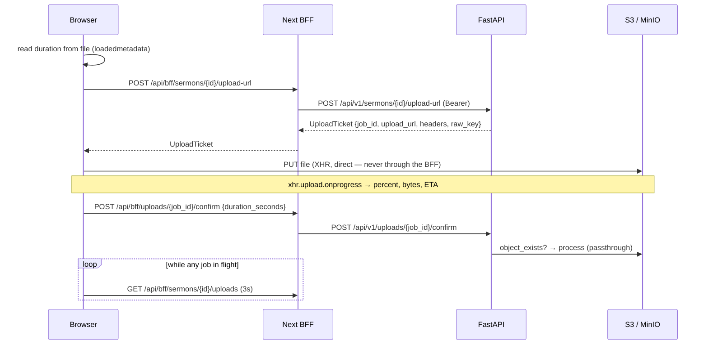

# Plan: RhemaPod Admin Portal (frontend) — architecture + Phase 1 build

Design source of truth: `docs/design_admin_portal/README.md` (+ the two `.dc.html` references).
Backend source of truth: `app/api/*.py`, `app/models/content_schemas.py`, `main.py` — **read over
the design README where the two disagree.** They disagree in several places; §A.9 lists them.

This plan carries both the architecture decisions and the phased work-item breakdown for **Phase 1**.

---

## Goal

Stand up `admin_portal/` — a Next.js App Router portal that lets church staff draft, upload,
review and publish sermons against the existing FastAPI service, at the design's stated fidelity,
with the session boundary owned by a Next BFF rather than by browser-held tokens.

## Definition of Done (Phase 1)

- [ ] `admin_portal/` exists as a sibling top-level dir in this repo, in the same git history, and
      root-level Python tooling (ruff, pytest, mypy, Docker build context) ignores it entirely.
- [ ] A staff member can: accept an invite → set a password → sign in → see a role-correct shell →
      list/filter/paginate sermons → create and autosave a sermon → upload media and watch it reach
      `ready` → submit for review → (as manager) approve & publish. End to end, against the local
      Docker stack.
- [ ] **No auth token is readable by browser JavaScript.** Access and refresh both live in httpOnly
      cookies; the browser never holds a bearer token and never calls FastAPI directly.
- [ ] Every screen in Phase 1 scope matches its `.dc.html` reference on colour, type, spacing, radii
      and copy, verified by a human side-by-side pass. Status is never colour-only.
- [ ] `npm run verify` (typecheck + lint + build + unit tests) is green, and the Playwright happy
      path passes against the Docker stack with a seeded DB.
- [ ] Every backend change this plan requires has been approved at the standing backend gate,
      landed with a regression test, and — where it changes a public response shape or an authz
      rule — logged as an ADR.
- [ ] `reviewer-gilfoyle` has passed on W6 (DataTable), W9 (upload pipeline) and the BFF in W4;
      `security-reviewer` has passed on W4 and on the backend batch.
- [ ] **No scope creep.** Phase 2 screens (§C) are not started. No mobile app. No CI wiring.

## Constraints / Assumptions

- Locked by Isaac, not relitigated here: location (`admin_portal/`, monorepo-lite), fresh
  Next.js + TS + Tailwind + shadcn/ui (the two Vite starts in `~/Downloads/Project/{react_sermon_admin,
  rhema-admin}` are discarded and must not be referenced or imported), Phase 1 screen list,
  BFF-proxy auth with httpOnly cookies.
- Auth review findings #2 (replayable reset/invite tokens) and #3 (forgot-password logs a token)
  are **closed** — commit `9e8d366`. The design README still lists them as "fix before launch";
  it is stale on that point. Do not re-raise.
- Backend routes are all under `/api/v1`. Error envelope is `{detail, correlation_id}`, with
  `{detail: "Validation failed", errors: [{field, message, type}], correlation_id}` on 422.
- Local stack: `docker compose up` → `http://127.0.0.1:8000`, `DEBUG=true`, admin
  `admin@rhemapod.com`. Storage is the `LocalStorage` stub, payments are `MockProvider`,
  email is the console backend. Transcoding is passthrough (`transcode_enabled=false`).
- Toolchain on this machine: Node 24.19, npm 11.17, **no pnpm**. **npm is the package manager**
  (resolved decision 8) — `package-lock.json` is the committed lockfile.
- `frontend_base_url` defaults to `http://localhost:3000` and the backend hard-codes the invite /
  reset link as `{frontend_base_url}/set-password?token=…` (`app/core/email.py:66-68`). The portal
  **must** serve `/set-password`. This is not a naming choice.

---

## Resolved decisions

Eight open decisions were put to Isaac before this plan was finalised. All eight are **settled** and
recorded here. The plan body below reflects them as decided facts, not as options. Reopening any of
them is a plan amendment, not an executor's call.

| # | Decision | Resolution | Where it lives |
|---|---|---|---|
| 1 | API client approach | **`openapi-typescript` (types, committed) + `openapi-fetch`, hooks hand-written.** Full codegen (orval) rejected. | §A.3, W3 |
| 2 | Frontend testing bar | **Proposal accepted as written**: floor of `tsc --noEmit` + ESLint + `next build` + Vitest on every work item; component/hook tests with **MSW, not mocked fetch**; **one** Playwright happy path against the Docker stack; **no** screenshot/visual-regression testing. | §A.11, W14 |
| 3 | Dev data: seed vs manual | **Seed.** `app/scripts/seed_dev.py`, production-guarded. Doubles as the Playwright fixture. | §A.8, GATE 3 #8 |
| 4 | MinIO in compose | **Yes.** Added to `docker-compose.yml`; dev points at it via the existing `s3_endpoint_url` / `s3_access_key_id` settings. **ADR 0001 §4 gets a `scribe` amendment recording the frontend rationale** (the browser-direct presigned PUT cannot be exercised against the `LocalStorage` stub). | §A.5, GATE 3 #3, W9 |
| 5 | Tailwind v3 vs v4 | **v4** — `@theme` CSS tokens, no JS config. | §A.6, W1 |
| 6 | Logout revokes every device | **UI copy only** — "Signed out of all devices". **No backend change.** | §A.2 |
| 7 | Refresh-rotation concurrency | **Single Next instance accepted as a stated Phase 1 constraint.** Preemptive refresh + per-process in-flight dedupe is the shipped strategy. The backend reuse-grace window (GATE 3 #9) stays on the shelf as a contingency and is **not** part of the Phase 1 backend batch. | §A.2, GATE 2, D3 |
| 8 | Package manager | **npm** (pnpm is not installed on this machine). | §A.8, W1 |

---

# A. Architecture decisions

## A.1 Directory layout

```
admin_portal/
├─ app/
│  ├─ layout.tsx                      root: fonts, <html lang>, providers
│  ├─ globals.css                     @theme token layer (§A.6)
│  ├─ (public)/
│  │  ├─ login/page.tsx
│  │  ├─ set-password/page.tsx        ← path fixed by the backend's email link
│  │  └─ forgot-password/page.tsx
│  ├─ (portal)/
│  │  ├─ layout.tsx                   RSC: bootstraps /auth/me → SessionProvider + shell
│  │  ├─ sermons/page.tsx
│  │  ├─ sermons/[id]/page.tsx
│  │  ├─ review/page.tsx              manager+
│  │  ├─ series/page.tsx
│  │  ├─ people/page.tsx              speakers & categories
│  │  └─ announcements/page.tsx
│  └─ api/
│     ├─ auth/{login,logout,refresh,forgot-password,set-password}/route.ts
│     └─ bff/[...path]/route.ts       generic authenticated pass-through
├─ components/
│  ├─ ui/                             restyled shadcn primitives (Button, Input, …)
│  ├─ portal/                         StatusBadge, DataTable, MediaPlaceholder, Sidebar, …
│  └─ <feature>/                      sermons/, review/, series/, announcements/, people/
├─ lib/
│  ├─ api/       schema.d.ts (generated, committed) · client.ts · errors.ts
│  ├─ auth/      cookies.ts · session.ts · exchange.ts
│  ├─ query/     client.ts · keys.ts · hooks per feature
│  ├─ upload/    uploader.ts (XHR) · provider.tsx · state machine
│  └─ format/    duration, bytes, relative time
├─ tests/        unit (Vitest) · e2e (Playwright)
└─ .env.local.example
```

**Rationale.** Route groups keep the two chrome contexts (`(public)` = no shell, `(portal)` = shell)
separate without leaking into the URL. `lib/` is layered the same way the backend is —
`api` (transport) → `query` (server-state) → feature hooks → components — so the dependency rule is
inspectable. `components/ui` is shadcn-owned and regenerable; `components/portal` is ours.

**Repo hygiene, non-optional:** `admin_portal/` must be excluded from `pyproject.toml`'s ruff/pytest
paths and added to `.dockerignore`, and `admin_portal/{node_modules,.next,.env.local}` added to
`.gitignore`. A stray `node_modules` in the Docker build context will balloon image builds; a stray
`app/` directory name collision (Next's `app/` vs the backend's `app/`) is harmless across dirs but
will confuse a careless glob.

## A.2 The BFF proxy

### Route families

| Route | Runs | Does |
|---|---|---|
| `POST /api/auth/login` | Node | Credentials → `POST /api/v1/auth/login` → set both cookies |
| `POST /api/auth/refresh` | Node | Rotate the pair, reset cookies |
| `POST /api/auth/logout` | Node | Revoke server-side, then clear cookies |
| `POST /api/auth/set-password` | Node | Token + new password → `POST /api/v1/auth/reset-password` |
| `POST /api/auth/forgot-password` | Node | Straight pass-through, always generic response |
| `ALL /api/bff/[...path]` | Node | Authenticated pass-through to `/api/v1/<path>` |

Nothing else. Every data call the browser makes goes through `/api/bff/…`; there is exactly one
place that attaches an `Authorization` header.

### Token storage — **both tokens in httpOnly cookies**

| Cookie | Contents | Attributes |
|---|---|---|
| `rp_at` | access JWT (15 min) | `HttpOnly; SameSite=Lax; Path=/api; Secure` (prod only); `Max-Age` = token TTL |
| `rp_rt` | refresh JWT (30 d) | `HttpOnly; SameSite=Strict; Path=/api/auth; Secure` (prod only); `Max-Age` = 30 d |

**Why both, not "refresh in a cookie + access in memory".** The locked decision is that the browser
talks only to Next, same-origin. Given that, there is no consumer for a browser-held access token —
holding one only adds an XSS exfiltration target and a hydration problem. Keeping both server-side
means an XSS on the portal can *act as* the user (unavoidable) but cannot *steal a token* and act as
the user later, from elsewhere, after the tab closes. That is a meaningful difference.

`rp_rt` is scoped to `Path=/api/auth` so the long-lived credential is not attached to the hundreds of
proxied data requests. `rp_at` is scoped to `Path=/api` so it is not sent on page/asset navigations.

**No Next-side cookie signing secret.** The cookie value is a backend-signed JWT and is httpOnly;
wrapping it in a second signature buys nothing and adds a secret to manage. This is a decision, not
an omission — call it out in review so nobody "fixes" it later.

### Session bootstrap

`(portal)/layout.tsx` is a Server Component. It reads `rp_at`, calls `GET /api/v1/auth/me`
server-to-server, and passes `{id, full_name, email, role}` into a client `SessionProvider`. No
session data is ever written to a client-readable cookie. No session round-trip on the client at
first paint. No session in `localStorage`.

If `/auth/me` 401s and no `rp_rt` exists → `redirect('/login')`.

### 401 → refresh → retry: **preemptive, in the proxy handler, not middleware**

Next middleware is the wrong home: it runs before the handler, so it cannot see FastAPI's 401, it
defaults to the Edge runtime, and coordinating `Set-Cookie` from middleware under concurrency is
fiddly. The logic lives in one server module (`lib/auth/exchange.ts`) that both the proxy and the
auth routes call.

```
handle(req):
  1. Origin/Sec-Fetch-Site check on mutating methods → 403 if not same-origin   (§CSRF)
  2. at = cookie rp_at;  exp = decodeJwtExp(at)          // read the claim, no verify needed
  3. if !at || now > exp - 60s:  at = await refreshOnce()   // preemptive
  4. res = forward(method, /api/v1/<path>, headers+Authorization, body)
  5. if res.status === 401 && rp_rt:  at = await refreshOnce(); res = forward(...)   // once only
  6. return res  (+ Set-Cookie if step 3 or 5 rotated)
```

**The concurrency hazard, stated plainly.** The backend rotates the refresh token and burns the old
`jti` in Redis. A Sermons page load fires ~5 parallel requests; if all five find an expired access
token, five concurrent refreshes race and four of them present an already-burned `jti` → cascading
401 → the user is logged out mid-session. Mitigations, in order of what this plan does:

1. **Preemptive refresh with a 60s skew** (step 3) means the reactive path in step 5 is rare, not the
   norm. Most refreshes happen on one request, not five.
2. **Per-process in-flight dedupe** — `refreshOnce()` holds a module-level `Promise | null` keyed by
   the presented refresh token; concurrent callers in the same Node process await the same promise.
   Correct for a single Next instance. **Breaks across instances.**
3. **Escape hatch if (2) is not enough:** ask the backend for a short reuse-grace window on rotate
   (accept a just-rotated refresh token for ~10s and return the same new pair). This is the actual
   correct fix and it belongs on the backend. → **standing backend gate**, §A.10.
4. Rejected for v1: a Redis mutex in the portal. It gives the portal a Redis dependency to solve a
   problem that only exists once the portal is multi-instance, which is not now.

**Accepted constraint (resolved decision 7): Phase 1 runs as a single Next instance** (or with sticky
sessions). Mitigations 1 and 2 are what ships; mitigation 3 is a contingency and is deliberately
**not** in the Phase 1 backend batch. Any move to a multi-instance deployment reopens this and must
take GATE 3 #9 first — it is not something to discover in production.

### Logout

`POST /api/auth/logout` → call `POST /api/v1/auth/logout` with the access token → **then clear both
cookies with `Max-Age=0` on the exact same `Path`/`SameSite`/`Secure` attributes, regardless of
whether the revoke succeeded.** A failed revoke must not leave the user logged in locally.

Note the backend's `auth_service.logout(str(user.id))` revokes **by user id** — signing out on the
laptop signs you out on every device. That is defensible for a staff tool; it is not what most users
expect. **Resolved (decision 6): UI copy only — the confirmation reads "Signed out of all devices".
No backend change.**

### Invite acceptance / set-password

The backend's invite email links to `{frontend_base_url}/set-password?token=…` — a single-use token
with a 48h TTL, ledgered in Redis since `9e8d366`. Flow:

1. `/set-password?token=…` renders a Server Component form. It **does not validate the token first** —
   there is no validation endpoint, and probing one would burn a single-use credential. The page is
   neutral copy ("Set your password") that serves both the invite and the self-service reset case;
   the backend distinguishes the token types, the UI does not need to.
2. Submit → `POST /api/auth/set-password` → `POST /api/v1/auth/reset-password {token, new_password}`.
3. `reset-password` returns `MessageResponse`, **not** a token pair. So: redirect to `/login` with a
   success banner ("Password set — sign in"). One extra step, zero new backend surface, and it
   matches the design's "first login".
   - Rejected: having the BFF auto-login by replaying the new password. It works, but it turns a
     password-reset endpoint into a token-minting path and requires the BFF to hold a plaintext
     password one step longer than it must.
4. The token never touches client JS beyond the query string it arrived in; the handler reads it
   server-side from the form post.

**Gap:** invite *sending* (`POST /api/v1/users`) is a Phase 2 screen. Until then staff accounts are
created by script/curl, and the dev invite link comes back in `StaffCreateResponse.invite_link`
(non-production only — `app/api/admin_auth.py:70-72`). Acceptable, but note the asymmetry: Phase 1
ships invite *acceptance* without invite *creation*.

### CSRF posture

`SameSite=Lax` on `rp_at` blocks cross-site cookie attachment on `POST/PATCH/DELETE` in every current
browser. That is not sufficient on its own here, because **the proxy itself supplies the bearer
token** — a cross-site request that manages to attach the cookie gets a fully authenticated call.
Lax is a browser behaviour, not a spec guarantee, and it does not defend against a same-site
subdomain attacker.

Defence, in the proxy, on every mutating method:

- Require `Sec-Fetch-Site: same-origin` **or** an `Origin` header exactly equal to `PORTAL_ORIGIN`.
  Reject with 403 otherwise. ~15 lines, no token plumbing, no state, no per-form wiring.
- Applies to `/api/auth/*` too — including login, which makes forced-login CSRF a non-issue.

Rejected: double-submit CSRF tokens. They add a cookie, a header, a provider and a failure mode, to
defend against the same class the Origin check already covers, in a tool that will never be embedded
cross-origin.

## A.3 API client — `openapi-typescript` + `openapi-fetch`

| Option | Tradeoff |
|---|---|
| Hand-rolled types + fetch | Zero deps; drifts silently the first time a backend field changes; ~40 DTOs of hand-maintenance |
| **`openapi-typescript` (types) + `openapi-fetch` (typed wrapper)** | One generated `.d.ts` you can read in a diff; hooks stay hand-written; ~6 kB runtime, no transitive deps |
| `orval` / full codegen → React Query hooks | Generates hooks for all ~60 endpoints incl. the 40 the portal never calls; its query-key convention fights the invalidation graph we actually want; large unreviewable diffs |

**Resolved (decision 1): the middle option.** The value of codegen here is *type safety at the boundary*, not
saving keystrokes on hooks — the hooks are where the interesting decisions live (query keys,
invalidation, optimistic rollback), and generating them means fighting the generator every time one
needs a bespoke `onMutate`. `lib/api/schema.d.ts` is generated and **committed**, so a contract change
shows up as a reviewable diff.

**Contract drift, and the DEBUG problem.** `/openapi.json` is served only when `DEBUG=true`
(`main.py:71`), so the portal cannot pull the spec from a staging or prod instance. Do not work
around this by turning DEBUG on. Instead: **generate the spec without HTTP.** `app.openapi()` builds
the schema regardless of whether `openapi_url` is routed. Add `app/scripts/dump_openapi.py` that
imports the app and writes `docs/openapi.json`, commit that file, and make drift detection a backend
concern:

- backend: `uv run python -m app.scripts.dump_openapi && git diff --exit-code docs/openapi.json`
- portal: `npm run gen:api` reads `../docs/openapi.json` — a file, not a URL, so it works offline and
  in CI with no running service.

This puts the failure where it belongs (a backend PR that changes a contract fails the backend
check) and removes the DEBUG dependency entirely. It is a new backend script → standing gate, but it
is additive and touches no runtime path.

## A.4 Data layer — client-first, server-rendered shell

**Server Components:** the portal layout (session bootstrap, shell, role-gated nav) and per-page
metadata. Nothing else.

**Client Components + React Query:** every list, the editor, the review queue, uploads. Rationale:
every Phase 1 surface is filter/paginate/select-driven, the editor is stateful with autosave, and
uploads poll. Doing that with RSC + Server Actions means a server round-trip per filter keystroke and
no client cache — fighting the framework's grain for a tool with ~20 users and no SEO. We give up
streamed SSR of list data; first paint is a skeleton, which the design already specifies at exact
geometry. That is alignment, not compromise.

**React Query config:**
- `staleTime: 30_000`, `gcTime: 5 * 60_000`
- `refetchOnWindowFocus: false` — an admin tool that refetches on every alt-tab is noise
- `retry: (n, err) => err.status >= 500 && n < 2` — never retry a 4xx, never retry a mutation
- Query keys from a typed factory in `lib/query/keys.ts`, never inline arrays

**Upload polling** — the design's rule expressed directly:
`refetchInterval: (q) => q.state.data?.some(j => ['awaiting_upload','uploaded','processing'].includes(j.status)) ? 3000 : false`

**Optimistic approval transitions:** `onMutate` snapshots both the list and detail caches, patches
`status` locally; `onError` restores both; `onSettled` invalidates `sermons.list`, `review.queue` and
`sermons.approvalLog`. **Approve, publish, unpublish and submit are optimistic. Reject is not** — it
carries a required note, has real server-side validation, and a rollback that silently discards the
manager's typed note is worse than a 400ms spinner.

**Autosave:** 2s debounce + flush on blur, `useMutation` with a serialized queue — at most one PATCH
in flight, later edits coalesce into a single pending payload. The "saved N min ago" stamp is driven
by the last successful mutation timestamp, not by the dirty flag.

## A.5 The upload pipeline (highest-risk surface)



**Where each piece runs.** Ticket request, confirm and polling go through the BFF (they need auth).
The `PUT` goes **browser → storage directly, bypassing the BFF entirely** — a 4 GB body must not be
buffered or streamed through a Node route handler for zero benefit, and platform body limits would
kill it outright.

**XHR, not `fetch`.** `fetch` has no upload-progress event. `XMLHttpRequest.upload.onprogress` gives
`loaded`/`total` for the design's "64% · 1.4 / 2.2 GB" line; a rolling rate average over the last ~5
progress events gives "3 min remaining" without it jittering.

**Duration** comes from the browser: a detached `<video>`/`<audio>` element, `loadedmetadata`, read
`duration`, pass to confirm. The backend expects exactly this and only fills a blank value
(`media_service.confirm_upload:162-168`).

**State mapping** — design row state ← source:

| Row state | Source |
|---|---|
| Uploading (clay bar, %, ETA) | client XHR only; server still says `awaiting_upload` |
| Processing (slate gradient, renditions) | server `uploaded` / `processing` |
| Ready (sage, "audio · 31:02 · 2 renditions") | server `ready` + a second query to `GET /sermons/{id}/media` |
| Failed (rose row, raw `error_message`, Retry) | server `failed`, or a client XHR error/abort |

**The `UploadJobPublic` gap.** The response carries `{id, sermon_id, media_type, status,
error_message, created_at}` — **no filename, no size, no progress**. So the portal holds a local map
`jobId → {filename, sizeBytes, xhr, progress}` for the page's lifetime and reconciles on poll. Reload
mid-upload and the row loses its filename. Two options:
- **(a)** Ask the backend to add `original_filename` and `size_bytes` to `UploadJobPublic`. The
  column already exists on the model (`original_filename` is written at ticket time). Two additive
  fields. → standing backend gate (public response shape).
- **(b)** Accept degraded copy after a reload ("Uploaded file" instead of the name).

Recommend (a). It is small, it is additive, and (b) leaves the design's most detailed screen looking
broken on the one path that will absolutely happen (an editor refreshes during a 2 GB upload).

**Retry** = request a **new ticket** and a new PUT, not a re-confirm. `confirm_upload` does accept a
re-confirm from `FAILED`, but if the failure was in the PUT the object is not there and confirm 409s.
A new ticket is correct for both failure modes. The failed row stays visible — the design is explicit
that failed jobs are never auto-cleared and the editor must be able to read the reason later.

**Not blocking the form.** The uploader lives in an `UploadProvider` context mounted above the editor
form and keyed by sermon id; it owns the XHR handles and job map. Form fields, autosave and submit
are untouched by an in-flight upload. Add a `beforeunload` warning while a PUT is live — the XHR dies
with the page and there is no resume.

**Two infrastructure facts that decide whether this works at all:**

1. **The bucket needs CORS.** The browser `PUT` is cross-origin to S3. Without an S3 CORS rule
   (`AllowedMethod: PUT`, `AllowedOrigin: <portal origin>`, `AllowedHeader: Content-Type`) every
   upload fails in the browser with an opaque network error. This is bucket config, not code.
2. **The local stack cannot exercise any of it.** `LocalStorage.presigned_upload_url` returns
   `https://local-storage.invalid/…` **and pre-registers the object as existing**
   (`app/core/storage.py:46-51`). So against the current Docker stack the browser PUT fails, but
   `confirm` succeeds anyway and the job marches to `ready`. **The pipeline will appear to work while
   never once exercising the risky part.** That is the worst possible failure mode for the screen the
   design calls highest-risk.

   **Resolved (decision 4): add MinIO to `docker-compose.yml`** and point dev at it via the existing
   `s3_endpoint_url` / `s3_access_key_id` settings — same boto3 code path, real presigned URLs, real
   CORS, no AWS account, no cost, no credentials on laptops. This **reverses a logged decision** —
   the compose file states "No MinIO (LocalStorage stub covers dev) — see ADR 0001 §4" — so
   **`scribe` amends ADR 0001 §4** with the frontend rationale (a browser-direct presigned PUT cannot
   be exercised against an in-process stub that fakes both the URL and the object's existence). Lands
   in the standing backend batch, GATE 3 #3.

   Rejected alternative: point dev at a real S3 dev bucket. Costs money, puts AWS credentials on dev
   machines, and makes the portal undevelopable offline.

## A.6 Design-system foundation

**Tailwind v4 (`@theme` in CSS), not v3 — resolved decision 5.** The token table maps 1:1 onto CSS
custom properties with no JS config to keep in sync, and shadcn/ui supports v4. Accepted tradeoff:
some third-party Tailwind plugins and older shadcn examples still assume v3 — we need zero plugins
here, so the cost is a bit of translation when copying examples.

- Token names mirror the design table verbatim — `--color-ink`, `--color-clay-600`,
  `--color-surface-sunken`, `--color-border-strong` — so a fidelity review can grep for drift.
- The spacing scale (2,4,6,7,8,9,10,11,12,14,16,18,20,22,24,28) is **off Tailwind's 4px grid** at 6,
  7, 9, 11, 18, 22. Define them as explicit `--spacing-*` tokens rather than scattering
  `p-[7px]` arbitrary values, or fidelity will rot within a week.
- Radii as `--radius-{4,5,6,8,9,10,11,12,14,16,18,full}` — the design uses ten distinct radii and
  each one is load-bearing (9 for toolbar controls vs 10 for buttons vs 11 for the login button).
- **No dark mode.** The palette has exactly one dark hint (`clay-400` labelled "dark-mode accent")
  and no dark surface set. Building a second palette from one token is invention. Explicit non-goal.

**Fonts** via `next/font/google`, `subsets: ['latin']`, `display: 'swap'`, exposed as
`--font-serif` (Newsreader 400/500), `--font-sans` (Figtree 400/500/600/700), `--font-mono`
(IBM Plex Mono 400/500). Three families with seven weights is a real payload — `next/font` self-hosts
and preloads, which is the whole reason to use it over a `<link>`.

**shadcn primitives to init and restyle:** Button, Input, Textarea, Select, Checkbox, RadioGroup,
Switch, Badge, Card, Progress, Dialog, DropdownMenu (the `···` row menu), Tabs, Alert, Skeleton,
Tooltip, Sonner (toast). The real dependency underneath is **Radix UI** — and it is the right one:
the design demands keyboard-reachable row menus, focus-trapped dialogs and a typed-confirmation
dialog, all of which are exactly what Radix does well and what hand-rolling gets wrong.

**Hand-built, not shadcn** — and the non-obvious reasons:

- **DataTable.** The design mandates **CSS grid rows, not `<table>`**, for column control. shadcn's
  Table is therefore the wrong base. The cost is real and must be planned for: a grid of divs gets
  none of the table semantics for free, so it needs `role="grid" / "row" / "columnheader" /
  "gridcell"`, a roving tabindex, Space-to-select and Shift-click range-select — all of which the
  design explicitly requires under Accessibility. **This is where fidelity and a11y fight**, and it
  is why DataTable is its own work item with a Gilfoyle pass.
- **StatusBadge.** The dot's **position in the pipeline** is the non-colour status cue, not just its
  colour. Encode status as an ordered enum (`draft → pending → under_review → approved → published`,
  with `rejected` / `unpublished` off-pipeline) and derive the dot from the pipeline index. Do not
  hand-place a dot per variant — that is how the a11y guarantee silently rots.
- **Avatar** (initials, tinted by name hash). The hash must be deterministic and identical on server
  and client or you get a hydration mismatch. A simple string hash, never `Math.random`.
- **SegmentedControl**, **MediaPlaceholder**, **Sidebar nav**, **EmptyState**, **StatCard**, the
  **clay bulk-action bar** (it *replaces* the header row rather than overlaying it — a swap, not an
  absolute-positioned bar, so row geometry never shifts).

**Icons.** The design says no icon set, deliberately. shadcn primitives ship `lucide-react` imports
(Select's chevron, Checkbox's tick). Recommend keeping lucide for those internals — it tree-shakes to
a handful of glyphs — but **banning it from nav, row menus and buttons**, where the design's rule is
that labels carry meaning and `···` is a text glyph.

**Charts:** none in Phase 1 (dashboard is Phase 2). When it arrives, the bars and progress rows are
plain divs per the design — no chart library required.

## A.7 Role-gating

Four layers, in order of authority:

1. **Backend `require_role` — the only real enforcement.** Everything below is cosmetics.
2. **Route:** `(portal)/layout.tsx` fetches `/auth/me` server-side; no session → `redirect('/login')`.
3. **Nav:** the nav tree is data — `{group, label, href, minRole}` — and the **Community** group
   carries `minRole: 'manager'`, hidden for Editors per the design. Rendered from the session role,
   server-side, so an Editor never receives the markup.
4. **Page:** manager-only pages (`/review` in Phase 1) call a `requireRole('manager')` helper in the
   Server Component that returns `notFound()`, **not** `redirect` — a redirect to login tells an
   Editor the route exists.

**Do not build a client-side route guard.** It flashes protected chrome before it redirects, and it
adds a second place for the rule to be wrong. Server-side gating on a Server Component layout is both
simpler and better.

**A real gap this surfaces:** `GET /api/v1/approvals/sermons/{id}/approval-log` is **ManagerPlus**
(`app/api/sermon_approval.py:105-109`). The Sermon editor shows an Approval log card — that is
exactly where an Editor reads why their sermon was rejected. As written, Editors get a 403 and the
card is permanently empty for the people it was designed for. Either the editor screen drops the card
for Editors (design regression) or the backend lets an Editor read the log **for their own sermon**.
The second is correct. → standing backend gate, security-reviewer pass.

## A.8 Config & running it

`admin_portal/.env.local` (gitignored), `.env.local.example` committed:

```
API_BASE_URL=http://127.0.0.1:8000    # server-only; NOT NEXT_PUBLIC_
PORTAL_ORIGIN=http://localhost:3000   # the Origin/CSRF check compares against this
```

That is the whole list. **No `NEXT_PUBLIC_*` variable exists in Phase 1** — assert that in review; the
moment one appears, something that should be server-side has leaked to the browser. `Secure` on
cookies is derived from `NODE_ENV === 'production'`, not from a flag (a `Secure` cookie on
`http://localhost` is silently dropped and login just… doesn't work, with no error).

**Backend `ALLOWED_ORIGINS` needs no change.** The proxied path is server-to-server — no browser
Origin, no CORS preflight, CORS is simply not in play. The only browser→non-Next request in the whole
portal is the S3 `PUT`, and that is the *bucket's* CORS policy, not FastAPI's. Stated explicitly
because this is the classic place to over-configure and then wonder why it "needed" a wildcard.

**Running it (Phase 1): host-run, not containerized.** `docker compose up` for postgres/redis/api,
then `npm run dev` in `admin_portal/` against `127.0.0.1:8000`. Rationale: Next HMR through a
bind-mount on macOS is slow and the `node_modules` volume dance is a known time sink, and there is no
deploy target yet to justify the image. Containerize when a deploy exists. Cheap to defer, expensive
to do twice.

**Compose additions:** MinIO (§A.5, approved — GATE 3 #3). A portal service is *not* added: Phase 1
runs the portal on the host with `npm run dev`.

**The empty-database problem.** The backend has an admin user and no content. Phase 1's acceptance
path is circular without data: you cannot review the Sermons list, filters, pagination, bulk actions,
row-menu-by-status or the review queue until sermons exist in six different statuses, and you cannot
produce a rejected sermon without a second account.

**Resolved (decision 3): a seed script** — `app/scripts/seed_dev.py`, guarded to refuse when
`ENVIRONMENT=production`, creating one user per role with known passwords, 3 speakers, 4 categories,
2 series, ~20 sermons spread across all statuses, and a couple of upload jobs in each state. It pays
for itself twice: it is also the Playwright fixture. It is a new dev-only script, not a contract
change, but it is backend code → standing backend batch, GATE 3 #8.

Rejected alternative: manual creation through the portal, re-seeded by hand each sitting. Workable,
slower, and it makes W7's acceptance criteria unverifiable in isolation.

## A.9 Where the design README and the backend disagree

The design README's "Backend contract" section is close but not accurate. Build against the code.

| README says | Reality (`app/api/`) |
|---|---|
| `/sermon-approval/review-queue`, `/start-review` etc. | `/api/v1/approvals/sermons/review-queue`, `/{id}/start-review` |
| `POST /media/uploads/{job_id}/confirm` | `POST /api/v1/uploads/{job_id}/confirm` — the media router has **no prefix** |
| `GET /media/sermons/{id}/uploads` | `GET /api/v1/sermons/{id}/uploads` |
| `PATCH /admin/users/{id}/role` | `PATCH /api/v1/users/{id}/role` |
| `GET /sermons?status=draft&created_by=me` | No `created_by` param. Editors already see only their own; managers see everyone's. Dashboard (Phase 2) needs a param or a different approach |
| Reset/invite tokens replayable; forgot-password logs a token | **Closed** in `9e8d366`. README is stale |

**Contract gaps the design needs but the API does not provide** — surface these at the work item that
hits them, batch them at the standing gate; do not silently work around them:

- **Sermons list filters.** `GET /sermons` accepts `status`, `q`, `limit`, `offset` only. The design's
  filter bar wants **speaker, series and tier** filters and a sort. Without them the selects are
  decorative or the filtering happens client-side on one page of results — which is wrong.
- **Sermons list counts.** "128 total · 96 published · 12 awaiting review" needs three counts. Today
  that is three requests with `limit=1` reading `total`, or a new stats endpoint. Three requests is
  ugly but shippable; note it and decide at W7.
- **Review queue payload.** Returns `list[SermonListItem]` — which carries **no `status`, no
  `submitted_at`, no `created_by`**. The design's review card needs the submitted date, "waiting N
  days", and the >48h warning alert. Either add fields or the card loses its provenance line. It is
  also **unpaginated**.
- **`UploadJobPublic`** lacks `original_filename` / `size_bytes` — §A.5.
- **Approval log is manager-only** — §A.7.

## A.10 The BFF's effect on backend rate limiting — read this one

`GlobalRateLimitMiddleware` keys on `request.client.host` with **no proxy-header handling**
(`app/core/middleware.py:129-139`), at **300 requests / 60s**. Behind a BFF, *every request from every
staff member* arrives from the Next server's single IP.

Rough arithmetic: one Sermons page load is ~5 requests. One open Sermon editor polling uploads is
20/min on its own. Five staff working simultaneously with two editors open will sit near or over
300/60s, and the limiter will start 429ing real users — with a "Too many requests" body, which the
portal will surface as a nonsense error.

The per-endpoint login limiter keys on `login:{ip}:{email}` and survives (the email component keeps
it per-account), but its IP component becomes meaningless.

**This is a defect that the BFF decision creates in the backend.** It is not optional to fix. Options:

1. Trust `X-Forwarded-For` when the immediate peer is in a configured trusted-proxy allow-list, and
   key on the real client IP. Correct, and needed eventually anyway for any load balancer.
2. Exempt a known internal caller (a shared secret header between BFF and API) from the global
   limiter, leaving the portal's own abuse control to the BFF.
3. Raise `GLOBAL_RATE_LIMIT` for dev and defer (1) to deploy. Unblocks Phase 1, does not solve it.

Recommend (3) for local development plus (1) as the real fix before any deploy — but this is a
security-relevant change to a protective control. → **standing backend gate + security-reviewer.**

## A.11 Testing — the frontend bar (resolved decision 2)

Isaac's testing conventions are backend-only. The bar below was proposed and **accepted as written**;
it is the standard every work item is held to, not a suggestion.

**Floor — non-negotiable, every work item, one command (`npm run verify`):**
`tsc --noEmit` · ESLint (`next/core-web-vitals` + `@typescript-eslint`) · `next build` · Vitest unit
suite. Cheap, fast, and it catches most of what a fast-moving UI breaks.

**Component / hook tests — Vitest + Testing Library + MSW.** Scope deliberately narrow. **Do not test
presentational components** — asserting that a `<Button>` renders its children is testing JSX. Test
the things with logic:

- StatusBadge status → variant + dot-position mapping (it is an a11y guarantee, so it gets a test)
- DataTable selection reducer: shift-range, select-all-across-a-filter, selection surviving a page change
- The upload state machine: XHR progress → row state, failure → retry issuing a new ticket
- Autosave: debounce, coalescing, one-in-flight serialization
- Optimistic approval rollback: mutation fails → both caches restored
- The BFF handlers: refresh-on-401, preemptive refresh, concurrent-refresh dedupe, the Origin check,
  cookie clearing on logout

**Use MSW, not `vi.mock('fetch')`.** This is the frontend analogue of Isaac's "don't mock the ORM"
rule: assert on the wire, not on the wrapper. Mocking the fetch wrapper tests the wrapper.

**E2E — Playwright against the Docker stack + seeded DB.** One small, high-value suite, not a
pyramid: login → sermons list → create → upload a small file → confirm `ready` → submit → switch to
manager → approve & publish → verify the approval log. That is the money path and it is the one thing
unit tests structurally cannot cover.

**Explicitly not in v1: visual regression / Chromatic / screenshot diffing.** "High fidelity, pixel
perfect" tempts people toward screenshot diffing, and that is a maintenance tax paid every time a
shadow moves. Design fidelity is a human side-by-side pass against the `.dc.html`, per work item.
This exclusion is part of the accepted bar — an executor does not get to add it back "for safety".

**CI coupling — flagged, not solved.** CI (contract A) is unstarted and no SCM host is chosen. Phase 1
therefore runs `npm run verify` locally and via the existing pre-commit hooks. When CI lands it will
need a monorepo path-filter (backend changes must not run the portal suite and vice versa) and a Node
toolchain alongside `uv`. **That is not this plan's scope**, but the shape of the plan assumes it is
coming — which is why the openapi drift check is a *backend* command and `verify` is one entry point.

---

# B. Phase 1 work items

Ordered. Each is independently reviewable and independently mergeable to `main`.

---

## [HUMAN_GATE 1] — Stack, dependency list, directory layout

**Position:** before W1. Nothing is scaffolded until this clears.

The eight design decisions in **Resolved decisions** are already settled and are **not** reopened
here. This gate asks Isaac for exactly one thing: **go / no-go on the dependency list and the
directory layout**, because both are painful to reverse once fifteen components exist.

**1. Stack + dependency list** — the complete set of runtime and dev dependencies for Phase 1:

| Package | Kind | Why |
|---|---|---|
| `next` (App Router, latest stable), `react`, `react-dom` | runtime | locked decision |
| `typescript` (`strict: true`) + `@types/*` | dev | locked decision |
| `tailwindcss` **v4** | runtime | §A.6, resolved decision 5 |
| `shadcn/ui` → **`radix-ui`** primitives, **`lucide-react`** | runtime | §A.6 — Radix is the real dependency; lucide is confined to primitive internals, banned from nav/row menus/buttons |
| `@tanstack/react-query` | runtime | §A.4 |
| `openapi-fetch` (~6 kB, no transitive deps) | runtime | §A.3, resolved decision 1 |
| `openapi-typescript` | dev | §A.3 — generates the committed `schema.d.ts` |
| `vitest`, `@testing-library/react`, `@testing-library/user-event`, `msw` | dev | §A.11, resolved decision 2 |
| `@playwright/test` | dev | §A.11 — one happy-path suite |
| `eslint` + `eslint-config-next` + `@typescript-eslint/*` | dev | §A.11 floor |

Package manager: **npm**, `package-lock.json` committed (resolved decision 8).

**Nothing else.** Any dependency an executor wants to add beyond this list is a plan amendment and
comes back to Isaac — no "while I'm here" additions, no date library, no form library, no state
library, no chart library, no icon set beyond lucide.

**2. Directory layout** — the tree in §A.1 as written (`app/` route groups, `components/{ui,portal,
<feature>}`, `lib/{api,auth,query,upload,format}`, `tests/`), plus the root-repo hygiene it requires:
`admin_portal/` excluded from root ruff/pytest paths and from the Docker build context, and
`admin_portal/{node_modules,.next,.env.local}` gitignored.

**Crossing this gate authorizes W1–W3 to run to completion.** Execution then halts at GATE 2 before
any auth code is written.

---

## [HUMAN_GATE 2] — BFF session design

**Position:** before W4. This is the auth/session boundary.

Isaac is approving §A.2 in full: both tokens in httpOnly cookies with those exact attributes and
paths; no Next-side cookie signing secret; the Origin/`Sec-Fetch-Site` CSRF check in place of
double-submit tokens; preemptive refresh with per-process dedupe; and `/set-password` redirecting to
login rather than auto-signing-in.

Two pieces of §A.2 are **already settled and not reopened here**: the single-instance constraint
(resolved decision 7) and logout revoking every device with UI copy rather than a backend change
(resolved decision 6). They are restated in the gate only so the approval is on the record as
covering the whole session design, not so they are re-argued.

---

## [HUMAN_GATE 3] — Standing gate: any backend change

**Position:** standing. Execution **halts** the moment a work item needs one of these; they are
batched, reviewed and landed together with regression tests, and the contract/authz ones get an ADR.

Known list, with the work item that surfaces each. **#3 and #8 are already approved in principle**
(resolved decisions 4 and 3) — they still pass through this gate for the *implementation* review and
to be batched with the rest, but the go/no-go on them is settled.

| # | Change | Class | Surfaces at | Status |
|---|---|---|---|---|
| 1 | Global rate limiter behind the BFF (§A.10) | security control | W4 | open — needs approach decision (XFF trust vs internal-caller exemption vs raise-for-dev) |
| 2 | `app/scripts/dump_openapi.py` + committed `docs/openapi.json` (§A.3) | additive, dev | W3 | open |
| 3 | **MinIO in compose** + `s3_endpoint_url` dev wiring (§A.5) | infra + **ADR amendment** | W9 | **approved** (decision 4). Carries a mandatory `scribe` amendment to **ADR 0001 §4** recording the frontend rationale — the amendment ships *with* the compose change, not after it |
| 4 | `UploadJobPublic` += `original_filename`, `size_bytes` (§A.5) | public response shape | W9 | open |
| 5 | Approval log readable by an Editor for their own sermon (§A.7) | **authz rule** | W8 | open |
| 6 | `GET /sermons` filters: speaker, series, tier (+ sort) (§A.9) | public API | W7 | open |
| 7 | Review queue payload: `status`, `submitted_at` (+ pagination) (§A.9) | public response shape | W10 | open |
| 8 | **`app/scripts/seed_dev.py`**, production-guarded (§A.8) | additive, dev | W7 | **approved** (decision 3). Refuses to run when `ENVIRONMENT=production`; doubles as the Playwright fixture in W14 |
| 9 | Refresh-rotation reuse-grace window (§A.2) | **auth** | — | **deferred, not in the Phase 1 batch.** Contingency only, unblocked by resolved decision 7 (single instance). Reopens if and when the portal goes multi-instance |

#1 and #5 additionally require a `security-reviewer` pass. #9 would too, if it is ever taken.

---

### W1 — Scaffold, theme, fonts
**Delivers:** `admin_portal/` scaffolded; `@theme` token layer transcribing the full design table
(colour, spacing incl. the off-grid values, radii, the three shadows, the focus treatment); three
fonts via `next/font`; shadcn initialised; `npm run verify`; root-repo hygiene (ignores, exclusions).
**Depends:** GATE 1.
**Acceptance:** `verify` green on an empty app. A token-audit page renders every colour, radius and
type style side by side against the UI Kit's token section with no visual delta. No `NEXT_PUBLIC_*`.
**Review:** design-fidelity pass on the token audit page.

### W2 — UI Kit primitives
**Delivers:** Button (3 sizes × 5 variants), Input/Textarea/Select, Checkbox/Radio/Switch, Card,
Alert (3), Skeleton, Tag pill (+dashed), Progress (3 fills), StatusBadge, TierChip/RoleChip, Avatar,
MediaPlaceholder (2 scales, caption + duration chips), SegmentedControl, Toast, EmptyState,
Pagination.
**Depends:** W1.
**Acceptance:** a `/kit` route reproduces the UI Kit `.dc.html` section by section. StatusBadge dot
position is derived from a pipeline enum, unit-tested. Avatar hash is deterministic across
server/client render (no hydration warning). Focus states visible on every interactive primitive.
**Review:** design-fidelity pass against `RhemaPod UI Kit.dc.html`.

### W3 — API client + query foundation
**Delivers:** backend `dump_openapi` script (**GATE 3 #2**) + committed `docs/openapi.json`;
`npm run gen:api` → committed `lib/api/schema.d.ts`; `openapi-fetch` wrappers (server-side and
browser-side variants); error-envelope → typed error mapping incl. the 422 `errors[]` shape;
`QueryClient` config and the typed query-key factory.
**Depends:** W1. Parallel with W2.
**Acceptance:** a typed call to `GET /sermons` compiles, and renaming a backend field breaks the
build. Regenerating the spec on an unchanged backend produces no diff. A 422 renders as field-level
errors; a 500 surfaces the `correlation_id`.

### W4 — BFF proxy, login, logout, set-password
**Delivers:** the six auth route handlers + the `/api/bff/[...path]` proxy; cookie helpers;
preemptive refresh with in-flight dedupe; the Origin/`Sec-Fetch-Site` check; Login screen (incl. the
401 inline error, the 429 retry-window alert, the invite-only warning alert, "Keep me signed in");
`/set-password`; `/forgot-password` with its deliberately generic response.
**Depends:** W2, W3, **GATE 2**. Surfaces **GATE 3 #1** (and possibly #9).
**Acceptance:** login sets both cookies with the specified attributes and *nothing* is readable from
`document.cookie`. An expired access token refreshes without the user noticing. Five concurrent
requests against an expired token produce exactly one refresh call. A cross-origin `POST` to
`/api/bff/*` is 403. Logout revokes server-side and clears both cookies even when the revoke fails.
An invite link → set password → sign in works end to end. Rate-limited login shows the warning
alert, not a generic error.
**Review:** `security-reviewer` (mandatory) + `reviewer-gilfoyle`.

### W5 — App shell + role-gated nav
**Delivers:** `(portal)/layout.tsx` with server-side `/auth/me` bootstrap → `SessionProvider`;
sidebar (wordmark 1b, grouped nav, trailing counts, the clay review-queue pill, active/hover states,
account footer with initials avatar and Out); top bar (search input, environment label, New sermon);
the page-title block convention; skeleton and empty-state conventions; the <1100px drawer.
**Depends:** W4, W2.
**Acceptance:** an Editor session never receives the Community group in the markup. `/review` returns
404 for an Editor. Nav counts come from real queries. Active nav state follows the URL, not local
state. Sidebar and row menus are keyboard reachable.
**Review:** design-fidelity pass.

### W6 — DataTable primitive
**Delivers:** CSS-grid DataTable — sticky 38px sunken header with mono-uppercase labels, 60px rows,
hover, selection reducer (click, Space, Shift-range, select-all), the header→clay-bulk-bar swap,
sunken footer with range text and pagination, exact-geometry skeleton rows, `role="grid"` semantics
with a roving tabindex.
**Depends:** W2.
**Acceptance:** the selection reducer is unit-tested including shift-range across a page boundary.
Screen-reader announces rows and columns despite there being no `<table>`. Bulk bar replaces the
header without any row shifting. Keyboard-only selection works.
**Review:** `reviewer-gilfoyle` (mandatory — this is the a11y-vs-fidelity fight, §A.6).

### W7 — Sermons list
**Delivers:** filter bar (status segmented control, speaker/series/tier selects, sort hint), the
table, status-dependent row menus, bulk actions (Submit for review, Delete) with confirm dialogs,
pagination, empty state, header counts.
**Depends:** W5, W6. Surfaces **GATE 3 #6** (filters) and **#8** (seed).
**Acceptance:** filters and page are in the URL and survive a reload and a back-button. An Editor
never sees a Publish action. Row click opens the editor; the `···` menu never navigates. Empty state
renders on a fresh DB.
**Review:** design-fidelity pass.

### W8 — Sermon editor (form half)
**Delivers:** breadcrumb + save row with the "saved N min ago" stamp; Details card (title,
description, speaker/category/series/episode, tag pills); Access card (tier radios, `null` = inherit,
with the series-tier sub-line); Thumbnail card (ticket → PUT → confirm); Approval log timeline;
autosave (2s debounce, blur flush, serialized queue); Save draft and Submit for review; locked fields
in pending/under-review.
**Depends:** W5, W3. Surfaces **GATE 3 #5** (approval log authz).
**Acceptance:** rapid edits produce one coalesced PATCH, never a queue of racing ones. Navigating
away with unsaved changes warns. `tier = null` round-trips as "Inherit". The approval log is
read-only, newest first, and **an Editor can read their own rejection note**.
**Review:** `reviewer-gilfoyle` (autosave concurrency).

### W9 — Upload pipeline
**Delivers:** dropzone; the XHR uploader with progress/rate/ETA; browser-side duration extraction;
the four row states at design fidelity; retry-as-new-ticket; the 3s conditional poll; the
`UploadProvider` context; `beforeunload` guard; failed rows that persist with their raw
`error_message`.
**Depends:** W8, **GATE 3 #3 (MinIO)** and **#4 (job fields)**. **Highest risk — §A.5, §D.**
**Acceptance:** a real multi-hundred-MB file uploads to MinIO through a genuine presigned PUT with
real bucket CORS, confirms, and reaches `ready`. Killing the network mid-PUT produces a Failed row
with a readable reason and a working Retry. The rest of the editor form stays usable and autosaving
throughout. Polling stops when no job is in flight. A page reload mid-upload leaves an honest row
state (this is the criterion GATE 3 #4 exists for).
**Review:** `reviewer-gilfoyle` + `security-reviewer` (presigned-URL handling, CORS posture).

### W10 — Review queue
**Delivers:** submission cards (thumb + duration chip, meta line, 62ch description, provenance line,
action row); start-review / approve / approve-and-publish / reject-with-note / unpublish; optimistic
transitions with rollback (reject excluded, §A.4); the >48h warning alert; "Under review · you"
state; the publish success toast with subscriber count; empty state.
**Depends:** W5, W2. Surfaces **GATE 3 #7** (queue payload).
**Acceptance:** a failed approve restores the previous badge in both the queue and the list. Reject
with an empty note is blocked client-side and server-side. Approve invalidates the sermons list.
Manager-only — 404 for an Editor.
**Review:** design-fidelity pass.

### W11 — Series manager
**Delivers:** series card grid + dashed new-series tile; create/edit; series art upload; the episode
order panel with drag-reorder writing `episode_number` (gaps allowed, ascending).
**Depends:** W2, W6.
**Acceptance:** reordering persists and survives reload. Non-contiguous episode numbers render and
sort correctly. Drag is keyboard-operable or has a documented keyboard fallback.

### W12 — Speakers & categories
**Delivers:** speakers panel (rotating-tint avatars, bio truncation, sermon counts, row menu),
add-speaker form, categories pill set with counts + dashed new, slug preview, delete flows with the
"detaches, never deletes content" confirm copy.
**Depends:** W2.
**Acceptance:** deleting either detaches without deleting sermons, and the copy says so before the
click. Categories stay flat — no nesting affordance anywhere.

### W13 — Announcements
**Delivers:** list (pinned dot, mono window column with all three forms, status badge, row menu) +
editor (title, image, short description, markdown body, publish/expiry, pin, Save/Publish).
**Depends:** W6, W2.
**Acceptance:** visibility is read from the server's computed status — nothing in the client flips a
row on a timer. All three window formats render correctly.

### W14 — Phase 1 hardening
**Delivers:** Playwright happy path against the seeded Docker stack; a11y sweep (focus order, contrast
spot-checks, grid semantics, keyboard-only run of the money path); responsive pass below 1100px; a
full design-fidelity review across all Phase 1 screens; README for `admin_portal/`; an ADR for the
BFF session design (`scribe`). The **ADR 0001 §4 amendment** ships with GATE 3 #3 at W9, not here.
**Depends:** all. Playwright runs against the seed script (GATE 3 #8) — not hand-made data.
**Acceptance:** the DoD checklist above is fully ticked.

---

# C. Non-goals for v1

- **Phase 2 screens:** Dashboard/Analytics, Subscriptions, Users & roles, Settings. Note the
  asymmetry this creates: invite **acceptance** ships in Phase 1 (login needs it), invite **sending**
  does not — staff accounts are created by script until Phase 2.
- **Dark mode.** The palette does not exist (§A.6).
- Global search. The top-bar input ships wired to `GET /sermons?q=` scoped to sermons only; the
  cross-entity `/search` + `/search/suggest` experience is Phase 2.
- Real-time anything. Polling only — no WebSocket, no SSE.
- Visual-regression / screenshot testing (§A.11).
- Containerizing the portal; any deploy target; any CI wiring (§A.11).
- The mobile viewer app.
- Real artwork. Every image stays a labelled striped placeholder.
- Wordmark vectorisation — direction 1b is built as markup.
- HLS / transcode ladder. `transcode_enabled=false`, passthrough only.
- Chart library. Nothing in Phase 1 charts.
- i18n, multi-tenancy, audit-log UI beyond the approval timeline.

---

# D. Risks

**D1 — The upload pipeline can pass locally without being exercised. (High / High)**
`LocalStorage` returns an unreachable URL *and* pre-marks the object as present, so `confirm`
succeeds after a PUT that never happened. Everything will look green while the genuinely risky part —
presigned PUT semantics, exact `Content-Type` matching, bucket CORS, multi-GB transfers — is
completely untested. *Mitigation:* MinIO in compose — **approved**, GATE 3 #3 — and W9's acceptance
criteria are written to require a real transfer and a real induced failure. With MinIO landed this
risk drops to Low; **W9 must not start before it does**, and its acceptance criteria are not to be
weakened to let W9 proceed early.

**D2 — The global rate limiter will 429 real staff behind the BFF. (High / Medium)**
Every request arrives from one IP against a 300/60s budget (§A.10). It will not show up in
single-user testing and will show up the first time three people work at once. *Mitigation:* GATE 3
#1 — raise the dev limit now, `X-Forwarded-For` trust before any deploy.

**D3 — Refresh-rotation races log users out mid-session. (Medium / High)**
Rotation burns the old `jti`; concurrent refreshes cascade to a forced logout. Preemptive refresh +
per-process dedupe covers the single-instance case and nothing beyond it. *Mitigation:* single
instance is an **accepted Phase 1 constraint** (resolved decision 7), restated at GATE 2, so this is
a known boundary rather than a surprise. GATE 3 #9 is the real fix and is deliberately deferred —
**the trigger for reopening it is a multi-instance deployment, and that trigger must be checked
before any deploy topology changes**, not after users start getting logged out.

**D4 — Design/API mismatch discovered mid-build. (Medium / Medium)**
Five gaps are already known (§A.9) and the design README is stale in six places. More will surface —
the design was drawn against a described contract, not the code. *Mitigation:* GATE 3 is standing
rather than one-shot, precisely so this is a routine halt-and-batch rather than a plan rewrite.

**D5 — Design fidelity drift. (Medium / Low-per-instance, High cumulative)**
Ten radii, an off-grid spacing scale and a dot whose *position* is semantic all rot quietly. *
Mitigation:* tokens named verbatim from the design table so drift is greppable; a `/kit` route as the
standing reference; a human fidelity pass per work item; explicitly **no** screenshot diffing.

**D6 — DataTable a11y vs the CSS-grid mandate. (Medium / Medium)**
Dropping `<table>` forfeits every free semantic while the design simultaneously demands roving focus,
Space-select and Shift-range. This is the most likely place to ship something that looks right and is
unusable by keyboard. *Mitigation:* W6 is its own work item with a mandatory Gilfoyle pass and
a keyboard-only acceptance criterion.

**D7 — CSRF on the proxy. (Low / High)**
The proxy attaches the bearer token, so any request that reaches it with a valid cookie is fully
authenticated. `SameSite` alone is a browser behaviour, not a guarantee. *Mitigation:* the Origin /
`Sec-Fetch-Site` check is mandatory on every mutating method including `/api/auth/*`, is unit-tested,
and is a named item in the W4 security review.

**D8 — Monorepo CI interaction. (Medium / Low now, rising)**
No SCM host, no CI, and now two toolchains in one repo. Every day without a path-filtered pipeline is
a day the two halves can break each other silently. *Mitigation:* out of scope here by decision, but
the openapi drift check is deliberately a backend command and `npm run verify` is a single entry
point, so the eventual CI job is thin.

**D9 — Phase 1 has no user-management screen. (Low / Low)**
Creating the editor/manager accounts needed to *test* the workflow requires curl or the seed script.
*Mitigation:* the seed script is **approved** (GATE 3 #8) and lands at W7, ahead of every work item
that needs multi-role data. Residual risk is only the window before it lands.

---

# Amendments

Post-approval amendments. Each is a recorded, deliberate deviation from the
approved plan body above; the plan body is otherwise still the contract.

## A1 — Cookie spec supersedes §A.2 (W4 fix pass, 2026-09-08)

Mandatory `security-reviewer` adjudication on the W4 BFF (verdict: SHIP WITH
FIXES) supersedes the §A.2 "Token storage" attribute table.

| cookie  | name (prod)      | name (dev) | Path   | SameSite | Secure    |
|---------|------------------|------------|--------|----------|-----------|
| access  | `__Host-rp_at`   | `rp_at`    | `/`    | Lax      | prod only |
| refresh | `__Secure-rp_rt` | `rp_rt`    | `/api` | Strict   | prod only |

- The `__Host-` / `__Secure-` prefixes are invalid without `Secure` (`__Host-`
  also requires `Path=/` and no `Domain`); on `http://localhost` in dev a
  prefixed cookie is rejected outright, so the bare names are used there. Name
  and `Secure` are gated on the same `IS_PROD` (`NODE_ENV === 'production'`)
  condition.
- Rationale: §A.2's `rp_at=/api, rp_rt=/api/auth` split broke the approved
  control flow — the RSC bootstrap reads `rp_at` on document navigations (not
  under `/api`), and the proxy reads `rp_rt` under `/api/bff/*` (not under
  `/api/auth`). `rp_at` widens to `/`; `rp_rt` sits at `/api`, which covers both
  `/api/bff/*` and `/api/auth/*` while keeping the 30-day credential off
  document navigations and the `/_next` asset stream.
- The per-cookie `Path` is applied in **both** `setAuthCookies` and
  `clearAuthCookies` (shared specs) — a split in only one place would mean
  logout stops clearing `rp_rt`.

## A2 — Deployment assumption (W4 fix pass, 2026-09-08)

The portal runs on a hostname with **no attacker-influenceable sibling
subdomains** under the registrable domain (no vendor CNAMEs, marketing site,
status page). If that stops holding, or the portal moves onto a shared domain,
revisit whether `rp_rt` should take `__Host-` (accepting `Path=/`).

## A3 — Generic proxy auth blocklist (W4 fix pass, security M1, 2026-09-08)

`/api/bff/[...path]` returns **404** for path prefixes `auth/login`,
`auth/refresh`, `auth/register`, `auth/reset-password`, `auth/forgot-password`,
`auth/logout`. Those flows run only through the dedicated `/api/auth/*`
handlers, so a raw `TokenPair` (incl. the 30-day refresh) can never reach a
JS-readable response body via the generic pass-through. `auth/me` stays allowed
— the portal calls it through the proxy. 404 not 403: the proxy does not
confirm the route shape.
